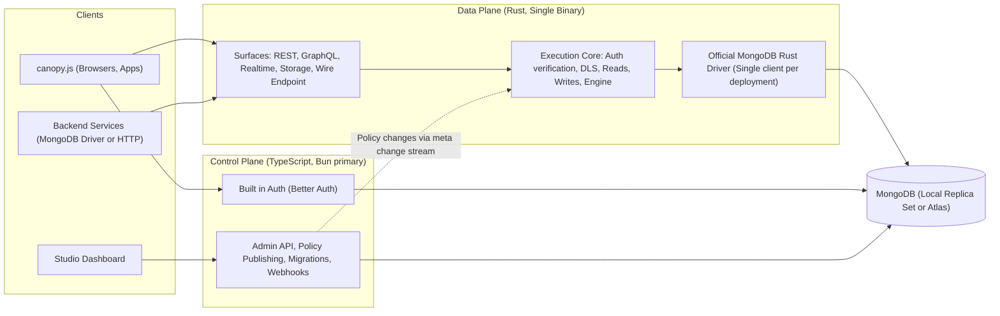

# Architecture and Decisions Context

This document captures the architectural framework and decision history leading up to [004-rust-data-plane.md](file:///D:/Coding/Canopy/docs/plans/004-rust-data-plane.md) and [ADR-0017](file:///D:/Coding/Canopy/docs/adr/0017-rust-data-plane.md).

## Core Architectural Decision: ADR-0017 (Option C)

On 2026-11-22, the project maintainers accepted Option C of Plan 004, selecting a unified Rust data plane for every data path. This decision amended ADR-0001, ADR-0014, and ADR-0016.

### The Problem With Previous Incremental Approaches

1. **The Stage 4 Performance Ceiling:**
   Phase 5 originally attempted to keep REST and GraphQL in TypeScript while using native Node-API bindings for EJSON encoding and matcher evaluation. Stage 4 measured throughput on pages of 20 and 100 documents. It achieved only 0.92x and 0.99x of pure TypeScript throughput per CPU core. The overhead of calling into native code across the Node-API boundary once per document negated any codec speedups.
2. **Dual Driver and Connection Overheads:**
   Under ADR-0014, the Rust gateway held a MongoDB connection pool for change streams and snapshot reads, while the TypeScript server held a second connection pool for REST, GraphQL, and writes. Non-realtime requests taken by the gateway had to be proxied over an HTTP loopback hop to the Node or Bun process.
3. **Driver and BSON Bottlenecks in TypeScript:**
   Spike S3 demonstrated that in transactional writes, 55% of CPU time was idle waiting on IO, 15% was spent in the official Node.js MongoDB driver, 6% was spent in the `bson` library, 5% in socket writes, and only 4.5% across all Canopy TypeScript packages combined. Improving Canopy's own TypeScript algorithms could not significantly move total request latency or throughput.

### The Tripartite Architecture

The architecture separates responsibilities strictly across three planes:

#### 1. Data Plane (Rust, Single Native Binary)
- **Scope:** Every request that reads or writes application data. This covers REST endpoints, GraphQL execution and subscriptions, realtime WebSocket/SSE/polling connections, file storage (GridFS and S3 backends), and the native MongoDB wire protocol listener.
- **Responsibilities:** Caller authentication (verifying JWTs via cached JWKS, checking API keys, checking revocations, validating view tokens), Document Level Security (compiling and evaluating DLS rules), execution against MongoDB via the official Rust driver, raw BSON handling, and response encoding.
- **Connection model:** One long lived `mongodb::Client` per deployment per process, shared by every surface and the change stream.

#### 2. Control Plane (TypeScript, Bun Primary)
- **Scope:** Administrative and operational tasks that change with business logic or integrate with complex TypeScript ecosystems.
- **Responsibilities:** Built in user authentication flows (Better Auth), API key generation, admin API endpoints, policy publishing to the meta database, meta database schema migrations, and outbound webhook delivery.
- **Isolation:** The control plane never proxies application data requests. A failure of the control plane leaves data routes serving normally.

#### 3. Developer Surface (TypeScript)
- **Scope:** Developer tooling, client libraries, and configuration DSLs.
- **Responsibilities:** `canopy.js` client library and framework bindings (React, Vue, Svelte, Solid, TanStack DB), policy DSL (`collection`, `allow`, `restrict`), schema DSL, configuration schema, type generation CLI, Studio dashboard, and embedded mode for Node.js applications.

### Interface Contract Between Planes

The planes remain decoupled and interact through two clean boundaries:
1. **The MongoDB Meta Database:**
   Policies, schema definitions, and administrative settings are persisted in the `canopy` meta database by the control plane or CLI. The Rust data plane watches the meta database change stream and updates its in memory cached compiled policies and schemas with sub-second latency.
2. **Resolved Configuration:**
   Static configuration is supplied to the data plane as resolved JSON via file or standard input.

There are no internal HTTP proxy hops or in-request IPC boundaries between the data plane and the control plane.

## Relationship to Other Architectural Decisions

- **ADR-0001 (TypeScript 6 and Bun):**
  TypeScript 6 and Bun remain the compiler and runtime of record for all TypeScript code. The data plane is a standalone native binary without an embedded JavaScript runtime.
- **ADR-0006 (Write Enforcement in Transactions):**
  Preserved completely. Update semantics and `check` policy constraints continue to be evaluated directly by MongoDB inside multi-document transactions. Canopy never attempts to simulate MongoDB update operators in application memory.
- **ADR-0014 (Native Core in Rust):**
  Retained the rule "measure, then port" and the strict equivalence requirements. Amended the prior stance that REST, GraphQL, writes, and storage must stay in TypeScript.
- **ADR-0015 (Reach Through MongoDB):**
  The platform extends capabilities through native MongoDB capabilities (indexes, aggregations, search indexes, wire protocol) rather than introducing additional languages or proprietary query layers.
- **ADR-0016 (Container Services Split):**
  Services are packaged into dedicated containers: `canopy` (the Rust data plane binary, formerly gateway), `canopy-control` (the TypeScript control plane), and `canopy-studio` (the administration dashboard).
