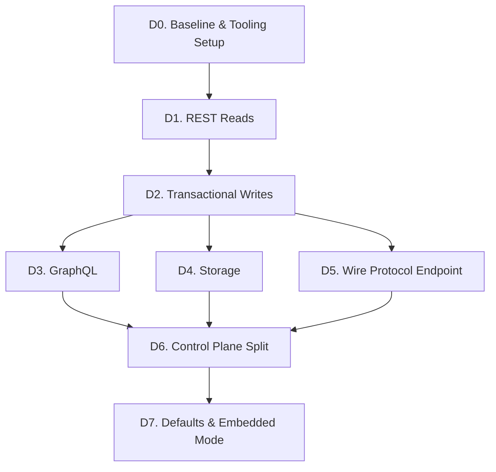

# Implementation Stages and Gates Context

This document details the stages D0 through D7 of [004-rust-data-plane.md](../../plans/004-rust-data-plane.md) and their specific verification gates.

## Stage Overview and Dependencies

Stages D1 and D2 form the critical path. Once D2 lands, D3, D4, and D5 can proceed in parallel because they reuse the unified read and write services.

## Detailed Stage Definitions and Gates

### Stage D0: Baseline Benchmark and Build Setup
- **Status:** In progress. The `dns-resolver` build (task 1), `bench/` reorganization (task 2), and baseline benchmark harness with initial local report (task 3) are done; Atlas benchmark runs, Linux reference hardware benchmark runs, and query plan and round trip findings fixes remain.
- **Deliverables:**
  - Standardized benchmarks for REST read, write, and fan out workloads against both a local replica set and a same region MongoDB Atlas cluster.
  - Metrics collected: MongoDB commands per request, bytes transferred, connection pool waits, query execution plans, documents examined, service CPU, memory allocations, throughput, and latency percentiles (p50, p95, p99).
  - Enable the official Rust driver `dns-resolver` feature in release builds to support `mongodb+srv` URIs on Atlas, checked against license requirements.
- **Gate Criteria:**
  - Recorded report on reference hardware. Any query plan inefficiencies or round trip flaws discovered are resolved in both TypeScript and Rust implementations before continuing.

### Stage D1: REST Reads in Rust
- **Status:** In progress. End to end `find` is implemented in Rust across `canopy-data` and `canopy-http` (task 10). The gate conformance test (`crates/canopy-http/tests/find_conformance.rs`) replays every HTTP case of `conformance/http/find/` against MongoDB (`CANOPY_TEST_MONGODB_URI`) and passes 226 of 226 cases byte for byte after volatile rules (the TypeScript suite counts 227 tests because it includes one file format check). Page commands are verified (`tests/page_commands.rs`: exactly one `find`, no `getMore`, a count adds one `aggregate`, cached `$ctx` lookups cost zero commands, refused requests cost zero commands). Keyset cursors are verified against reference values (`crates/canopy-data/tests/cursor.rs`, 12 tests). Fail closed behavior is verified (`tests/fail_closed.rs`, 4 tests).
- **What Remains for the D1 Gate:**
  - Wire `canopy-http` into the gateway Hyper server behind `CANOPY_DATA_PLANE_ROUTES` (or the config equivalent through `canopy-config` and its schema and fixtures) with TypeScript fallback through the existing reverse proxy.
  - Generate keyset cursor reference data as `conformance/cursor/` inputs and outputs via a TypeScript script, checked by TypeScript tests and consumed by Rust tests.
  - Execute cross entry point DLS equivalence tests and the query bypass corpus against the Rust route.
  - Achieve at least 1.5x simple read throughput per vCPU against the TypeScript route, measured with the D0 harness on reference hardware.
  - Implement `count`, `distinct`, and `aggregate` routes in Rust.
- **Deliverables:**
  - `find` end to end in Rust: caller resolution from verified principal, query limits, field rules, keyset pagination cursors, Data API response envelopes, EJSON encoding, and RFC 7807 Problem Details error formatting (Completed in task 10).
  - Integration test replaying `conformance/http/find/` against MongoDB (Completed in task 10, 226 of 226 cases passing).
  - Gateway routing behind `CANOPY_DATA_PLANE_ROUTES` with TypeScript fallback (Task 11).
  - `conformance/cursor/` vector generator and suite (Task 11).
  - Cross entry point DLS equivalence and bypass attack suites against the Rust route (Task 11).
  - D1 throughput gate measurement (Task 11).
  - `count`, `distinct`, and `aggregate` routes with pipeline validation.
- **Gate Criteria:**
  - The gate compares the Rust route directly against the `conformance/http/find/` oracle (227 cases, no known differences):
    - Byte identical responses for deterministic requests: HTTP status code, exact body text (including member order and JSON escaping), keyset cursors (`base64url(canonicalEJSON({ s: [sort values, _id last], q: hash }))`), weak `ETag` (`W/"<32-hex>"` from sha256 of `"<encoding>:" + text`), and contract headers (`allow`, `content-type`, `etag`, `location`, `retry-after`, `vary`, `www-authenticate`, `x-canopy-ct`, `x-request-id`). Transport headers (`date`, `content-length`, `connection`, `server`) are excluded from comparison.
    - Volatile fields evaluated through substitution rules: `<ct>` cluster time (decimal string, 1 to 20 digits, identical in header and body `$.ct`), `<request-id>` (UUIDv7 identical in header and body), and `<engine-text>` (non empty regex engine error in `$.detail`).
    - Invariant verification: `neverInBody` lists guard against unauthorized field or document disclosures independently of byte comparisons.
    - Contractual equivalence for error responses (RFC 7807 Problem Details with stable `CANOPY_*` codes and `urn:canopy:error:<slug>` type prefix), malformed cursors, and cancellation.
    - Keyset filter wire query structure matching `packages/rest/test/cursor.test.ts`.
  - Green runs across the DLS equivalence suite and query bypass corpus.
  - At least 1.5x simple read throughput per vCPU with stable tail latency on reference hardware.

### Stage D2: Transactional Writes in Rust
- **Deliverables:**
  - The transactional write path in Rust: `insert`, `patch`, `replace`, `delete`, and `batch` operations.
  - Idempotency records in `canopy.mutations`, single-document atomic fast path with automatic fallback, and commit cluster time capture.
  - Elimination of mutation forwarding over loopback; socket mutations handled natively.
- **Gate Criteria:**
  - Comprehensive passing tests for duplicate mutation IDs, ambiguous commits, primary stepdown, batch rollbacks, and dynamic policy updates.
  - Echo before ack verified via the S7 test harness with 0 ordering violations across 100,000 mutations.
  - At least 1.5x transactional write throughput per vCPU compared to TypeScript.

### Stage D3: GraphQL Schema and Execution
- **Deliverables:**
  - GraphQL schema generation and query execution implemented in Rust on top of the shared D1 read and D2 write services.
  - Subscriptions integrated with the realtime engine.
  - Library selection guided by spike S15.
- **Gate Criteria:**
  - The existing GraphQL test suite passes unchanged against the Rust data plane.
  - Nested operations execute in a single round-trip without internal resolver request loops.

### Stage D4: File Storage
- **Deliverables:**
  - File storage policies on `storage.objects`, supporting GridFS and S3-compatible backends.
  - Signed URLs, resumable uploads, and image transformations.
- **Gate Criteria:**
  - Full compatibility with existing object URLs and metadata.
  - Storage policy test suite green.
  - Transfer throughput and memory consumption per upload characterized and verified.

### Stage D5: MongoDB Wire Protocol Endpoint
- **Deliverables:**
  - Wire protocol listener implementing milestone M3 of [15-mongodb-depth.md](../../design/15-mongodb-depth.md).
  - Driver handshake, authentication via `MONGODB-OIDC` and `SCRAM-SHA-256`, strict command allowlist, cursors bound to authenticated identities, and change streams exposed as subscriptions.
- **Gate Criteria:**
  - Upstream unified spec tests pass with official Node.js, Python, Go, and Java drivers.
  - Wire endpoint integrated into cross-entry-point DLS tests with 0 bypasses on the attack corpus.
  - Concurrency, write throughput, and change stream resumption fully validated.

### Stage D6: Control Plane Split
- **Deliverables:**
  - Package `packages/control`: extracts built in authentication, admin API, policy publishing, meta migrations, and webhooks into an independent TypeScript service with its own container image.
  - The `canopy` container image becomes the standalone Rust data plane binary (`canopyd`).
  - Updated Docker Compose, Helm charts, and Kubernetes deployment manifests.
- **Gate Criteria:**
  - The entire stack passes `sdk-e2e`, Studio, and `todo-react` Playwright suites.
  - Resilience verification: a failure or crash of the control plane leaves data routes serving uninterrupted.

### Stage D7: Defaults and Embedded Mode
- **Deliverables:**
  - The Rust data plane becomes the default engine for all promoted routes.
  - TypeScript data packages are frozen as the embedded mode for Node.js apps and preserved as the equivalence test reference.
- **Gate Criteria:**
  - Zero P0 or P1 bugs open against the Rust data plane for one full release cycle.
  - Formal resolution of open question Q17 regarding post-1.0 embedded mode support.
