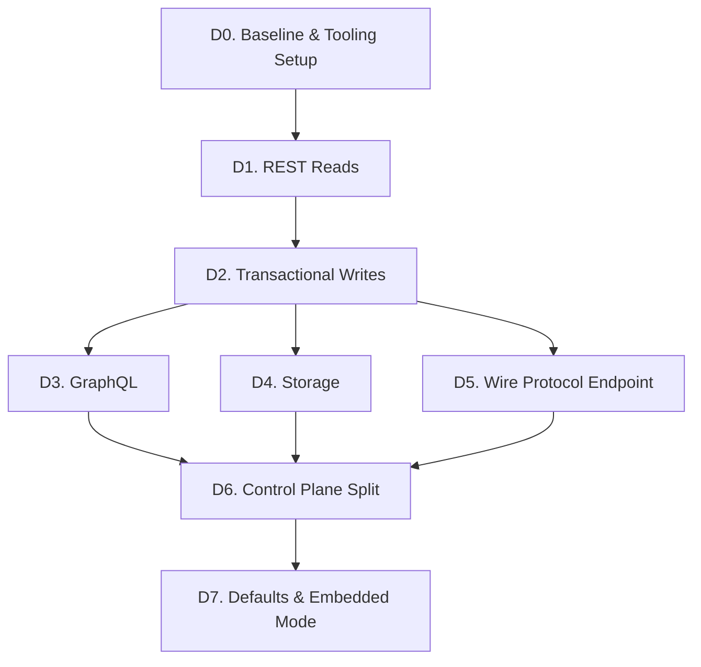

# Implementation Stages and Gates Context

This document details the stages D0 through D7 of [004-rust-data-plane.md](../../plans/004-rust-data-plane.md), their execution status from the codebase and progress log, concrete work items, and verification gates.

## Stage Overview and Dependencies

Stages D1 and D2 form the critical path. Once D2 lands, D3, D4, and D5 can proceed in parallel because they reuse the unified read and write services.

## Detailed Stage Definitions, Status, and Gates

### Stage D0: Baseline Benchmark and Build Setup
- **Status:** In progress.
  - Completed: the official Rust driver `dns-resolver` build (task 1), `bench/` reorganization into workspace package `@canopy/bench` (task 2), baseline benchmark harness with initial local report (task 3), keyset cursor tight bounds and NaN fixes (task 6), replace precheck without transaction and grouped batches (task 5), batch read back deferral for string and ObjectId identifiers (task 4).
  - What Remains: Atlas benchmark runs (`CANOPY_BENCH_TIER=M30`), Linux reference hardware benchmark runs, and recording gate numbers of record.
- **Deliverables:**
  - Standardized benchmarks for REST read, write, and fan out workloads against both a local replica set and a same region MongoDB Atlas cluster.
  - Metrics collected: MongoDB commands per request, bytes transferred, connection pool checkout waits, query execution plans, documents examined, service CPU, memory allocations, throughput, and latency percentiles (p50, p95, p99).
  - Enable the official Rust driver `dns-resolver` feature in release builds to support `mongodb+srv` URIs on Atlas, checked against license requirements.
- **Gate Criteria:**
  - Recorded report on reference hardware. Any query plan inefficiencies or round trip flaws discovered are resolved in both TypeScript and Rust implementations before continuing.

### Stage D1: REST Reads in Rust
- **Status:** Complete on CI; reference hardware and Atlas runs remain.
  - Completed:
    - End to end `find` in Rust across `canopy-data` and `canopy-http` (task 10). Replays 226 of 226 cases in `conformance/http/find/` byte for byte after volatile substitutions.
    - `find` routed through gateway Hyper server behind `CANOPY_DATA_PLANE_ROUTES=find` and launcher JSON `dataPlane.routes` (task 11).
    - Keyset cursor conformance suite (`conformance/cursor/`) generated by TypeScript and replayed by Rust (`canopy-data/tests/cursor.rs`, 43 cases).
    - `_count`, `_distinct`, and `_aggregate` served in Rust from `canopy-data` and `canopy-http`.
    - Pipeline sanitizer in Rust (`canopy_policy::secure_pipeline`, `secure_search_stage`) held to TypeScript by `conformance/policy/pipeline.json` (2242 cases).
    - Reads conformance oracle (`conformance/http/reads/`) replaying 150 of 150 cases in `canopy-http/tests/reads_conformance.rs` on MongoDB 8 and 9 (83 for count, distinct, aggregate; 45 for query; 22 for document).
    - DLS equivalence suite: cross entry point DLS tests running bypass corpus and leak pipelines through all read routes on MongoDB 8 and 9 with zero violations.
    - Verified JWT memory: `canopy-auth` caches verified tokens for up to 60 seconds (up to 4096 tokens), checking revocations and expiration on every request.
    - Request rate limits in Rust: `canopy-auth` token buckets matching `@canopy/auth` arithmetic, verified by `conformance/auth/rate-limits.json` (208 cases), integrated into `canopy-http` and `canopy-gateway`.
    - Request log: gateway samples answered requests into meta database `request_log`.
    - Linux CI throughput gate passed in all 28 measurements (run 45128153402, 1.81x to 4.09x throughput per CPU second over TypeScript).
    - `_query` route implemented in `canopy-http` (replaying 45 query cases byte for byte).
    - OpenTelemetry tracing spans on Rust routes (`canopy-gateway/src/telemetry.rs`, OTLP/HTTP protobuf, `telemetry.tracing`).
    - `POST /rest/v1/{collection}/_explain` from Rust, selectable as `explain`, replaying `conformance/http/reads/cases/explain.json`.
    - `conformance/errors.json`: the hand written source both languages are checked against.
    - Numeric id deferral in atomic batches (`packages/rest/src/write-defer.ts`).
    - Document route `GET /rest/v1/{collection}/{id}` served in Rust from `canopy-data` (`ReadPath::find_by_id`) and `canopy-http`, selectable as `document`.
  - What Remains for D1 Gate Completion:
    - Gate numbers of record: execute D0 and D1 benchmarks on Linux reference hardware and a same region MongoDB Atlas cluster (the CI runs are the evidence so far).
- **Existing Conformance and Oracle Files:**
  - `conformance/http/find/`: 227 cases covering pages, filters, sort, pagination, fields, count, limits, encoding, conditional requests, dls, and errors.
  - `conformance/http/reads/`: 150 cases covering count (25), distinct (23), aggregate (36), query (45), and document (22).
  - `conformance/cursor/`: 43 cases covering hashes (12), keysets (26), and cursors (5).
  - `conformance/policy/pipeline.json`: 2242 cases validating pipeline sanitization and search stages.
  - `conformance/auth/rate-limits.json`: 208 cases validating token bucket arithmetic and rate limit errors.
- **Gate Criteria:**
  - Deterministic responses byte identical to the HTTP oracles (`conformance/http/find/`, `conformance/http/reads/`).
  - Contractual equivalence for Problem Details errors (`CANOPY_*` error codes, status codes, and headers).
  - Cross entry point DLS equivalence suite and query bypass corpus pass with zero leaks.
  - At least 1.5x throughput per vCPU with stable tail latency across all read routes on reference hardware.

### Stage D2: Transactional Writes in Rust
- **Status:** Done (2026-11-24).
- **Concrete Work Items:**
  1. Port `WritePath` to `canopy-data`: implemented `insert`, `patch`, `replace`, `delete`, `execute_batch`, `execute_each`, and `explain_denials` in `canopy_data::writes`.
  2. Implement single document fast paths: replace precheck without transaction via `$unionWith` on the target collection, fast path patch for unconstrained updates, single write sent with its idempotency record in one client `bulkWrite` (`crates/canopy-data/tests/record_with_write.rs`).
  3. Multi-document transactions: writes executed in MongoDB transactions with majority read and write concerns, transient error retries, commit cluster time captured from session `operationTime`.
  4. Idempotency records: documents in `canopy.mutations` with request fingerprints, replaying stored outcomes on duplicate keys with cross version idempotency verified (`packages/server/test/data-plane-switch.test.ts`).
  5. HTTP write routes in `canopy-http`: routes for `POST`, `PATCH`, `PUT`, `DELETE`, and `POST /_batch`, supporting `application/json`, `application/ejson`, and `application/merge-patch+json`, replaying 100 cases in `conformance/http/writes/` byte for byte in `crates/canopy-http/tests/writes_conformance.rs` and through the gateway binary.
  6. Realtime engine socket mutations: processed natively in process via `Rest::mutate` without loopback forwarding.
  7. Echo before ack: S7 suite ported to `crates/canopy-data/tests/echo_correlation.rs`, verifying 100,000 mutations across concurrent workers with zero ordering violations on MongoDB 8.0.34 and 9.0.8 (`docs/spikes/S7-echo-before-ack.md`).
  8. Batch optimizations: deferred read backs in atomic batches (`crates/canopy-data/tests/read_backs.rs`) and grouped client `bulkWrite` for batches that are not atomic.
- **Conformance and Oracle Deliverables:**
  - `conformance/http/writes/`: 100 cases covering single insert, patch, replace, delete, atomic batches, grouped batches, check violations, conflict errors, and idempotency replays.
  - S7 echo before ack verification harness: 100,000 mutations across concurrent workers with zero ordering violations on MongoDB 8.0.34 and 9.0.8.
- **Gate Criteria and Evidence:**
  - Linux CI throughput gate passed in all 28 measurements (run 45335688043, 1.56x to 2.97x write requests per server CPU second over TypeScript, `bench/baselines/d2/README.md`).
  - S7 echo before ack verified with 0 violations in 100,000 mutations on MongoDB 8.0.34 and 9.0.8.
  - Conformance oracle `conformance/http/writes/` 100 cases pass byte for byte in `canopy-http` and through the gateway binary.
  - Cross version idempotency and DLS property tests pass with zero violations on MongoDB 8 and 9 (`packages/server/test/data-plane-switch.test.ts`, `dls-equivalence.test.ts`).

### Stage D3: GraphQL Schema and Execution
- **Status:** Done (2026-11-24).
- **Completed Work Items:**
  1. Spike S15 completed (commit `b2371dd`): evaluated `async-graphql`, `apollo-compiler`, and `graphql-js`. Decided to build `canopy-graphql` on `apollo-compiler` 1.x (parsing, validation, introspection, schema built as SDL) with a Canopy executor over `canopy_data` (`docs/spikes/S15-rust-graphql.md`).
  2. GraphQL HTTP oracle recorded (commit `16d0d3c`): `conformance/http/graphql/` with 51 cases and 53 requests in six files (queries 6, policies 12, mutations 11, limits 8, transport 8, errors 6), recorded by `packages/graphql/test/conformance/record.ts` via `bun run vectors:http-graphql` (`--check`), checked by `packages/graphql/test/conformance-graphql.test.ts`.
  3. Collection schema shape model in `canopy-data` (commit `aa92ddc`): `canopy_data::schema` (`Shape`, `Field`, `ObjectShape`, `ScalarType`, `union`, `restrict_shape`, `CollectionSchema`, `SchemaSource`), enabling schema generation restricted to the fields a caller role may access.
  4. Schema inference and loader in `canopy-data` (commit `ffbb504`): ported schema inference over sampled BSON documents (`infer_schema`), JSON schema conversion (`from_json_schema`), schema loader and cache (`SchemaCache`), and `ReadPath::collections` reporting granted operations. Validated against 68 recorded schema cases in `conformance/schema/schema.json`.
  5. Crate `canopy-graphql` implemented on `apollo-compiler` (commit `d4de299`): names derivation, schema model and SDL generation, operation limits (`OperationLimits`), filters translation, custom Canopy executor over `canopy_data` executing root fields as single reads or writes and relation levels as batched `$in` queries.
  6. GraphQL HTTP endpoint in `canopy-graphql::endpoint`: implements `/graphql/v1` serving both GET and POST requests, batched operations (`max_batch`), persisted operations by SHA-256 allowlist, operation limits enforcement before execution, CORS, token bucket rate limits, and custom introspection adapter (`introspection.rs`) ensuring role based schema visibility.
  7. Conformance and oracle replay: `crates/canopy-graphql/tests/conformance.rs` replays all 51 cases (53 requests) of `conformance/http/graphql/` matching TypeScript behavior. Introspection schema vectors in `conformance/graphql/schema.json` replay and pass via `crates/canopy-graphql/tests/schema_vectors.rs`. Relation level batching verified via `crates/canopy-graphql/tests/batching.rs`.
  8. Gateway serves GraphQL over HTTP (uncommitted, 2026-11-24): `DataPlaneRoute::Graphql` named `graphql` in `crates/canopy-config` (selectable in `dataPlane.routes` and `CANOPY_DATA_PLANE_ROUTES`), new gateway JSON section `graphql` (`path`, `maxDepth`, `maxComplexity`, `maxAliases`, `maxBatch`, `introspection`, `persisted.{operations,only}`, `collections.<name>.{typeName,relations}`; body limit reuses `rest.maxBodyBytes`) in `crates/canopy-config/src/graphql.rs`, JSON Schema and fixtures. TypeScript launcher `packages/realtime/src/gateway.ts` writes it and resolves persisted operations file (`readPersistedGraphqlOperations`, moved from `packages/server/src/canopy.ts`). `crates/canopy-gateway/src/data_plane.rs` builds `canopy_graphql::endpoint::Graphql` over shared `Arc<Rest>`, records `canopy_http_rate_limited_total{surface="graphql"}`, and replays all 51 cases (53 requests) of `conformance/http/graphql/` through gateway binary in `crates/canopy-gateway/tests/data_plane.rs` sharing `crates/canopy-graphql/tests/graphql_replay/mod.rs`.
  9. In process realtime connections: `crates/canopy-realtime` `EngineSender::connect(address, deliver) -> LocalConnection` (`LocalFrame::Text`/`Close`), engine routes frames of local connections to a callback instead of a shard, `EngineSender` owns connection counter.
  10. Live queries in Rust: `crates/canopy-graphql/src/live.rs`, a port of `packages/graphql/src/live.ts` and `realtime-follower.ts` (`LiveQueries`, `LiveStream`, `Realtime`/`RealtimeConnection` traits, `LiveCredentials`, `LiveQuery`), one realtime session per credentials, caller's own `hello` so DLS is the engine's, sequence checks, resync, nosub, reconnect with backoff, heartbeat pings, close code handling as the TypeScript follower.
  11. Subscription execution: `crates/canopy-graphql/src/execute.rs` `subscription_source`, `execute_event`, `SubscriptionEvent`, `ChangeTracker` (port of `liveChanges`), `LiveChange`, `ChangeKind`, `crates/canopy-graphql/src/endpoint.rs` `Graphql::with_live`, `Graphql::start` (returns `Started::Result` or `Started::Stream(SubscriptionRun)`), schemas built with `subscriptions` when live queries are on.
  12. graphql-ws server protocol: `crates/canopy-graphql/src/ws.rs`, an I/O free port of the graphql-ws 6.4.1 server protocol (`ServerConnection`, `Action`, `Close`, close codes 4400, 4401, 4403, 4406, 4408, 4409, 4429, 4500, `credential_headers`, 12 tests in `crates/canopy-graphql/tests/ws_protocol.rs`), `crates/canopy-gateway/src/graphql_ws.rs` serves `graphql-transport-ws` upgrades on GraphQL path in gateway shards when `graphql` route is selected.
  13. graphql-ws subscriptions verified end to end: `packages/server/test/graphql-ws-switch.test.ts` (11 cases: authenticated init, liveTodos and todoChanges through REST inserts, updates and deletes, relations, filter, sort and limit, DLS visibility transitions, client complete, closes 4400/4401/4408/4409, query and mutation over the socket, operation errors for validation failure, missing key, anonymous caller and bad key) passes on Node 26 and Bun against MongoDB 8.0.34 and 9.0.8. Validation error messages are compared by kind only per S15. Operation errors are masked like TypeScript `maskError` (Canopy errors keep `extensions.http.status`, parse and validation errors take `CANOPY_INVALID_QUERY`) in `canopy_graphql::endpoint` (`masked`).
  14. Follower and change tracker tests: `crates/canopy-graphql/tests/live_follower.rs` (12 tests) and `change_tracker.rs` (3 tests) verify that an error stream releases its session at once, subscription ids restart at `s1` for each realtime session, and a `changed` frame with `replace` and no `d` is a protocol error.
  15. SSE subscription streaming and parity: `Graphql::serve_answer` returns `Answer::Response` or `Answer::Events(EventStream)`, with result processor negotiated like GraphQL Yoga (`[sse, multipart, regular]` by default, `[sse, regular]` for subscription failing before first event, only SSE for subscription stream, else 406 with `accept` header). Event streams format as `:\n\n`, `event: next\ndata: ...\n\n` per result and `event: complete\ndata:\n\n`, with 12 second pings, streamed via `events_of` in `crates/canopy-gateway/src/data_plane.rs`. Verified end to end in `packages/server/test/graphql-ws-switch.test.ts` (18 cases: 11 graphql-ws plus 7 HTTP SSE: liveTodos and todoChanges across REST writes, DLS visibility, recovery after an aborted request, GET subscriptions, a query as an event stream, negotiation 406, variable errors) passing on Node 26 and Bun against MongoDB 8.0.34 and 9.0.8. Fix found: variable coercion errors carry `BAD_USER_INPUT` with status 400 as GraphQL Yoga answers them (`crates/canopy-graphql/src/execute.rs` `coerce_variables`); the HTTP oracle had no variable error case. The test compares `connection` only on event streams, because Node adds it to every response.
  16. Measure the D3 performance gate on GitHub Actions: done; GitHub Actions run 45402064970 passes 12 of 12 measurements on Linux across Node 26 and Bun with MongoDB 8.0.34 and 9.0.8, reaching 2.07 to 4.10 times TypeScript GraphQL requests per server CPU second (`bench/baselines/d3/README.md`).
- **Conformance and Oracle Deliverables:**
  - `conformance/http/graphql/`: 51 cases across 6 files validating queries, mutations, policies, limits, transport, and errors.
  - `conformance/schema/schema.json`: 68 recorded schema inference and conversion cases.
  - `conformance/graphql/schema.json`: Introspection schema vectors matching `graphql-js`.
  - Oracle comparison rules: parse and validation error messages compared only by kind; data, `extensions.code`, paths, and locations compared exactly; Canopy's own messages compared byte for byte.
- **Gate Criteria and Evidence:**
  - Linux CI throughput gate passed in all 12 measurements (run 45402064970, 2.07x to 4.10x GraphQL requests per server CPU second over TypeScript, `bench/baselines/d3/README.md`).
  - The existing GraphQL test suite passes unchanged against the Rust data plane.
  - Replay of `conformance/http/graphql/` passes with contractual parity (verified in `tests/conformance.rs`).
  - Nested queries execute in a single round trip without internal resolver request loops, batching relation levels with `$in` (verified in `tests/batching.rs`).

### Stage D4: File Storage
- **Status:** In progress (storage oracle recorded and verified across runtimes, `canopy-storage` local backend and HTTP handler implemented with all 55 oracle cases replaying byte for byte; the S3 backend and the gateway `storage` route done, with the gateway replaying all 55 cases; copy free uploads done in commit `b164485`; D4 throughput and memory gate measured on GitHub Actions run 45449511220; image transforms remain).
- **Completed Work Items:**
  1. Storage oracle recorded: `conformance/http/storage/` (`fixture.json` and `cases/`: uploads 13, downloads 4, ranges 8, public 2, signed 4, lists 2, deletes 4, resumable 2, policies 7, errors 6, cors 3; 55 cases, 125 requests), recorded by `packages/storage/test/conformance/record.ts`, `bun run vectors:http-storage` (with `--check`) through `packages/testing/scripts/http-storage-vectors.ts`, checked by `packages/storage/test/conformance-storage.test.ts`, documented in `conformance/README.md`. Identical on Bun and Node 26 against MongoDB 8.0.34 and 9.0.8. TypeScript behaviors preserved as recorded: unsupported methods answer 404 (not 405), and an upload response echoes metadata fields that field rules hide from the same caller in a listing.
  2. Crate `canopy-storage` core: `tokens` (`UrlSigner`, `SignedGrant`: HKDF SHA 256 key from master key, base64url JSON plus HMAC, byte identical to TypeScript `UrlSigner`, checked by `crates/canopy-storage/tests/tokens.rs` with tokens signed by TypeScript), `paths` (`is_bucket_name`, `check_path`, `media_type`, `check_type`), `backend` (the `StorageBackend` trait with streaming `get`), `storage` (`Storage`: metadata documents in `storage_objects`, written in a transaction under `storage.objects` policies with dry run before content is stored, uploads, stat, open, public and signed opens, sign, remove, list, resumable uploads in `storage_uploads`, sweep). Supporting primitives added in `canopy-http`: `read_body`, `segments_of`, `Rest::limit_anonymous`, and a public `Cors::allowed`.
  3. Local backend: `crates/canopy-storage` `local` (`LocalBackend`, atomic writes through tmp, streamed ranges, multipart parts, sweep; 12 tests in `tests/local_backend.rs`).
  4. HTTP handler and conformance replay: `http` (`StorageHandler`, `StorageAnswer::{Response, File}` streaming file bodies; routes object, list, sign, signed, public, upload, uploads; `render/...` image transforms are not owned and stay on TypeScript until the image stack is decided), and `tests/http_conformance.rs` replaying all 55 cases byte for byte, with the `storage_objects` state, on MongoDB 8.0.34 and 9.0.8.
  5. D4 throughput and memory gate measured: GitHub Actions run 45449511220 characterized transfer throughput and memory across Node 26 and Bun with MongoDB 8.0.34 and 9.0.8 (`bench/baselines/d4/README.md`). Full downloads deliver 1.54 to 2.67 times TypeScript requests per server CPU second and 1.63 to 2.01 times transfer throughput. Ranged downloads in release mode reach 1.48 to 1.60 times higher transfer throughput in MiB/s, confirming Rust is faster on the wall clock and resolving debug smoke run concerns. Peak resident memory during 8 concurrent 16 MiB uploads remains lower in Rust across all four environments (215.38 to 244.28 MiB vs 330.30 to 379.67 MiB in TypeScript). Uploads reach 0.51 to 0.82 times TypeScript requests per CPU second with 182.38 to 229.16 MiB/s throughput.
  6. Copy free uploads (commit `b164485`): removed double body copies in gateway and storage handler. Peak upload memory increase dropped by 33.5% to 42.1% to 24.43 to 28.01 MiB per 16 MiB upload (now lower than TypeScript's 31.16 to 32.20 MiB) and peak RSS dropped to 215.38 to 244.28 MiB (compared to TypeScript's 330.30 to 379.67 MiB). Upload throughput and CPU remained steady, confirming that upload costs are bounded by MongoDB transaction commits and metadata writes.
- **Remaining Work Items:**
  1. Image transforms (needs a decision: pure Rust covers PNG and JPEG and AVIF encoding through ravif, but lossy WebP encoding and AVIF decoding need C libraries).
- **Conformance and Oracle Deliverables:**
  - `conformance/http/storage/`: 55 cases (125 requests) across uploads 13, downloads 4, ranges 8, public 2, signed 4, lists 2, deletes 4, resumable 2, policies 7, errors 6, cors 3.
  - Storage policy test suite green.
- **Gate Criteria and Evidence:**
  - Full compatibility with existing object URLs and metadata.
  - Storage policy test suite green.
  - Replay of `conformance/http/storage/` passes byte for byte on MongoDB 8 and 9.
  - Transfer throughput and memory consumption per upload characterized and verified on GitHub Actions run 45449511220 (`bench/baselines/d4/README.md`).

### Stage D5: MongoDB Wire Protocol Endpoint
- **Status:** Done (2026-11-24, gate characterized on GitHub Actions run 45453474230; see bench/baselines/d5/README.md).
- **Completed Work Items:**
  1. Crate `canopy-wire` core and framing (commit `1ee5390`): OP_MSG and legacy OP_QUERY framing with CRC32C checksums, hello command answering as a MongoDB 8.0 router.
  2. Authentication (commits `1ee5390`, `bf93ad7`, `50265bd`): MONGODB-OIDC with access tokens (roles extracted from token claims), SCRAM-SHA-256 for user `service` using configured secret keys, and SCRAM-SHA-256 for stored secret keys (verifier stored next to key hash, key id as username, revocations read from primary on handshake, decoy for unknown users).
  3. Read commands execution (commits `1ee5390`, `9766e12`): `find`, `count`, `distinct`, `aggregate`, `listCollections`, and `listIndexes` through `ReadPath` applying DLS policies, field rules, read limits, and pipeline sanitization. Per connection cursors with random 64 bit identifiers that expire after 10 minutes.
  4. Keyset paging for wire find cursors (commit `9766e12`): `getMore` continues through Data API keyset cursor when buffered page runs out, skip applied once, limit counted across pages. Aggregations exceeding document or byte limits refused with BadValue.
  5. Transactional write commands (commit `549a6ce`): `insert`, `update`, `delete`, and `findAndModify` running each statement in its own majority acknowledged transaction under write policies through `WritePath`. Ordered batches stop at the first write error. Refuses unacknowledged writes (w:0), update pipelines, arrayFilters, and collation. Policy denials answer Unauthorized.
  6. Wire point updates without select (commit `6160e84`): updates and single deletes by `_id` execute without a prior find select, dropping retryable update by `_id` from 6 to 3 MongoDB commands, and raising local smoke ratio to REST from 0.56 to 0.90.
  7. Gateway wire listener (commit `f66b157`): dedicated TCP port configured by the `wire` setting (`port`, `host`, `maxMessageBytes` 48000000, `maxConnections` 256, `idleTimeoutMs` 60000, optional PEM TLS), oversized frames refused from header, `moreToCome` support, per peer request budgets, shutdown drain, metrics `canopy_wire_connections` and `canopy_wire_commands_total`, launcher `GatewayOverrides.wire`. Verified with official Rust driver over SCRAM and OIDC, reads and writes, on MongoDB 8.0.34 and 9.0.8.
  8. Retryable writes over the wire (commit `dd4064f`): accepts retryable writes with mutation IDs derived as `wire_<session uuid hex>_<txnNumber>_<stmtId>`. `findAndModify` images are kept in the idempotency record and replayed only while the policy version and claims are unchanged; client transactions are still refused.
  9. Wire DLS replay and equivalence (commit `b97de08`): bypass corpus, hidden field filters, sorts and projections, the 16 aggregation leak pipelines and hidden value write oracles over the official Node driver: 657 wire commands per run, nothing hidden shown, the wire refuses exactly what REST refuses; 18 tests pass on Node 26 and Bun with MongoDB 8.0.34 and 9.0.8.
  10. Unified CRUD spec tests (commit `832a82f`): Node driver over SCRAM (19 files, 61 passed, 10 refused with BadValue for arrayFilters, write hints, collation, let and pipeline updates, 3 skipped by version requirements); Python, Go, and Java over OIDC each passed the shared 7 cases; tested on MongoDB 8.0.34 and 9.0.8 across Node 26 and Bun.
  11. Wire writes accept `maxTimeMS` (commit `832a82f`): a nonnegative value is accepted and validated; the transaction keeps its own configured deadlines.
  12. Stage D5 gate benchmark on Actions (run 45453474230, `bench/baselines/d5/README.md`): characterized wire throughput against Rust Data API and direct MongoDB floor across Node 26 and Bun with MongoDB 8.0.34 and 9.0.8. Wire find by `_id` reaches 1.21 to 1.30 times Data API requests per CPU second, count reaches 1.41 to 1.54 times, insertOne reaches 1.13 to 1.16 times, find 20 documents is on par at 0.92 to 0.99 times, and updateOne reaches 0.67 to 0.70 times due to retryable write documents. Idle wire memory confirmed at 19.50 to 22.74 KiB per authenticated connection across 200 connections.
  13. Change streams over wire (commits `f11bf8a`, `0a9e54a`, `7b8c3a3`): watch served by realtime engine, change stream unified spec tests and DLS coverage, batch updateLookup keeping wire change streams open across repeated updates to one document in a single batch.
  14. OP_COMPRESSED (commit `01ea940`): snappy, zlib and zstd in pure Rust.
- **Remaining Work Items:** None.
- **Read cursor behavior:** Wire `find` continues through the Data API keyset cursor, with `skip` applied to the first page and the driver's `limit` applied across the cursor. Each continuation uses a fresh Data API snapshot. Aggregation has no continuation in the Data API, so the wire endpoint returns an error if the aggregation exceeds its document or BSON byte budget.
- **Conformance and Oracle Deliverables:**
  - Official MongoDB driver unified spec tests passing with Node.js, Python, Go, and Java drivers (CRUD complete in commit `832a82f`; change streams complete).
  - Wire protocol query denial attack corpus passing with 0 bypasses.
- **Gate Criteria:**
  - Allowlisted unified spec tests pass with official drivers.
  - Wire endpoint integrated into cross entry point DLS tests with 0 bypasses on the attack corpus.
  - Concurrency, write throughput, and change stream resumption fully validated.
  - Gate status: Passed. Characterized on GitHub Actions run 45453474230 (`bench/baselines/d5/README.md`).

### Stage D6: Control Plane Split
- **Status:** Done (2026-11-25).
- **Completed Work Items:**
  1. Control role groundwork (commit `f048d0a`): `CANOPY_ROLE=control` serves only built in auth, the JWKS, the admin API and health, keeps webhooks, and refuses every data path through an allowlist.
  2. Standalone Rust data plane binary renamed to `canopyd` (`crates/canopyd`, commits `34b2d02`, `6cbdf1a`).
  3. Control plane service extracted to `packages/control` (commit `e30ac6a`) with its own Dockerfile `deploy/docker/canopy-control.Dockerfile`.
  4. Split container stack in Docker Compose (`deploy/compose/split.yaml`, commit `849c4e9`), Helm (`split.enabled`), and Kubernetes manifests (`deploy/kubernetes/split.yaml`), running the control plane from `canopy-control` image with policies published at startup (commit `0108ec4`).
  5. Control plane resilience test (commit `520794b`) and probe mode `canopyd --probe` (commit `3927295`).
  6. SCRAM authentication for stored secret keys issued by control plane (commits `bf93ad7`, `50265bd`).
  7. Split stack test harness and CI setup (commits `1fc80ad`, `2ca9c4d`): `sdk-e2e`, Studio Playwright suite and `todo-react` Playwright suite configured to run against the split stack; smoke waits up to 15 seconds for routes to leave 503 through the edge.
  8. GraphQL and wire stream fixes (commit `4e52c47`): delivered complete live snapshots for GraphQL follower through grouped `batch` frames, wire change streams start at operation time when opened, oracle replays skip under native engine, GraphQL coverage back above 94%.
  9. Live query SSE reconnect stabilization (commit `717dc78`): SSE reconnect check in route switch suite waits for the reconnected live query before the next write (passed 40 runs in a row on Bun and Node 26 with MongoDB 8 and 9).
  10. Built in auth verification in `canopyd` (commit `65ec3f5`): `canopyd` verifies built in auth tokens from public keys read from `canopy_auth.signing_keys` with `auth.builtinJwks` / `CANOPY_JWT_BUILTIN_JWKS`, projecting only `_id`, `publicKey` and `alg`, refreshing every five seconds and once early for an unknown key id, keeping retired keys through the grace period, denying when a refresh fails; HTTPS requirement for remote JWKS stays.
- **Remaining Work Items:** None.
- **Conformance and Oracle Deliverables:**
  - Verification through `sdk-e2e`, Studio, and `todo-react` Playwright suites against the split edge.
  - Control plane failure resilience verification: data plane routes and built in auth tokens continue serving during control downtime while `/admin/v1` answers 503.
- **Gate Criteria:**
  - The container stack passes `sdk-e2e`, Studio, and `todo-react` Playwright suites against the split stack.
  - A crash or failure of the control plane leaves data plane routes serving without interruption.
  - Gate status: Passed. GitHub Actions run 45482098612 on commit 65ec3f5 (https://github.com/FlazexHQ/Canopy/actions/runs/45482098612) is green on all 28 jobs (two macOS jobs were cancelled before running any step and passed on a rerun). Its "Docker images and compose stack" job built the images, ran the existing stack smoke, ran the split stack smoke that stops the control plane and checks that REST reads and writes, realtime, Studio and a built in auth token issued by control keep working through the edge while `/admin/v1` answers 503, and ran sdk-e2e, the Studio Playwright suite and the todo-react Playwright suite against the split stack.

### Stage D7: Defaults and Embedded Mode
- **Status:** Done in code (default flip in commit `750ca82`, `@canopy/embedded` in commit `c4608cb`; gate waits on the user).
- **Completed Work Items:**
  1. Route selection groundwork (commit `dcfe7a5`): `all` in `dataPlane.routes` selects every Data API route plus graphql and storage when configured.
  2. Default flip (commit `750ca82`): `canopyd` and the front door default to `all`, serving every Data API route plus GraphQL and storage when configured; an empty list or empty `CANOPY_DATA_PLANE_ROUTES` opts out; the sidecar and filtered front doors keep passing HTTP routes upstream.
  3. Embedded mode package (commit `c4608cb`): added `@canopy/embedded` (`createEmbeddedCanopy`), composing REST, GraphQL, realtime and storage on the TypeScript engine as the single entry for running Canopy data routes in Node applications; frozen TypeScript equivalence reference for `canopyd`.
  4. Export cleanup (commit `446a360`): removed unused test helper exports flagged by Knip.
- **Remaining Work Items:**
  1. One release cycle with zero P0 or P1 bugs open against the Rust data plane.
  2. Formal resolution of open question Q17 regarding post-1.0 embedded mode support, which decides whether the TypeScript data packages move into `@canopy/embedded`.
  3. Note: image transforms in storage (Stage D4) wait on the user's choice of image library. Nothing else is in progress.
- **Gate Criteria:**
  - Zero P0 or P1 bugs open against the Rust data plane for one full release cycle.
  - Formal resolution of open question Q17.
