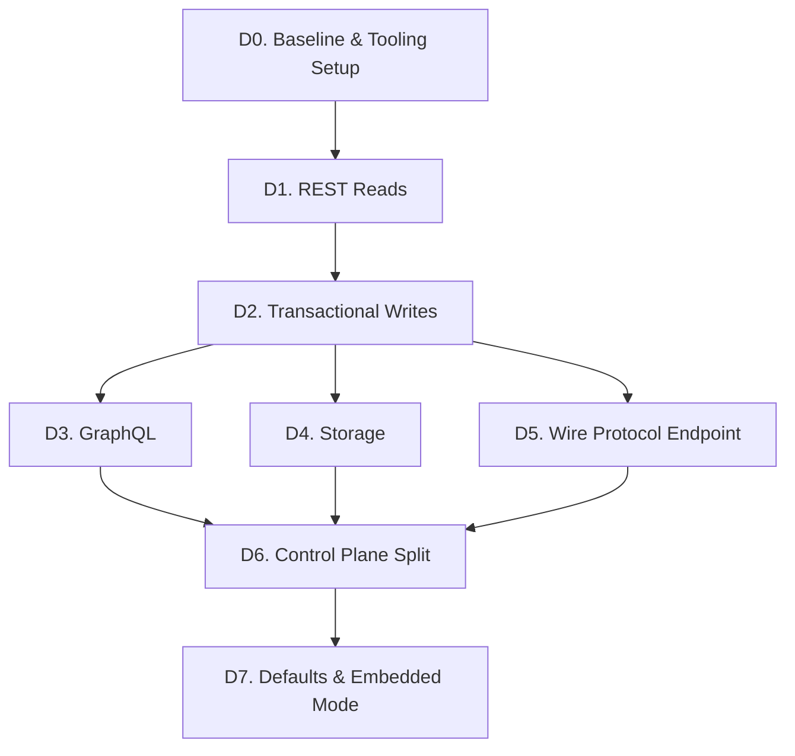

# Implementation Stages and Gates Context

This document details the stages D0 through D7 of [004-rust-data-plane.md](../../plans/004-rust-data-plane.md), their execution status from the codebase and progress log, concrete work items, and verification gates.

## Stage Overview and Dependencies

Stages D1 and D2 form the critical path. Once D2 lands, D3, D4, and D5 can proceed in parallel because they reuse the unified read and write services.

## Detailed Stage Definitions, Status, and Gates

### Stage D0: Baseline Benchmark and Build Setup
- **Status:** In progress.
  - Completed: the official Rust driver `dns-resolver` build (task 1), `bench/` reorganization into workspace package `@canopy/bench` (task 2), baseline benchmark harness with initial local report (task 3), keyset cursor tight bounds and NaN fixes (task 6), replace precheck without transaction and grouped batches (task 5), batch read back deferral for string and ObjectId identifiers (task 4).
  - What Remains: Atlas benchmark runs (`CANOPY_BENCH_TIER=M30`), Linux reference hardware benchmark runs, and recording gate numbers of record.
- **Deliverables:**
  - Standardized benchmarks for REST read, write, and fan out workloads against both a local replica set and a same region MongoDB Atlas cluster.
  - Metrics collected: MongoDB commands per request, bytes transferred, connection pool checkout waits, query execution plans, documents examined, service CPU, memory allocations, throughput, and latency percentiles (p50, p95, p99).
  - Enable the official Rust driver `dns-resolver` feature in release builds to support `mongodb+srv` URIs on Atlas, checked against license requirements.
- **Gate Criteria:**
  - Recorded report on reference hardware. Any query plan inefficiencies or round trip flaws discovered are resolved in both TypeScript and Rust implementations before continuing.

### Stage D1: REST Reads in Rust
- **Status:** Complete on CI; reference hardware and Atlas runs remain.
  - Completed:
    - End to end `find` in Rust across `canopy-data` and `canopy-http` (task 10). Replays 226 of 226 cases in `conformance/http/find/` byte for byte after volatile substitutions.
    - `find` routed through gateway Hyper server behind `CANOPY_DATA_PLANE_ROUTES=find` and launcher JSON `dataPlane.routes` (task 11).
    - Keyset cursor conformance suite (`conformance/cursor/`) generated by TypeScript and replayed by Rust (`canopy-data/tests/cursor.rs`, 43 cases).
    - `_count`, `_distinct`, and `_aggregate` served in Rust from `canopy-data` and `canopy-http`.
    - Pipeline sanitizer in Rust (`canopy_policy::secure_pipeline`, `secure_search_stage`) held to TypeScript by `conformance/policy/pipeline.json` (2242 cases).
    - Reads conformance oracle (`conformance/http/reads/`) replaying 150 of 150 cases in `canopy-http/tests/reads_conformance.rs` on MongoDB 8 and 9 (83 for count, distinct, aggregate; 45 for query; 22 for document).
    - DLS equivalence suite: cross entry point DLS tests running bypass corpus and leak pipelines through all read routes on MongoDB 8 and 9 with zero violations.
    - Verified JWT memory: `canopy-auth` caches verified tokens for up to 60 seconds (up to 4096 tokens), checking revocations and expiration on every request.
    - Request rate limits in Rust: `canopy-auth` token buckets matching `@canopy/auth` arithmetic, verified by `conformance/auth/rate-limits.json` (208 cases), integrated into `canopy-http` and `canopy-gateway`.
    - Request log: gateway samples answered requests into meta database `request_log`.
    - Linux CI throughput gate passed in all 28 measurements (run 45128153402, 1.81x to 4.09x throughput per CPU second over TypeScript).
    - `_query` route implemented in `canopy-http` (replaying 45 query cases byte for byte).
    - OpenTelemetry tracing spans on Rust routes (`canopy-gateway/src/telemetry.rs`, OTLP/HTTP protobuf, `telemetry.tracing`).
    - `POST /rest/v1/{collection}/_explain` from Rust, selectable as `explain`, replaying `conformance/http/reads/cases/explain.json`.
    - `conformance/errors.json`: the hand written source both languages are checked against.
    - Numeric id deferral in atomic batches (`packages/rest/src/write-defer.ts`).
    - Document route `GET /rest/v1/{collection}/{id}` served in Rust from `canopy-data` (`ReadPath::find_by_id`) and `canopy-http`, selectable as `document`.
  - What Remains for D1 Gate Completion:
    - Gate numbers of record: execute D0 and D1 benchmarks on Linux reference hardware and a same region MongoDB Atlas cluster (the CI runs are the evidence so far).
- **Existing Conformance and Oracle Files:**
  - `conformance/http/find/`: 227 cases covering pages, filters, sort, pagination, fields, count, limits, encoding, conditional requests, dls, and errors.
  - `conformance/http/reads/`: 150 cases covering count (25), distinct (23), aggregate (36), query (45), and document (22).
  - `conformance/cursor/`: 43 cases covering hashes (12), keysets (26), and cursors (5).
  - `conformance/policy/pipeline.json`: 2242 cases validating pipeline sanitization and search stages.
  - `conformance/auth/rate-limits.json`: 208 cases validating token bucket arithmetic and rate limit errors.
- **Gate Criteria:**
  - Deterministic responses byte identical to the HTTP oracles (`conformance/http/find/`, `conformance/http/reads/`).
  - Contractual equivalence for Problem Details errors (`CANOPY_*` error codes, status codes, and headers).
  - Cross entry point DLS equivalence suite and query bypass corpus pass with zero leaks.
  - At least 1.5x throughput per vCPU with stable tail latency across all read routes on reference hardware.

### Stage D2: Transactional Writes in Rust
- **Status:** Done (2026-11-24).
- **Concrete Work Items:**
  1. Port `WritePath` to `canopy-data`: implemented `insert`, `patch`, `replace`, `delete`, `execute_batch`, `execute_each`, and `explain_denials` in `canopy_data::writes`.
  2. Implement single document fast paths: replace precheck without transaction via `$unionWith` on the target collection, fast path patch for unconstrained updates, single write sent with its idempotency record in one client `bulkWrite` (`crates/canopy-data/tests/record_with_write.rs`).
  3. Multi-document transactions: writes executed in MongoDB transactions with majority read and write concerns, transient error retries, commit cluster time captured from session `operationTime`.
  4. Idempotency records: documents in `canopy.mutations` with request fingerprints, replaying stored outcomes on duplicate keys with cross version idempotency verified (`packages/server/test/data-plane-switch.test.ts`).
  5. HTTP write routes in `canopy-http`: routes for `POST`, `PATCH`, `PUT`, `DELETE`, and `POST /_batch`, supporting `application/json`, `application/ejson`, and `application/merge-patch+json`, replaying 100 cases in `conformance/http/writes/` byte for byte in `crates/canopy-http/tests/writes_conformance.rs` and through the gateway binary.
  6. Realtime engine socket mutations: processed natively in process via `Rest::mutate` without loopback forwarding.
  7. Echo before ack: S7 suite ported to `crates/canopy-data/tests/echo_correlation.rs`, verifying 100,000 mutations across concurrent workers with zero ordering violations on MongoDB 8.0.34 and 9.0.8 (`docs/spikes/S7-echo-before-ack.md`).
  8. Batch optimizations: deferred read backs in atomic batches (`crates/canopy-data/tests/read_backs.rs`) and grouped client `bulkWrite` for batches that are not atomic.
- **Conformance and Oracle Deliverables:**
  - `conformance/http/writes/`: 100 cases covering single insert, patch, replace, delete, atomic batches, grouped batches, check violations, conflict errors, and idempotency replays.
  - S7 echo before ack verification harness: 100,000 mutations across concurrent workers with zero ordering violations on MongoDB 8.0.34 and 9.0.8.
- **Gate Criteria and Evidence:**
  - Linux CI throughput gate passed in all 28 measurements (run 45335688043, 1.56x to 2.97x write requests per server CPU second over TypeScript, `bench/baselines/d2/README.md`).
  - S7 echo before ack verified with 0 violations in 100,000 mutations on MongoDB 8.0.34 and 9.0.8.
  - Conformance oracle `conformance/http/writes/` 100 cases pass byte for byte in `canopy-http` and through the gateway binary.
  - Cross version idempotency and DLS property tests pass with zero violations on MongoDB 8 and 9 (`packages/server/test/data-plane-switch.test.ts`, `dls-equivalence.test.ts`).

### Stage D3: GraphQL Schema and Execution
- **Status:** In progress (schema inference, loader, executor, HTTP endpoint, batching, and conformance replay complete; subscriptions over `graphql-ws` remain).
- **Completed Work Items:**
  1. Spike S15 completed (commit `b2371dd`): evaluated `async-graphql`, `apollo-compiler`, and `graphql-js`. Decided to build `canopy-graphql` on `apollo-compiler` 1.x (parsing, validation, introspection, schema built as SDL) with a Canopy executor over `canopy_data` (`docs/spikes/S15-rust-graphql.md`).
  2. GraphQL HTTP oracle recorded (commit `16d0d3c`): `conformance/http/graphql/` with 51 cases and 53 requests in six files (queries 6, policies 12, mutations 11, limits 8, transport 8, errors 6), recorded by `packages/graphql/test/conformance/record.ts` via `bun run vectors:http-graphql` (`--check`), checked by `packages/graphql/test/conformance-graphql.test.ts`.
  3. Collection schema shape model in `canopy-data` (commit `aa92ddc`): `canopy_data::schema` (`Shape`, `Field`, `ObjectShape`, `ScalarType`, `union`, `restrict_shape`, `CollectionSchema`, `SchemaSource`), enabling schema generation restricted to the fields a caller role may access.
  4. Schema inference and loader in `canopy-data` (commit `ffbb504`): ported schema inference over sampled BSON documents (`infer_schema`), JSON schema conversion (`from_json_schema`), schema loader and cache (`SchemaCache`), and `ReadPath::collections` reporting granted operations. Validated against 68 recorded schema cases in `conformance/schema/schema.json`.
  5. Crate `canopy-graphql` implemented on `apollo-compiler` (commit `d4de299`): names derivation, schema model and SDL generation, operation limits (`OperationLimits`), filters translation, custom Canopy executor over `canopy_data` executing root fields as single reads or writes and relation levels as batched `$in` queries.
  6. GraphQL HTTP endpoint in `canopy-graphql::endpoint`: implements `/graphql/v1` serving both GET and POST requests, batched operations (`max_batch`), persisted operations by SHA-256 allowlist, operation limits enforcement before execution, CORS, token bucket rate limits, and custom introspection adapter (`introspection.rs`) ensuring role-based schema visibility.
  7. Conformance and oracle replay: `crates/canopy-graphql/tests/conformance.rs` replays all 51 cases (53 requests) of `conformance/http/graphql/` matching TypeScript behavior. Introspection schema vectors in `conformance/graphql/schema.json` replay and pass via `crates/canopy-graphql/tests/schema_vectors.rs`. Relation level batching verified via `crates/canopy-graphql/tests/batching.rs`.
- **Remaining Work Items:**
  1. Wire GraphQL subscriptions to `canopy-engine` over `graphql-ws`.
  2. Measure the D3 performance gate on reference hardware: verifying that nested queries execute in a single round trip without internal resolver loops and meet throughput requirements.
- **Conformance and Oracle Deliverables:**
  - `conformance/http/graphql/`: 51 cases across 6 files validating queries, mutations, policies, limits, transport, and errors.
  - `conformance/schema/schema.json`: 68 recorded schema inference and conversion cases.
  - `conformance/graphql/schema.json`: Introspection schema vectors matching `graphql-js`.
  - Oracle comparison rules: parse and validation error messages compared only by kind; data, `extensions.code`, paths, and locations compared exactly; Canopy's own messages compared byte for byte.
- **Gate Criteria:**
  - The existing GraphQL test suite passes unchanged against the Rust data plane.
  - Replay of `conformance/http/graphql/` passes with contractual parity (verified in `tests/conformance.rs`).
  - Nested queries execute in a single round trip without internal resolver request loops, batching relation levels with `$in` (verified in `tests/batching.rs`).

### Stage D4: File Storage
- **Status:** Planned (parallel with D3 and D5 after D2).
- **Concrete Work Items:**
  1. Implement `canopy-storage` crate enforcing storage policies on `storage.objects`.
  2. Pluggable backends: implement GridFS and S3-compatible backends.
  3. Cryptographic URL signing and token verification for download and upload URLs.
  4. Chunked and resumable upload handling (`storage.uploads`).
  5. Image transformations.
- **Conformance and Oracle Deliverables:**
  - Record `conformance/http/storage/`: upload, download, public access, policy denials, range requests, and signed URLs.
  - Storage policy test suite green.
- **Gate Criteria:**
  - Full compatibility with existing object URLs and metadata.
  - Storage policy test suite green.
  - Transfer throughput and memory consumption per upload characterized and verified.

### Stage D5: MongoDB Wire Protocol Endpoint
- **Status:** Planned (parallel with D3 and D4 after D2).
- **Concrete Work Items:**
  1. Implement `canopy-wire` crate.
  2. Implement `OP_MSG` wire listener.
  3. Implement handshake and driver authentication: `hello`, `MONGODB-OIDC`, and `SCRAM-SHA-256`.
  4. Implement strict command allowlist (`find`, `count`, `distinct`, `aggregate`, `insert`, `update`, `delete`, `getMore`, `killCursors`).
  5. Bind server cursors to authenticated caller identity.
  6. Map change stream commands to subscriptions in `canopy-engine`.
  7. Route writes through the D2 transactional write path.
- **Conformance and Oracle Deliverables:**
  - Official MongoDB driver unified spec tests passing with Node.js, Python, Go, and Java drivers.
  - Wire protocol query denial attack corpus passing with 0 bypasses.
- **Gate Criteria:**
  - Allowlisted unified spec tests pass with official drivers.
  - Wire endpoint integrated into cross entry point DLS tests with 0 bypasses on the attack corpus.
  - Concurrency, write throughput, and change stream resumption fully validated.

### Stage D6: Control Plane Split
- **Status:** Planned (after D3, D4, and D5).
- **Concrete Work Items:**
  1. Extract `packages/control`: move Better Auth, admin API, meta database migrations, policy publishing, and webhooks into an independent TypeScript service with its own container image.
  2. Rename `canopy-gateway` to `canopyd` as the standalone Rust data plane binary.
  3. Update Docker Compose, Helm charts, and Kubernetes manifests.
- **Conformance and Oracle Deliverables:**
  - Verification through `sdk-e2e`, Studio, and `todo-react` Playwright suites.
  - Control plane failure resilience verification.
- **Gate Criteria:**
  - The container stack passes `sdk-e2e`, Studio, and `todo-react` Playwright suites.
  - A crash or failure of the control plane leaves data plane routes serving without interruption.

### Stage D7: Defaults and Embedded Mode
- **Status:** Planned (final stage).
- **Concrete Work Items:**
  1. Make the Rust data plane the default for all promoted routes.
  2. Consolidate TypeScript data packages (`packages/rest`, `packages/realtime`, `packages/graphql`, `packages/storage`, `packages/node-http`) into a single frozen `packages/embedded` package for Node.js apps.
  3. Resolve open question Q17 regarding post-1.0 embedded mode support.
- **Gate Criteria:**
  - Zero P0 or P1 bugs open against the Rust data plane for one full release cycle.
  - Formal resolution of open question Q17.
