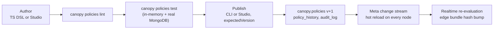

# 02: Document Level Security (DLS)

> DLS is Canopy's equivalent of PostgreSQL Row Level Security. It consists of declarative, per-collection rules
> that decide which documents a request may read or change, evaluated against the caller's JWT claims. Every
> Canopy entry point (REST, GraphQL, realtime, Studio impersonation and edge workers) enforces the **same compiled
> policies**.

## 1. Goals and non-goals

**Goals**

- Semantics that Postgres/Supabase developers already know: permissive and restrictive policies, `using`
  (USING) and `check` (WITH CHECK), roles, and a bypass role.
- Rules **stored in MongoDB** (meta DB), authored as code or in Studio, versioned, diffable and unit-testable.
- One rule enforced both as a **MongoDB filter** (queries, writes) and as an **in-memory matcher** (realtime),
  with proven equivalence for the supported operators.
- Field-level read and write control, including fields that cannot change after insert.
- No changes to user documents or collections.
- Fail closed.

**Non-goals for 1.0**

- Arbitrary JavaScript rule functions.
- Joins inside rules, beyond declarative `$ctx` lookups (§10).
- Enforcement for clients that connect to MongoDB directly (see §16).

## 2. RLS to DLS mapping

| PostgreSQL / Supabase | Canopy DLS |
|---|---|
| `ALTER TABLE t ENABLE ROW LEVEL SECURITY` | `exposed: true`. An exposed collection is always protected by policies. There is no "exposed but unprotected" state. |
| No policies means no rows | Exposed with no applicable permissive policy means no documents |
| `CREATE POLICY p ON t FOR SELECT TO authenticated USING (...)` | `allow.read('authenticated').where({...})` |
| `WITH CHECK (...)` | `.check({...})` |
| `AS PERMISSIVE` / `AS RESTRICTIVE` | `allow.*` / `restrict.*` |
| `auth.uid()`, `auth.jwt() ->> 'x'` | `auth('sub')`, `auth('x')`, which store as `{ "$auth": "sub" }` |
| `TO public` | role `public`, meaning every role including `anon` |
| `BYPASSRLS` / `service_role` | role `service` (secret key). Bypasses DLS entirely. |
| Column privileges (`GRANT SELECT (col)`) | `fields.read` / `fields.write` / `immutable` |
| Subquery in a policy (`EXISTS (...)`) | `$ctx` context lookups: declarative, cached, invalidated live (§10) |
| Enforced inside Postgres | Enforced by Canopy at every API boundary (§16) |

## 3. Core concepts

- **Exposed collection.** A collection that non-service callers can reach. *Nothing is exposed by default.*
  Requests to an unexposed collection get `404 CANOPY_NOT_FOUND`, so collection names are not revealed.
- **Request context.** `{ roles, claims, ctx, now }`:
  - `roles` is a set of strings. It always contains exactly one base role, `anon` (publishable key, no user
    token) or `authenticated` (valid user JWT), plus custom roles from a configured claim (for example
    `roles: ["admin"]`). A secret key sets the role to `service` alone.
  - `claims` is the verified JWT payload, or `null` for `anon`.
  - `ctx` holds lazily resolved context lookups (§10).
  - `now` is the request time (for realtime, the time the event is processed).
- **Operations.**
  - `read`: `find`, `findOne`, `count`, `distinct`, `aggregate` and realtime subscriptions.
  - `insert`.
  - `update`: update operators, replace, and the update half of an upsert.
  - `delete`.
- **Role `public`** in a policy matches any request role. The role `service` can never be named in a policy,
  because it bypasses DLS.
- **JWT-asserted service role is off by default.** In external-auth mode, mapping an IdP claim to `service` is
  rejected unless `auth.allowServiceRoleFromJwt` is explicitly enabled.

## 4. Policy format

### 4.1 Authoring (TypeScript DSL)

```ts
// canopy/policies/todos.ts
import { collection, allow, restrict, auth } from '@canopy/policy';

export default collection('todos', {
  exposed: true,
  realtime: true,
  policies: [
    allow.read('authenticated').where({ ownerId: auth('sub') }).named('read own'),
    allow.read('authenticated')
      .where({ orgId: { $in: auth('org_ids') }, shared: true })
      .named('read shared in my orgs'),
    allow.insert('authenticated').check({ ownerId: auth('sub') }).named('create own'),
    allow.update('authenticated').where({ ownerId: auth('sub') }).named('edit own'), // check defaults to the using clause
    allow.delete('authenticated').where({ ownerId: auth('sub') }).named('delete own'),
    restrict.delete('authenticated').where({ archived: { $ne: true } }).named('archived is permanent'),
  ],
  fields: {
    read: { default: { omit: ['internalNotes'] } },
    write: { default: { only: ['title', 'done', 'dueAt', 'tags', 'ownerId', 'orgId', 'shared'] } },
  },
  immutable: ['ownerId', 'createdAt'],
});
```

The DSL is a typed builder that compiles to plain JSON. It contains no functions and no closures, so a policy
round-trips losslessly between code, the database and Studio.

### 4.2 Stored form (`canopy.policies`, one document per collection)

```json
{
  "_id": "todos",
  "version": 8,
  "exposed": true,
  "realtime": true,
  "policies": [
    {
      "name": "read own",
      "kind": "permissive",
      "ops": ["read"],
      "roles": ["authenticated"],
      "using": "{\"ownerId\":{\"$auth\":\"sub\"}}"
    },
    {
      "name": "archived is permanent",
      "kind": "restrictive",
      "ops": ["delete"],
      "roles": ["authenticated"],
      "using": "{\"archived\":{\"$ne\":true}}"
    }
  ],
  "fields": {
    "read": { "default": { "omit": ["internalNotes"] } },
    "write": { "default": { "only": ["title", "done", "dueAt", "tags", "ownerId", "orgId", "shared"] } }
  },
  "immutable": ["ownerId", "createdAt"],
  "hash": "sha256:9f2c…",
  "updatedAt": { "$date": "2026-11-05T12:00:00Z" },
  "updatedBy": "admin:alice@example.com"
}
```

- `using` and `check` are stored as **canonical EJSON strings**. This sidesteps MongoDB's restrictions on
  `$`-prefixed field names in stored documents and preserves BSON types such as ObjectId, Date and Decimal128.
- `hash` is the SHA-256 of the canonical policy body. Nodes and edge workers use it as the **bundle version**.
- Every publish appends the previous version to `canopy.policy_history` and writes an `audit_log` entry (§11).

### 4.3 Validation rules (enforced by the compiler)

- Each clause applies only to the operations that use it: `using` to `read`, `update` and `delete`; `check` to
  `insert` and `update`. A policy that covers only `insert` may not have `using`. A policy that covers only
  `read` and/or `delete` may not have `check`.
- A policy needs at least one role and one operation, and names must be unique within a collection.
- Variables (§5) may only appear in **value** positions, never as field names or operators.
- Operators must be on the allowlist for the clause type (§6).
- Limits: at most 64 policies per collection, 32 KiB per clause, and nesting depth 12.

## 5. Variables

| Variable | Stored form | Resolves to |
|---|---|---|
| JWT claim | `{ "$auth": "<path>" }`, optional `"as": "objectId" \| "string" \| "number" \| "bool" \| "date" \| "uuid"` | The value at that dotted path in the verified JWT payload (for example `sub`, `email`, `org_ids`, `app_metadata.tenant`) |
| Context lookup | `{ "$ctx": "<name>" }` | The value of a declared lookup (§10) |
| Time | `{ "$now": {} }` or `{ "$now": { "offset": "-P7D" } }` | Request or event time, optionally shifted by an ISO-8601 duration |

**Resolution rules (security-critical):**

1. **Missing or `null` values never match.** If a variable resolves to `undefined` or `null`, the policy
   containing it is treated as **non-matching**. A permissive policy drops out of the OR. A restrictive policy
   makes the whole result DENY. This mirrors SQL `NULL` semantics. Without it, `{ ownerId: null }` would match
   every document that **lacks** `ownerId` in MongoDB.
2. **Shapes are checked.** In an equality position the value must be a scalar. Under `$in`, `$nin` and `$all`
   it must be an array with at most 1,000 elements by default. A mismatch makes the policy non-matching and
   increments `canopy_policy_variable_errors_total`.
3. **Coercion is explicit.** `as: 'objectId'` converts a 24-hex string, and a failed conversion counts as a
   missing value. Nothing is coerced implicitly.
4. **There are no defaults.** A `default:` fallback is deliberately not supported, because it is too easy to
   create a "match everything" fallback.
5. **`user_metadata` should not be trusted.** Claims that users can edit themselves (see
   [07 §4](07-auth.md#4-claims)) are flagged by the linter wherever they appear in policies.

## 6. Allowed operators

`using` clauses are evaluated **in memory** by the realtime engine, and also as MongoDB filters. `check` clauses
are evaluated **only by MongoDB**, inside the write transaction. This is why `check` can allow more operators.

| Operator(s) | In `using` | In `check` | Notes |
|---|:---:|:---:|---|
| `$eq $ne $gt $gte $lt $lte $in $nin` | ✓ | ✓ | BSON comparison order and type bracketing, as in MongoDB |
| `$exists $type` | ✓ | ✓ | |
| `$and $or $nor $not` | ✓ | ✓ | |
| `$all $elemMatch $size` | ✓ | ✓ | |
| `$mod` | ✓ | ✓ | |
| `$regex` | ✓ (restricted) | ✓ | `using`: only patterns compatible with a linear-time engine (§12); max 256 chars |
| `$expr` | ✗ | ✓ | `$function`, `$accumulator` and `$where` are banned inside it |
| `$jsonSchema` | ✗ | ✓ | Useful for shape validation of written documents |
| `$text`, geo operators | ✗ | ✗ | Not in 1.0 |
| `$where`, `$function`, `$accumulator` | ✗ | ✗ | Never |

The same "matcher-safe" set limits which **user** subscription filters take the fast realtime path. Other
operators fall back to a polling observer ([03 §5](03-realtime-engine.md#5-observers)).

## 7. Evaluation semantics

### 7.1 Combining policies

For a collection `C`, an operation `op` and a request context `c`:

```
applicable(op) = policies of C where op ∈ p.ops and (p.roles ∩ c.roles ≠ ∅ or 'public' ∈ p.roles)

USING(op) = OR( resolve(p.using ?? {})               for permissive p ∈ applicable(op) )
            AND
            AND( resolve(p.using ?? {})              for restrictive p ∈ applicable(op) )

CHECK(op) = OR( resolve(p.check ?? p.using ?? {})    for permissive p ∈ applicable(op) )
            AND
            AND( resolve(p.check ?? p.using ?? {})   for restrictive p ∈ applicable(op) )
```

- No applicable permissive policy means **DENY**. DENY is represented as `{ _id: { $in: [] } }`, which matches
  nothing and is cheap for the query planner.
- A permissive policy without `using` means "all documents" (`{}`) for its roles.
- For `update`, a policy without `check` uses its `using` as the check, as in Postgres. This blocks "moving a
  document out of your own scope".
- `c.roles ∋ 'service'` returns `ALL` immediately (bypass).

```ts
function compileUsing(coll: CollectionPolicies, op: Op, c: RequestContext): Filter | typeof DENY | typeof ALL {
  if (c.roles.has('service')) return ALL;
  const applicable = coll.policies.filter(
    (p) => p.ops.includes(op) && (p.roles.includes('public') || p.roles.some((r) => c.roles.has(r))),
  );
  const permissive = applicable
    .filter((p) => p.kind === 'permissive')
    .map((p) => resolve(p.using ?? {}, c))
    .filter((f) => f !== DENY);
  if (permissive.length === 0) return DENY;
  const restrictive = applicable
    .filter((p) => p.kind === 'restrictive')
    .map((p) => resolve(p.using ?? {}, c));
  if (restrictive.includes(DENY)) return DENY;
  return simplify({ $and: [{ $or: permissive }, ...restrictive] }); // flatten, dedupe, short-circuit
}
```

### 7.2 Per-operation rules

| Operation | Target documents | Post-condition | When denied |
|---|---|---|---|
| `read` | `userFilter ∧ USING(read)` | n/a | Documents are invisible: empty results, or `404` for `GET /:id` |
| `insert` | n/a | every inserted document satisfies `CHECK(insert)` | `403 CANOPY_POLICY_VIOLATION`; the transaction is aborted |
| `update` | `userFilter ∧ USING(update) ∧ USING(read)` | every modified document satisfies `CHECK(update)` | Non-visible targets are silently untouched (`matched: 0`). A failed check returns `403 CANOPY_POLICY_VIOLATION`. |
| `delete` | `userFilter ∧ USING(delete) ∧ USING(read)` | n/a | Non-visible targets are silently untouched |
| upsert | update rules, plus insert rules if a document is inserted | `CHECK(insert)` or `CHECK(update)` | As above. Requires both insert and update grants. |

Two rules apply across all operations:

- **"You can't modify what you can't see."** `update` and `delete` always include `USING(read)`. This prevents
  blind writes and keeps the model simple.
- **Invisible looks like nonexistent.** Row-level denials never return `403` on reads. `403` is reserved for
  check violations on writes and for operation-level denials, such as "role has no insert policy at all" →
  `403 CANOPY_FORBIDDEN`.

### 7.3 What writes return

Insert and update responses include the **post-image filtered through `USING(read)` and the read field rules**.
If the caller can't read the result (for example, a write-only drop box), the response is
`{ ok: true, document: null }`. Deletes return the readable pre-image when it is requested.

## 8. Field-level security

```ts
fields: {
  read:   { default: { omit: ['internalNotes'] }, hr: { only: ['*'] } },
  write:  { default: { only: ['title', 'done'] } },
  update: { default: { omit: ['title'] } },   // optional: overrides `write` for updates only
},
immutable: ['ownerId', 'createdAt'],          // settable on insert, never changed by non-service callers
```

- Rules are keyed by role. A request gets the **union** of what its roles allow. A role without an entry uses
  `default`. If there is no `default` either, all fields are allowed, and the linter warns when rules exist for
  only some roles. In `only` lists, `'*'` means every field.
- Paths are dotted and apply through nested documents and arrays.

**Reads**

- The projection is `userProjection ∩ readable`. Canopy pushes it down to MongoDB when it can be expressed as
  one projection. Otherwise it strips fields in-process, and unreadable fields are never returned.
- **Inference is blocked.** Filters, sorts, `distinct` fields and `arrayFilters` that reference an unreadable
  path are rejected with `400 CANOPY_INVALID_QUERY`. Without this rule, `find({ salary: { $gt: 100000 } })`
  would reveal salaries even with the field projected out.
- Aggregations get a prefix stage (`$unset` for `omit`, `$project` for `only`) **before** any user stage
  (§9.2), so a pipeline such as `$group: { total: { $sum: '$salary' } }` sees nothing.
- Realtime `changed` messages carry only readable fields. An update that touched only unreadable fields
  produces no message.

**Writes**

- A write to path `P` is allowed only if:
  - under `only` rules, `P` equals an allowed path or lies beneath one;
  - under `omit` rules, `P` is not equal to, beneath, or an **ancestor of** an omitted path. Writing `profile`
    as a whole would overwrite a forbidden `profile.ssn`.
- Every path in every update operator is checked: `$set`, `$unset`, `$inc`, `$mul`, `$min`, `$max`,
  `$currentDate`, `$push`, `$addToSet`, `$pull`, `$pullAll`, `$pop`, `$setOnInsert`, and both the source and
  target of `$rename`. Positional segments (`$`, `$[]`, `$[id]`) are normalized away before the check.
- Inserted documents may not contain `$`-prefixed or dotted keys. Keys such as `__proto__`, `constructor` and
  `prototype` are rejected at the parser.
- `immutable` paths, and their ancestors, are rejected in update operators and replacements from non-service
  callers.
- `_id` may be supplied on insert, because optimistic inserts need client-generated IDs. It must match the
  collection's `idType`. MongoDB already refuses to change `_id`.
- **Pipeline-style updates** (an update given as an aggregation pipeline) are only accepted from `service` in
  1.0. Their data flow is too hard to analyze for field rules.

## 9. Enforcement points

| Entry point | Read path | Write path | Notes |
|---|---|---|---|
| REST | Effective filter injected into `find`, `count` and `distinct`; aggregation prefix | Transactional check (§9.3) | [06](06-data-api.md) |
| GraphQL | Same functions as REST, called from resolvers. Relations resolve per collection with that collection's policy. | Same as REST | [06 §13](06-data-api.md#13-graphql) |
| Realtime | Snapshot uses the REST read path. Events use the in-memory matcher on pre- and post-images. | `mut` messages use the REST write path | [03](03-realtime-engine.md) |
| Studio "view as" | Admin builds a synthetic context, which is audited | Same as REST | [08 §3](08-studio-and-cli.md#3-key-flows) |
| Edge worker | Policy bundle evaluated in the Durable Object. Snapshots are delegated to the core. | Delegated to the core | [03 §14](03-realtime-engine.md#14-canopy-edge) |
| `service` role | Bypass | Bypass | Secret key only. Every use is counted in metrics. |

### 9.1 Query rewriting (reads)

```
effective  = simplify({ $and: [ userFilter, USING(read) ] })
projection = intersect(userProjection, readable(c.roles))
options    = { limit: min(userLimit ?? defaultLimit, maxLimit), maxTimeMS, sort (paths validated) }
```

Compiled policies are cached per `(collection, op, roleSet, policyVersion)` as templates with variable slots.
Each request only substitutes variables, so the cost is proportional to the size of the policy and has nothing
to do with the number of documents.

### 9.2 Aggregation sanitizer

- **Allowed stages:** `$match`, `$project`, `$addFields`/`$set`, `$unset`, `$sort`, `$limit`, `$skip`,
  `$group`, `$count`, `$bucket`, `$bucketAuto`, `$sortByCount`, `$unwind`, `$replaceRoot`/`$replaceWith`,
  `$facet` (each branch is sanitized recursively), `$densify`, `$fill`, `$setWindowFields`, `$sample` (size
  capped), `$lookup` (rewritten), `$unionWith` (rewritten).
- **Rejected stages:** `$out`, `$merge`, `$currentOp`, `$listSessions`, `$listLocalSessions`, `$collStats`,
  `$indexStats`, `$planCacheStats`, `$changeStream`, `$graphLookup` (1.0), `$searchMeta`, and
  `$search`/`$vectorSearch` anywhere but first.
- **Search (opt in per collection):** with `collections.<name>.search`, `$search` or `$vectorSearch` may be the
  first stage; the prefix below follows it, so the policy filters the search results. Every path, sort,
  highlight and vector filter field must be readable; `queryString`, `moreLikeThis` and wildcard paths need
  every field readable; unknown operators and options are refused. Hidden documents still take places in
  `$vectorSearch.limit` (fewer results, never hidden ones). Design: plan 002, F3.
- **Rejected expressions** anywhere in the pipeline: `$function`, `$accumulator`, `$where`. System variables
  other than `$$NOW`, `$$ROOT`, `$$CURRENT` and `$$REMOVE` are rejected too.
- **Prefix:** `[{ $match: USING(read) }, <field-rule stage>]` is placed before the user's stages.
- **`$lookup` rewriting:** `from` must be an exposed collection the caller may read. Canopy uses the
  `localField`/`foreignField` + `pipeline` form and adds the **foreign** collection's prefix stages:
  `pipeline: [{ $match: USING_from(read) }, <field rules of from>, ...userSubPipeline]`.
  `$unionWith` gets the same treatment. Sub-pipelines are sanitized recursively, with a total stage limit.

### 9.3 Write path (transactional)

```ts
async function update(c: RequestContext, coll: string, filter: Filter, update: UpdateDoc, opts: WriteOptions) {
  assertUpdateOperatorsAllowed(update);            // allowlist; no pipeline updates unless service
  assertWritablePaths(coll, c, update);            // §8, including immutable fields
  const target = and(filter, USING(coll, 'update', c), USING(coll, 'read', c));
  const check = CHECK(coll, 'update', c);

  return withTransaction(async (session) => {      // readConcern snapshot, writeConcern majority, bounded retries
    if (opts.mutationId) await recordMutation(session, opts.mutationId, c);  // canopy.mutations; duplicate key → replay
    const ids = await findIds(session, coll, target, opts.multi ? maxBulk + 1 : 1);
    if (ids.length > maxBulk) throw problem('CANOPY_BULK_LIMIT');
    const res = await updateMany(session, coll, { _id: { $in: ids } }, update);
    if (check !== ALL && res.modifiedCount > 0) {
      const bad = await countDocuments(session, coll, { _id: { $in: ids }, $nor: [check] });
      if (bad > 0) throw problem('CANOPY_POLICY_VIOLATION'); // aborts the transaction
    }
    const post = await readBack(session, coll, ids, c);       // projected by read rules
    return { matched: res.matchedCount, modified: res.modifiedCount, documents: post };
  }); // the commit's operationTime becomes the response `ct`
}
```

- **MongoDB evaluates `check`.** Canopy never re-implements update-operator semantics to predict post-images on
  the server, so there is no semantic drift.
- **Fast path.** When `CHECK(op)` compiles to "all documents" (always for `delete`), there is no mutation ID and
  the operation targets one document by `_id`, Canopy runs one atomic operation on the target (`insertOne`,
  `updateOne`, `replaceOne` with `upsert` when the insert check is also "all", `findOneAndDelete`) with majority
  write concern and no transaction. The response's `ct` is the session's operation time right after the write.
  Inserts with a matcher-certified `check` may later be pre-checked in-process
  ([S3](../spikes/S3-write-path-cost.md)).
- **Pre-checked writes.** A single insert and a single replace without `upsert` are stored exactly as sent (a
  replacement with `_id` first), so MongoDB evaluates `CHECK` on the document before the write, through
  `$documents`, and the write is one `insertOne` or `replaceOne` with majority write concern and no
  transaction. The check runs as an aggregation on the target collection (an empty `_id` match, then
  `$unionWith` over `$documents`), so MongoDB compares strings with the collection's default collation, as it
  does for the stored document; a `$documents` aggregation on the database has no collation and could pass a
  document that fails its check once stored. `check` is a filter of constants over the document alone, so
  nothing it reads can change between the check and the write. A replace whose pre-check fails still runs the
  transaction: the target may be missing, invisible or unchanged, which the transaction decides as it always
  did. Nothing is pre-checked when `check` reads `$$NOW` or another system variable besides `$$ROOT`, when a
  mutation ID is given, for an upsert, or when the document is larger than 8 MiB.
- **Round trips.** A single document transactional write targets `_id` directly, and evaluates `check` and
  reads back the post-image in one aggregation (`$facet` with a `$nor: [check]` count and the `USING(read)`
  read with the read field rules), so an update is update, aggregate, commit.
- **Idempotency.** The `canopy.mutations` record (`_id` = mutation ID, plus `sub`, collection, operation and the
  result; TTL 24 h) is inserted at the end of the **same transaction**. A duplicate key on it aborts the
  transaction and replays. Any failure of a keyed write also looks the record up first, because a retry can
  fail before reaching it (a duplicate `_id`, a `check` that the first attempt already moved past). A replayed
  mutation returns the stored result with `replayed: true` and a `ct` read after the original commit. A record
  that belongs to another subject, or to another collection or operation, returns `409`.
- **Replacements** by non-`service` callers are refused (`403`) on collections with field write rules or
  `immutable` paths, since a replacement drops fields the caller may not touch. Such callers send updates.
- Because the transaction spans the meta DB and the app DB, **both must live on the same deployment**.

### 9.4 Realtime path

The engine compiles `USING(read)` for each subscriber into a matcher. It then decides visibility before and after
each change using pre- and post-images, or a tracked ID set when pre-images are off. Details are in
[03 §7](03-realtime-engine.md#7-visibility-transitions). Policy, claim and `$ctx` changes trigger re-evaluation
of the affected subscriptions (§12).

## 10. Context lookups (`$ctx`): membership rules without joins

Many real policies take the form "visible if I'm a member of the document's project". Postgres expresses that
with `EXISTS (subquery)`. MongoDB filters can't express it, so DLS provides **declared context lookups**:

```ts
// canopy/policies/_context.ts
import { context, auth } from '@canopy/policy';

export default context({
  projectIds: {
    from: 'project_members',            // a collection in the app DB (does not need to be exposed)
    where: { userId: auth('sub') },     // only $auth variables are allowed here
    select: 'projectId',                // the resolved value is an array of this field
    max: 1000,                          // above this the lookup fails closed and a warning metric fires
    ttl: '5m',                          // safety TTL; live invalidation usually happens first
  },
});

// canopy/policies/tasks.ts
allow.read('authenticated').where({ projectId: { $in: ctx('projectIds') } });
```

- **Resolution.** A lookup is resolved lazily for each `(subject, policy version)` the first time it is needed.
  It runs with service privileges, because it belongs to the admin-authored policy. Results are cached
  in-process.
- **Live invalidation.** The source collection is always included in the change stream. A change whose pre- or
  post-image matches `where` for subject *U* (found through a reverse index from source `_id` to subjects when
  pre-images are off) invalidates *U*'s cache. *U*'s subscriptions that depend on the lookup are then
  re-evaluated: re-snapshot plus diff, which yields `added`/`removed` messages.
- **Fail closed.** Exceeding `max`, a timeout or an error makes the variable count as missing (§5, rule 1).
- **When to use claims instead.** Small, rarely changing memberships (for example ≤ 20 org IDs) can live in
  JWT claims. That is cheaper, but stale until the token refreshes. `$ctx` is for larger or fast-changing
  memberships that must take effect immediately.

## 11. Policy lifecycle



- **Optimistic concurrency.** A publish carries `expectedVersion`. A concurrent edit returns `409`, and the
  publisher has to diff and retry.
- **Rollback** means republishing an earlier version from `policy_history`, which is itself audited.
- **Drift detection.** `canopy policies diff` compares the code in Git with the database. CI can fail a deploy
  when production has been edited in Studio but not committed.
- **Bootstrapping without a writable meta DB.** In read-only sidecar deployments, policies may be loaded from a
  mounted directory (`CANOPY_POLICIES=/policies`) and are then immutable at runtime.

## 12. Realtime-specific rules

- **Subscriptions are reads.** A subscription is allowed if the caller may `read` the collection and the
  collection has `realtime: true`.
- **Claim changes.** When a client sends a refreshed token whose claims differ, the gateway recompiles that
  connection's effective filters and re-snapshots the subscriptions whose filter changed.
- **Policy publish.** Affected subscriptions are re-evaluated with a concurrency limit, so a publish cannot
  cause a stampede of snapshot queries (see [03 §10](03-realtime-engine.md#10-connection-auth-and-policy-changes)).
- **`$now` in `read` policies.** Event-driven matching can't notice that time has passed, so observers whose
  effective filter contains `$now` are re-snapshotted periodically (60 s by default). The documented guarantee
  is "eventually consistent within the interval".
- **Regex.** Policy and subscription regexes run in-process on every candidate event. They must compile under a
  linear-time engine (RE2 semantics: no backreferences or lookaround). Anything else is rejected for `using`
  and routed to the polling observer for subscriptions. This removes ReDoS as a way to take a node down.

## 13. Testing and linting policies

### 13.1 Policy tests

```ts
// canopy/policies/todos.test.ts
import { describePolicies, as } from '@canopy/policy/testing';

describePolicies('todos', ({ doc, expect }) => {
  const alice = as.user({ sub: 'u_alice', org_ids: ['o1'] });
  const bob = as.user({ sub: 'u_bob', org_ids: ['o1'] });
  const t = doc({ _id: 't1', ownerId: 'u_alice', orgId: 'o1', shared: false, internalNotes: 'x' });

  expect(alice).can.read(t).withoutFields(['internalNotes']);
  expect(bob).cannot.read(t);
  expect(bob).can.read({ ...t, shared: true });
  expect(alice).cannot.update(t, { $set: { ownerId: 'u_bob' } });   // immutable field
  expect(alice).cannot.delete({ ...t, archived: true });            // restrictive policy
  expect(as.anon()).cannot.read(t);
});
```

`canopy policies test` runs every case twice: once with the in-memory matcher, and once against a throwaway
MongoDB through Testcontainers or a configured URI, using the real query and transaction path. **Any
disagreement fails the run.** That disagreement is exactly the class of bug that would make realtime and REST
differ. The command also reports **policy coverage**: which policies and which branches of `$or` were
exercised.

### 13.2 Lint rules (`canopy policies lint`)

| Rule | Severity | Catches |
|---|---|---|
| `exposed-without-read-policy` | warn | An exposed collection that nobody can read (often a mistake) |
| `public-allow-all` | error | A permissive policy for `public` or `anon` with an empty `using` on a write operation |
| `user-editable-claim` | error | `$auth: 'user_metadata.*'` used in a policy |
| `missing-index` | warn | Equality fields in policies with no supporting index (needs DB access) |
| `field-rules-partial` | warn | Field rules for some roles but no `default` |
| `ctx-unbounded` | error | A `$ctx` lookup without `max` |
| `regex-not-linear` | error | A `using` regex that is incompatible with a linear-time engine |
| `unreachable-role` | info | A policy for a role that no token issuer emits (needs config) |
| `update-without-check` | info | Reminder that `using` doubles as `check` |

## 14. Performance

- **Compiled templates** per `(collection, op, roleSet, policyVersion)`: substituting variables per request
  costs microseconds.
- **Index advisor.** Policy equality fields such as `ownerId` and `orgId` end up in nearly every query, so
  Studio and `canopy doctor` suggest compound indexes that start with them. Creating an index is always an
  explicit, confirmed action.
- **Realtime predicate index.** Policies naturally partition data by user or tenant (`ownerId = $auth.sub`).
  The engine indexes subscriptions on these equality conjuncts, so the cost per event is proportional to the
  number of *affected* subscribers rather than the total
  ([03 §6](03-realtime-engine.md#6-candidate-selection-the-predicate-index)).

## 15. Worked examples

**1. Personal data.** See §4.1.

**2. Multi-tenant SaaS with tenant admins**

```ts
collection('invoices', {
  exposed: true,
  policies: [
    allow.read('authenticated').where({ tenantId: auth('tenant_id') }),
    allow.ops(['insert', 'update'], 'authenticated').where({ tenantId: auth('tenant_id') })
      .check({ tenantId: auth('tenant_id'), status: { $in: ['draft', 'sent'] } }),
    allow.ops(['update', 'delete'], 'tenant_admin').where({ tenantId: auth('tenant_id') }),
    restrict.ops(['update', 'delete'], 'public').where({ status: { $ne: 'paid' } }), // paid invoices are frozen
  ],
  immutable: ['tenantId'],
});
```

**3. Public read, owner write (blog)**

```ts
collection('posts', {
  exposed: true,
  policies: [
    allow.read('public').where({ published: true }),
    allow.read('authenticated').where({ authorId: auth('sub') }),          // drafts visible to their author
    allow.insert('authenticated').check({ authorId: auth('sub') }),
    allow.update('authenticated').where({ authorId: auth('sub') }),
  ],
  immutable: ['authorId'],
});
```

**4. HR records with salary hidden from non-HR**

```ts
collection('employees', {
  exposed: true,
  policies: [allow.read('authenticated').where({ orgId: auth('org_id') })],
  fields: { read: { default: { omit: ['salary', 'ssn'] }, hr: { only: ['*'] } } },
});
```

**5. Team membership with `$ctx`.** See §10.

**6. Stories visible for 24 hours**

```ts
allow.read('authenticated').where({ createdAt: { $gte: now('-PT24H') } });
```

**7. Write-only intake (contact form)**

```ts
collection('leads', {
  exposed: true,
  realtime: false,
  policies: [allow.insert('anon').check({ $jsonSchema: { required: ['email'], properties: { email: { bsonType: 'string', maxLength: 254 } } } })],
});
```

Inserts return `{ ok: true, document: null }` because `anon` can't read leads.

## 16. Limitations and future work

- **Not enforced inside `mongod`.** Any client holding MongoDB credentials bypasses DLS, just as any client with
  the `service` key does. Canopy must be the *only* path for untrusted clients. Native features don't close
  this gap: views with `$$USER_ROLES` are role-level, not per-user, and Queryable Encryption is about
  confidentiality, not authorization. Documentation and `canopy doctor` will say so plainly.
- `$ctx` supports single-collection equality lookups only in 1.0.
- Time-based visibility in realtime is periodic (§12).
- No pipeline-style updates for non-service callers, and no `$graphLookup` for DLS-constrained callers in
  1.0. Search stages are only allowed first, on collections that opt in (§9.2).
- **Future work:** sandboxed policy functions (WASM), masking or partial redaction of fields, request-attribute
  conditions such as IP range (MFA level already works through the `aal` claim), and search that applies
  the policy before ranking.
