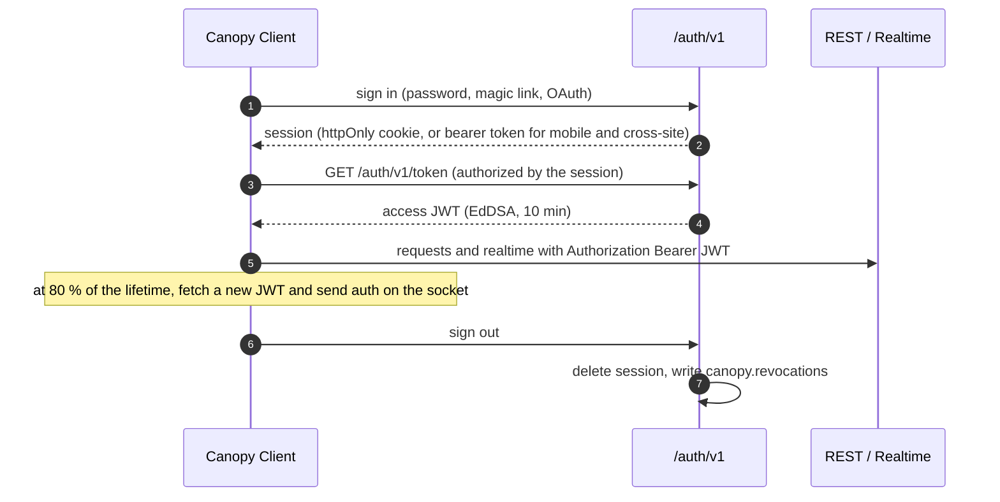

# 07: Auth

> Canopy supports two auth modes that produce the same request context: **built-in** (Canopy issues the
> JWTs) and **external** (bring your own identity provider through JWKS). DLS works the same way in both.

## 1. Two modes

| | Built-in (`auth: builtin()`) | External (`auth: external()`) |
|---|---|---|
| Who issues user JWTs | Canopy (Better Auth engine, `canopy_auth` DB) | Auth0, Clerk, Firebase, Cognito, Keycloak, Supabase Auth, WorkOS, Okta, Entra ID, your own service |
| What Canopy stores | Users, sessions, identities, signing keys | Nothing user-related |
| Typical deployment | Platform mode (C) | Sidecar (A) or embedded (B) |
| Sign-in UI | SDK methods; prebuilt UI components later | Your existing UI |
| Role mapping | `role` + `roles` claims | Configurable claim paths |

Both modes accept project **API keys** (§5) and produce the `{ roles, claims }` request context described in
[02 §3](02-document-level-security.md#3-core-concepts).

**Where auth runs.** Issuing credentials and verifying them are split. Built in auth (sign up, sign in,
sessions, OAuth, MFA, key rotation) runs in the TypeScript control plane on Better Auth. Verifying a token,
an API key, a revocation or a Studio view token happens on every request, so the Rust data plane does it
itself, from the JWKS and the meta database, without calling the control plane
([ADR-0017](../adr/0017-rust-data-plane.md)). A control plane outage therefore stops new sign ins but not
requests that carry a valid token.

## 2. Built-in auth (Canopy Auth)

Built-in auth embeds **Better Auth** with `@better-auth/mongo-adapter`, using a `MongoClient` so writes are
transactional, in its own database `canopy_auth`. User collections never touch the app DB.

| Capability | Phase | Notes |
|---|---|---|
| Email + password, email verification, password reset | 3 | Uniform responses prevent email enumeration |
| Magic link / email OTP | 3 | |
| OAuth / OIDC providers (Google, GitHub, Apple, Microsoft, Discord, generic OIDC) | 3 | Redirect URL allowlist |
| Anonymous sign-in, with upgrade or linking to a permanent account | 3 | `is_anonymous: true` claim |
| TOTP 2FA, passkeys | 4 | `aal` claim (`aal1` or `aal2`) for step-up policies |
| Organizations / teams | after 1.0 | Can be modeled today with `app_metadata` + `$ctx` |
| Prebuilt UI components (`canopy.js/react-auth`) | after 1.0 | |

## 3. Token model



- **Session.** An opaque Better Auth session stored server-side, with rolling expiry (7 days by default,
  extended on use). Same-site web apps get an httpOnly, `Secure`, `SameSite=Lax` cookie. Cross-site SPAs,
  native apps and server-to-server callers get a bearer session token, which the SDK keeps through its storage
  adapter.
- **Access token.** A JWT minted by the Better Auth JWT plugin. **EdDSA (Ed25519)** is the default and ES256
  is available. Lifetime is 10 minutes (configurable from 5 to 60). `iss` is `${CANOPY_PUBLIC_URL}/auth/v1` and
  `aud` is `CANOPY_PUBLIC_URL`.
- **JWKS** at `/auth/v1/jwks`, with an alias at `/.well-known/jwks.json`. Keys **rotate** every 30 days with a
  30-day grace period, so no downtime is needed. Verifiers refetch when they see an unknown `kid`.
- **Revocation.** Signing out deletes the session, which stops new JWTs. To revoke access tokens that are still
  valid, Canopy also writes `{ subject | sid, until }` to `canopy.revocations` (TTL = the maximum token
  lifetime). REST nodes keep an in-memory revocation set synced from the meta stream, and realtime closes
  matching sockets ([03 §10](03-realtime-engine.md#10-connection-auth-and-policy-changes)). In an emergency,
  rotating the signing key immediately invalidates every token.

## 4. Claims

```json
{
  "iss": "https://api.example.com/auth/v1",
  "aud": "https://api.example.com",
  "sub": "u_8f3k2q",
  "sid": "s_19ab7",
  "iat": 1793871000,
  "exp": 1793871600,
  "role": "authenticated",
  "roles": ["tenant_admin"],
  "email": "alice@example.com",
  "email_verified": true,
  "is_anonymous": false,
  "aal": "aal1",
  "app_metadata": { "tenant_id": "t_42", "org_ids": ["o1", "o7"] },
  "user_metadata": { "display_name": "Alice" }
}
```

- **`app_metadata`** can only be written by `service` and admins, so it is safe for policies.
- **`user_metadata`** can be edited by the user and **must never be used in policies.** The linter fails a
  publish that references it ([02 §13.2](02-document-level-security.md#132-lint-rules-canopy-policies-lint)).
- **Custom claims hook.** An HTTPS endpoint of the app, called each time an access token is minted
  (`GET /auth/v1/token`), the same idea as Supabase's custom access token hook. It replaces the TypeScript
  function of earlier releases: the config carries only its URL and a secret reference.

```ts
// canopy/canopy.config.ts
auth: {
  kind: 'builtin',
  accessTokenTtl: '10m',
  claims: { url: 'https://app.example.com/hooks/claims', secret: env.secret('CLAIMS_KEY') },
},
```

  **Request.** `POST` to the URL with `content-type: application/json` and a body of the user and the
  session the token is for (the user fields of the admin API, without any database handle):

```json
{
  "user": {
    "id": "u_8f3k2q", "email": "alice@example.com", "emailVerified": true, "name": "Alice",
    "isAnonymous": false, "roles": ["tenant_admin"], "appMetadata": { "tenant_id": "t_42" },
    "userMetadata": { "display_name": "Alice" }, "banned": false,
    "createdAt": "2026-11-01T09:30:00.000Z", "updatedAt": "2026-11-20T17:02:11.000Z"
  },
  "session": { "id": "s_19ab7" }
}
```

  `email` is absent for anonymous users, `name` when it is empty, `banReason` and `banExpires` when unset.
  The request is signed exactly like a webhook delivery, with
  [Standard Webhooks](https://www.standardwebhooks.com/) headers: `webhook-id` (`msg_` and a random id),
  `webhook-timestamp` (Unix seconds) and `webhook-signature: v1,<base64 HMAC SHA-256>` over
  `<webhook-id>.<webhook-timestamp>.<body>`. The secret has the webhook format: `whsec_` followed by the
  base64 key, or any other text used as the key itself. The endpoint should verify the signature with a
  Standard Webhooks library and refuse timestamps more than five minutes away from its clock.

  **Answer.** A 2xx status with a JSON object holding at most two fields: `app_metadata`, an object merged
  over the stored `app_metadata`, and `roles`, a list of names added to the stored roles (`anon`,
  `authenticated`, `service` and `public` are refused). An empty body (for example a `204`) or `null` adds
  nothing. Canopy owns every other claim: any other field fails the call.

```json
{ "app_metadata": { "org_ids": ["o1", "o7"] }, "roles": ["billing"] }
```

  **Limits.** The whole call, connecting included, must finish within 200 ms; the answer may hold at most
  4 KiB; the resulting JWT must be at most 4 KiB. The URL must use HTTPS; plain HTTP is accepted only on a
  loopback address (`localhost`, `127.0.0.1`, `::1`) outside production, and a URL with credentials is
  refused at startup. Redirects are never followed.

  **Failures fail closed.** A timeout, a connection error, a status other than 2xx (redirects included), an
  answer over 4 KiB, a body that is not JSON, an answer that is not an object, a forbidden field or role, or a
  token over 4 KiB: **no token is issued** and the session is not refreshed. The answer is status 500 with
  `{"code": "CANOPY_AUTH_HOOK_FAILED", "message": "The claims hook failed"}` (for an oversize token,
  `The access token is <n> bytes, over the 4096 byte cap`), which the SDK surfaces as `AuthHookFailedError`.
  The reason, which can carry transport details of the hook's host, is never returned to the client (the
  TypeScript server still appends it as `The claims hook failed: <reason>`); the audit log records `auth.claims_hook_failed` with the user as actor, the client address and
  `details.reason` (plus `details.bytes` for an oversize token). For memberships that change often, prefer
  `$ctx` lookups ([02 §10](02-document-level-security.md#10-context-lookups-ctx-membership-rules-without-joins)).

## 5. API keys

| Key | Format | Role | Where it may live | Storage |
|---|---|---|---|---|
| **Publishable** | `canopy_pk_` + 32 random base62 characters | `anon` | Browsers and mobile apps; it is public by design | Plaintext. It isn't a secret and can be shown again. |
| **Secret** | `canopy_sk_` + 32 random base62 characters | `service` (bypasses DLS) | Servers only | SHA-256 hash plus an 8-character display prefix. Shown once. |

- API keys are independent of JWT signing keys. Rotating one never forces rotating the other. Supabase moved to
  this model in 2025 with its publishable/secret keys and asymmetric JWT signing keys.
- **Rotation:** create a new key, deploy it, then revoke the old one. A revocation propagates through the meta
  stream within about a second, and realtime connections that used the key close with `4003`.
- Several keys of each type can exist, with names and `lastUsedAt` tracking (sampled, so it isn't a write per
  request).
- After 1.0: scoped secret keys (limited to certain collections and operations, or to IP allowlists), and
  registering the `canopy_sk_` prefix with GitHub secret scanning.

## 6. External (BYO) identity providers

```ts
auth: external({
  jwksUrl: 'https://YOUR_TENANT.auth0.com/.well-known/jwks.json',
  issuer: 'https://YOUR_TENANT.auth0.com/',
  audience: 'https://api.example.com',
  algorithms: ['RS256'],                       // pinned; 'none' and HS* are rejected unless explicitly allowed
  subjectClaim: 'sub',
  rolesClaim: 'https://example.com/roles',     // array or string
  claimsNamespace: 'https://example.com/',     // `$auth: 'tenant_id'` reads 'https://example.com/tenant_id'
}),
```

| Provider | Notes |
|---|---|
| Auth0 | RS256. Custom claims are namespaced, so use `claimsNamespace`. |
| Clerk | Use a JWT template to add roles and org claims |
| Firebase Auth | RS256. JWKS at `https://www.googleapis.com/service_accounts/v1/jwk/securetoken@system.gserviceaccount.com`; `iss` is `https://securetoken.google.com/<project>`; `aud` is `<project>` |
| Amazon Cognito | JWKS at `https://cognito-idp.<region>.amazonaws.com/<poolId>/.well-known/jwks.json`. Check `token_use` with `requireClaims: { token_use: 'access' }`. |
| Supabase Auth | Asymmetric keys through `https://<ref>.supabase.co/auth/v1/.well-known/jwks.json` |
| Keycloak | `/realms/<realm>/protocol/openid-connect/certs` |
| Your own service | Any JWKS URL. HS256 with `CANOPY_JWT_SECRET` is supported for legacy setups and logs a warning. |

**Verification hardening.**

- The JWKS host is fixed by config. Header-supplied key locations (`jku`, `x5u`, embedded `jwk`) are ignored.
- JWKS is fetched over HTTPS only, with a 3 s timeout, cached according to `Cache-Control`, and refetched on an
  unknown `kid` at most once a minute.
- The algorithm is pinned. `iss` and `aud` are required. Skew is ±60 s.
- The Rust data plane remembers a token whose signature and claims passed for at most 60 s, keyed by its
  exact text, so a busy client's token is not verified again on every request. Expiry and session revocations
  are still checked on each request, and a refetched JWKS forgets every remembered token, so a key removed from
  the JWKS stops being accepted at the next refetch or within 60 s.
- Mapping an external claim to `service` is refused unless `allowServiceRoleFromJwt` is set
  ([02 §3](02-document-level-security.md#3-core-concepts)).

## 7. Endpoints (built-in mode)

- **Better Auth's routes** (sign-up, sign-in, OAuth callbacks, sign-out, session, token and JWKS) are mounted
  under the base path `/auth/v1`. The **SDK is the supported contract**, so routes can change behind it. The
  stable subset is documented as part of the v1 API.
- **Canopy additions:**
  - `GET /auth/v1/settings`: enabled providers and password rules, for building sign-in UIs;
  - `GET /.well-known/jwks.json`: an alias for the JWKS;
  - admin user management through `/admin/v1/users` (Studio and CLI), backed by Better Auth's admin APIs.

## 8. Email and SMS

- Delivery adapters: SMTP, Resend, Postmark, Amazon SES. SMS for OTP (Twilio and others) comes after 1.0.
- Templates for verification, magic link, reset, invite and email change can be edited in Studio, previewed
  with test data, and versioned in `canopy.settings`.
- Sending is rate-limited per template and per recipient. Bounce and complaint webhooks are a post-1.0 item.

## 9. Security controls

| Control | Default |
|---|---|
| Rate limiting on auth endpoints (per IP, per identifier) | On (Better Auth limiter, with tuned limits) |
| CAPTCHA (Cloudflare Turnstile or hCaptcha) on sign-up, sign-in and reset | Off; recommended for public apps |
| Password policy | ≥ 10 characters; optional breached-password check through the k-anonymity range API |
| Brute-force protection | Exponential backoff per account and per IP |
| Email-enumeration protection | Uniform responses and timing |
| Redirect allowlist (`trustedOrigins`) | Required for OAuth and magic links; open redirects are impossible by construction |
| CSRF / origin checks on cookie flows | On |
| Session management | Users list and revoke their own sessions; admins revoke any session |
| Audit events (sign-in, failures, password, MFA or email changes) | Written to `canopy.audit_log` |

## 10. Admin users vs app users

Studio administrators are **separate accounts** in `canopy.admin_users`. They are not Better Auth users. They
have their own login, TOTP is required for the `owner` role, and OIDC SSO for admins comes after 1.0. A flaw in
an app-user flow therefore can't escalate to administrative control. The admin surface can also be bound to a
private listener ([08 §6](08-studio-and-cli.md#6-studio-security)).

## 11. Importing users

`canopy auth import --from firebase|auth0|cognito|csv` (Phase 4) imports users and identities. For password
hashes (bcrypt, Firebase's modified scrypt, argon2id, PBKDF2), Canopy plugs a custom verifier into Better Auth's
password hashing. The legacy hash is checked on the first login, then the password is **rehashed** with the
default algorithm. Migration guides cover users moving off Atlas App Services auth.

## 12. Why Better Auth, and the exit plan

**Why:** it is TypeScript-native, ships a first-party MongoDB adapter with transaction support, has a JWT
plugin with EdDSA and JWKS **key rotation with grace periods**, and has plugins for anonymous, magic link,
2FA, passkeys and admin. Building and securing all of that from scratch would take months. Spike S6 validates
the fit ([12 §4](12-roadmap.md#4-technical-spikes)).

**Exit plan:** `@canopy/auth` defines an `AuthProvider` interface:

```ts
interface AuthProvider {
  handler(req: Request): Promise<Response>;            // mounted at /auth/v1
  verifyAccessToken(token: string): Promise<Claims>;
  jwks(): Promise<JSONWebKeySet>;
  users: UserAdmin;                                    // list, get, create, update, ban, delete
}
```

Better Auth is the first implementation. The SDK talks to Canopy's documented contract, not to Better Auth
directly, so a GoTrue-compatible or custom provider can replace it without breaking applications. Versions are
pinned, and integration tests cover every flow Canopy depends on.
