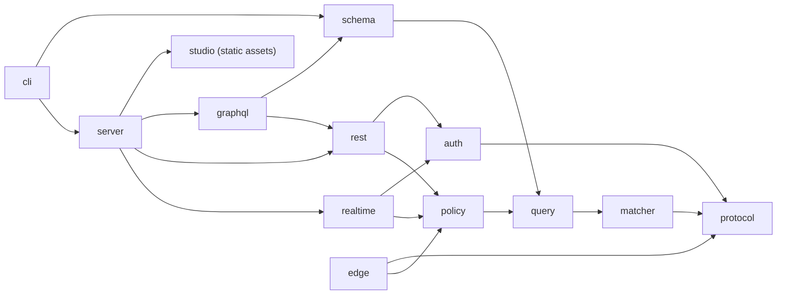

# 11: Engineering

> How the code is organized, built, tested and released. The repository is set up **by hand in Phase 0**: no
> `bun init` and no framework generators. It uses Bun workspaces and TypeScript 6 project references for the
> TypeScript packages, and a Cargo workspace for the Rust data plane.

## 1. Repository layout

The layout as of 2026-11-22. The target layout for the Rust data plane, and which directory moves in which
stage, is proposed in [plan 004 §7](../plans/004-rust-data-plane.md#7-proposed-repository-layout).

```
canopy/
├─ apps/
│  ├─ studio/                 # Canopy Studio (React SPA)
│  └─ docs/                   # Documentation site (Astro Starlight)
├─ packages/
│  ├─ protocol/  matcher/  query/  policy/            # universal core (Web APIs only), synced to Canopy.js
│  ├─ schema/  config/                                # DSLs, schema inference, type generation
│  ├─ realtime/  rest/  graphql/  storage/  node-http/ # TypeScript data path (embedded mode from Phase 5b)
│  ├─ auth/  auth-builtin/                            # AuthProvider contract, Better Auth provider
│  ├─ server/  cli/  studio/                          # composition, `canopy` CLI, Studio assets
│  ├─ native/  wasm/                                  # Node-API and WebAssembly ports of the crates
│  └─ testing/  sdk-e2e/                              # private harnesses
├─ crates/                    # Rust: protocol, matcher, query, policy, engine, port, gateway (14, plan 004)
├─ fuzz/                      # cargo fuzz targets
├─ examples/                  # auth-notes, express-dropin, graphql-vue, next-ssr, todo-react
├─ deploy/                    # compose files, Dockerfiles, Helm chart, Kubernetes manifests, binaries, dev project
├─ docs/                      # design, ADRs, spikes, reviews and work plans
├─ api/                       # public TypeScript API reports
├─ tools/repo-check/          # repository rules, not a workspace member
├─ .changeset/
├─ .github/                   # workflows, CODEOWNERS, issue and PR templates
├─ biome.json
├─ bun.lock                   # the only JavaScript lockfile
├─ Cargo.toml  Cargo.lock     # Rust workspace and its lockfile
├─ package.json               # workspaces, catalogs and scripts
├─ tsconfig.base.json         # shared compiler options (TS 6)
├─ tsconfig.json              # solution file: references every package
└─ turbo.json                 # task graph and caching
```

The client SDK and framework bindings live in the separate Canopy.js repository
([ADR-0016](../adr/0016-canopy-js-and-container-services.md)).

## 2. Package dependency graph



Arrows mean "depends on". The client (`canopy.js`, its own repository) vendors `protocol` and `matcher` and
never depends on `policy`: DLS is enforced on the server only. Universal packages have **no runtime
dependencies** outside the workspace. The crates keep the same layering
(`protocol ← matcher ← query ← policy ← engine`), and the data plane crates sit on top of it
([14 §4.1](14-native-core.md#41-crates)).

## 3. TypeScript 6 configuration

`tsconfig.base.json`:

```jsonc
{
  "compilerOptions": {
    // Emit and module semantics
    "module": "nodenext",
    "moduleResolution": "nodenext",
    "moduleDetection": "force",
    "verbatimModuleSyntax": true,
    "isolatedModules": true,
    "erasableSyntaxOnly": true,               // no enums, namespaces or parameter properties: Node type stripping and TS 7 friendly
    "rewriteRelativeImportExtensions": true,  // sources import './x.ts'; emitted as './x.js'
    "resolveJsonModule": true,
    "declaration": true,
    "declarationMap": true,
    "sourceMap": true,
    "composite": true,
    "incremental": true,
    "types": [],                              // the TS 6 default, stated explicitly; packages opt in

    // Type checking ("strict" is the TS 6 default; repeated for readers)
    "strict": true,
    "noUncheckedIndexedAccess": true,
    "exactOptionalPropertyTypes": true,
    "noImplicitOverride": true,
    "noImplicitReturns": true,
    "noFallthroughCasesInSwitch": true,
    "noPropertyAccessFromIndexSignature": true,
    "noUncheckedSideEffectImports": true,     // the TS 6 default
    "skipLibCheck": true,
    "forceConsistentCasingInFileNames": true
  }
}
```

| Variant | Used by | Overrides |
|---|---|---|
| `tsconfig.server.json` | realtime, rest, graphql, auth, schema, server, cli, testing | `target`/`lib`: `es2025` (the TS 6 default target; Bun and the Node 24 floor support it), `types: ["node"]` (the `node:` APIs every supported runtime implements; Bun adapter modules add `"bun"`) |
| `tsconfig.universal.json` | protocol, matcher, query, policy, client | `target: es2022`, `lib: ["es2022", "webworker"]` (Web-standard globals only: no DOM, no Node), `types: []`, `isolatedDeclarations: true` |
| `tsconfig.web.json` | react, vue, svelte, solid, studio | `module: esnext`, `moduleResolution: bundler`, `lib: ["es2023", "dom", "dom.iterable"]`, `jsx: react-jsx` where relevant |
| `tsconfig.edge.json` | edge | `lib: ["es2023"]`, `types: ["@cloudflare/workers-types"]` |

**Rules:**

- No options deprecated in TS 6.0, and no `ignoreDeprecations`. That means no `baseUrl`, no
  `moduleResolution: node`/`node10`/`classic`, no `outFile`, no `target: es5`, no AMD/UMD/System modules.
- `rootDir` is always set explicitly. TS 6 defaults it to the tsconfig's directory.
- `tsc -b` at the root type-checks and emits every package in dependency order.

## 4. Runtime and build matrix

| Package group | Build | Output | Runtimes tested |
|---|---|---|---|
| Universal (protocol, matcher, query, policy) | `tsc -b` | ESM + `.d.ts` | Bun, Node 24/26 (PR); Deno, workerd (nightly) |
| Server (realtime, rest, graphql, auth, schema, server, cli) | `tsc -b` | ESM + `.d.ts` | Bun, Node 24/26 (PR); Deno (nightly) |
| Client + bindings | In the Canopy.js repository: `tsc -b` for types; **tsdown** (Rolldown) for size-optimized ESM bundles | ESM + `.d.ts` | Bun, Node 24/26, Deno, Chromium/Firefox/WebKit (Playwright), React Native (smoke) |
| Studio | Vite | Static assets copied into `@canopy/server` | Playwright |
| Edge | Wrangler | Worker bundle | `@cloudflare/vitest-pool-workers` (workerd) |
| Rust crates and ports (Phase 5) | `cargo build`; napi-rs for `@canopy/native`; wasm-bindgen for `canopy-wasm` | Node-API binaries for 8 targets, WebAssembly, the static `canopy-gateway` binary | Bun, Node 24/26 (PR); Deno, workerd, every cross target (nightly). Details in [14 §6](14-native-core.md#6-platforms-toolchain-and-distribution) and [14 §7](14-native-core.md#7-engineering-changes) |
| Data plane (Phase 5b) | `cargo build --release` per target; carried by the CLI as optional platform packages | The `canopyd` binary for 8 targets, the `canopy` image | Every target (release); the TypeScript suites against it on Linux, Windows and macOS (PR) |
| Container | TypeScript images: multi stage Dockerfile, `bun install --production`, then a distroless Bun base (plus a Node variant). Data plane image: the static musl binary on a distroless base | Images | Smoke tests in CI |

Every row that names Bun, Node or Deno is tested on **Linux, Windows and macOS**
([01 §8](01-architecture.md#8-runtime-strategy)): Bun and Node 24/26 on all three on every PR, Deno on all three
nightly. The container row is Linux only (amd64 and arm64).

Development runs `.ts` sources directly: natively on Bun, and through Node's built in type stripping (unflagged
since Node 22.18 and 23.6) on Node. This works because sources only use erasable syntax. Published artifacts are always compiled by
`tsc`.

## 5. Coding standards

- **ESM only.** No CommonJS output. Node 20.19+ and 22.12+ can `require()` ESM, so CommonJS consumers still
  work.
- **Errors:** one `CanopyError` hierarchy with stable `code` values that match [04 §7](04-wire-protocol.md#7-errors-and-close-codes).
  Never throw strings. `catch (e: unknown)` is narrowed explicitly.
- **No `any`** (lint error). No non-null assertions in library code. `unknown` at trust boundaries, and Zod or
  hand-written validators before use.
- **Async hygiene:** no floating promises (lint), `AbortSignal` on every public async API that can block, and
  `await using` / `Symbol.asyncDispose` for resources where the runtime supports it. The MongoDB driver v7
  exposes it on clients, sessions, cursors and change streams.
- **Hot-path discipline** (matcher, fan-out, codec): avoid megamorphic call sites and per-event closure
  allocation, and serialize each payload once. Microbenchmarks (`tinybench` or `mitata`) live next to the
  code and are tracked in CI.
- **Lint with Biome, format with `bun fmt`.** A thin typescript-eslint pass is used only for type-aware rules Biome doesn't
  cover yet, if any are needed. Both run in CI and through a pre-commit hook (lefthook).
- **Public APIs** carry TSDoc comments. The docs site generates API reference pages from them (TypeDoc → MDX).
- **Dependencies:** licenses must be MIT, Apache-2.0, BSD or ISC. Server packages need a written justification
  for each new dependency. The default install has no native dependencies; the uWebSockets.js adapter is
  optional.
- **Rust** follows the same rules, as set out in [14 §7](14-native-core.md#7-engineering-changes): rustdoc on
  every public item, no `unwrap`, `expect` or `panic!` in library code, `#![forbid(unsafe_code)]` outside the
  ports, one error enum per crate mapped to the stable `CanopyError` codes, `cargo deny` on licenses.

## 6. Testing strategy

| Layer | Tooling | Scope | When |
|---|---|---|---|
| Unit | Vitest | Parsers, compiler, codecs, store logic | Every PR |
| Property-based | fast-check | Round-trips, rebase convergence, invariants I1 to I6 ([09 §4.2](09-security.md#42-policy-engine)) | PR (short), nightly (long) |
| **Differential** | Vitest + Testcontainers against MongoDB 7.0, 8.0 and the latest 8.x | Matcher, updater, sort order and policy compile vs real MongoDB on generated documents and queries | PR (subset), nightly (full) |
| Integration | Testcontainers / `mongodb-memory-server` (replica set) | REST, realtime, auth flows, transactions | Every PR |
| **Deterministic simulation** | Custom seeded harness ([03 §17](03-realtime-engine.md#17-testing-the-engine)) | Realtime guarantees G2 to G5 | PR (100 seeds), nightly (10k seeds) |
| Conformance | Protocol vectors | SDKs and gateways | Every PR |
| **Data plane equivalence** | The TypeScript route as the reference, request and response pairs, the cross entry point DLS test | Each Rust route against its TypeScript counterpart: byte identical deterministic responses, equal errors by contract ([14 §8.1](14-native-core.md#81-data-plane-stages)) | PR (subset), nightly (full) |
| End-to-end | Playwright | SDK in browsers, Studio, examples, multi-tab, multi-user | PR (smoke), nightly (full) |
| Chaos | Toxiproxy, `rs.stepDown()`, process kills, a tiny oplog | Resume and resync, no lost updates | Nightly |
| Performance | k6, `ws-loadgen` | Targets in [10 §7](10-operations.md#7-performance-targets-and-benchmarking) | Nightly and per release |
| Security | Bypass corpus, fuzzers, CodeQL, ZAP | [09 §5](09-security.md#5-security-testing-program) | PR and nightly |
| Mutation | Stryker on policy, query and matcher | Test-suite strength on security-critical code | Weekly |

**Coverage goals:** universal packages ≥ 95 % of lines and branches, server packages ≥ 85 %, and a mutation
score ≥ 80 % on policy, query and matcher.

## 7. CI/CD

- **Every PR** (GitHub Actions):
  1. `bun install --frozen-lockfile` (cached);
  2. Biome;
  3. `tsc -b`;
  4. unit and property tests on Bun and Node 24 and 26, on Linux, Windows and macOS;
  5. integration tests against a MongoDB replica set, on Bun and Node, on Linux (a Docker service) and on
     Windows and macOS (a single node replica set started from the official MongoDB server binaries, since
     hosted macOS runners have no Docker and Windows runners only run Windows containers);
  6. a short simulation run;
  7. protocol vectors;
  8. a Playwright smoke test;
  9. an install and smoke test of the packed packages with Bun, pnpm, Yarn and npm, including the `canopy`
      and `canopy-realtime` binaries, on Linux, Windows and macOS;
  10. a docs build;
  11. a check that a changeset is present.

  Turborepo remote caching keeps the run under 10 minutes.

  **MongoDB 8 and new Linux kernels.** MongoDB 8.x refuses to start on Linux kernels from 6.19 up to (not
  including) 7.0.14, because its bundled TCMalloc breaks the rseq ABI there (SERVER-121912). The hosted
  `ubuntu-24.04` runners boot such a kernel as of November 2026, so the Linux jobs that run MongoDB 8 in
  Docker use `ubuntu-22.04` (kernel 6.8) until the runners ship 7.0.14 or newer; the arm64 job runs
  MongoDB 7.0. Developers on an affected Linux kernel hit the same wall with `bun run db:up`
  (`CANOPY_MONGO_IMAGE=mongo:7.0.45` works there).
- **Nightly:**
  - the full MongoDB matrix (7.0, 8.0, latest; replica set and sharded);
  - long fuzz and property runs;
  - chaos and performance tests;
  - Deno jobs on Linux, Windows and macOS (the full suite except the Studio app, a browser app, through
    Vitest's thread pool with a small setup file that fills in a worker API Deno lacks), and the workerd
    job;
  - the example end to end tests on Windows and macOS, and an Alpine (musl) and arm64 Linux job;
  - the **TS 7 compatibility job** (§11);
  - a ZAP baseline scan.
- **Release:** the Changesets "version packages" PR is merged, then:
  - npm publishing with provenance (OIDC trusted publishing);
  - multi-arch images pushed to GHCR, signed with cosign, with an SBOM attached;
  - a GitHub Release with notes;
  - a docs deploy.
- **Canary:** every merge to `main` publishes `@canopy/*@canary` and `:canary` images.

## 8. Releases and versioning

- Before 1.0, all `@canopy/*` packages share **one fixed version** (a Changesets fixed group), so compatibility
  is never in doubt. Breaking changes are allowed in minor releases, with migration notes.
- From 1.0, strict semver. The protocol version (`canopy.v1`) is independent of package versions
  ([04 §3](04-wire-protocol.md#3-versioning-and-negotiation)).
- Cadence: a minor release every two weeks before 1.0, patch releases as needed. Support windows are in
  [13 §7](13-open-source.md#7-release-and-support-policy).

## 9. Documentation and examples

- **Docs site** (`apps/docs`, Astro Starlight):
  - quickstarts for sidecar, embedded and platform modes;
  - concept guides (DLS, realtime guarantees);
  - recipes (pagination, infinite live lists, multi-tenant setups, presence after 1.0);
  - migration guides (Atlas App Services, Parse, Firebase, Socket.IO change-stream setups);
  - the API reference generated from TSDoc;
  - the protocol spec.
- **Examples** are real apps with end-to-end tests in CI, so they never rot: `todo-react`, `chat-nextjs`,
  `saas-multitenant` (tenants, `$ctx`, admin roles), `express-dropin` (sidecar + BYO Auth0), `edge-cloudflare`
  and `expo-app`.

## 10. Contributor experience

- `bun install && bun run dev` starts a MongoDB replica set (Docker Compose), the Canopy server in watch mode, and
  Studio with hot module reload. Seed data comes from `examples/todo-react`.
- A Rust toolchain is optional. Without one, `bun install` and `bun run test:all` run the TypeScript suites
  against the TypeScript engine; data plane work needs the toolchain pinned in `rust-toolchain.toml`.
- A devcontainer is provided. `CONTRIBUTING.md`, the architecture docs (this folder), ADRs and the RFC process
  ([13 §3](13-open-source.md#3-contribution-model)) are linked from the README.
- Issue labels: `good first issue`, `help wanted`, `area/*`, `security` (private), and `rfc`.

## 11. TypeScript 7 readiness

- **Background.** TypeScript 7.0, the Go-native compiler, shipped in July 2026 and is roughly 10× faster. Its
  stable programmatic API is expected in 7.1. Tools that depend on that API (Astro, Vue and Svelte type
  checkers, among others) stay on TS 6 until then.
- **Decision.** Canopy uses TS 6.x as the compiler of record, as decided for this project
  ([ADR-0001](../adr/0001-typescript-6-and-bun.md)). This also matches the docs site (Astro) and the
  Vue/Svelte bindings.
- **Staying ready:**
  - the config uses no deprecated options and only erasable syntax;
  - a nightly CI job type-checks the repository with TS 7 and compares the emitted `.d.ts` for published
    packages (using `--stableTypeOrdering` on the TS 6 side to reduce noise);
  - developers may use TS 7 locally for speed, without blocking anything.
- **Switch criteria:**
  - TS 7.1 or later with a stable API;
  - the Astro, Vue and Svelte checkers support it;
  - the published `.d.ts` output is identical;
  - an RFC is approved.
