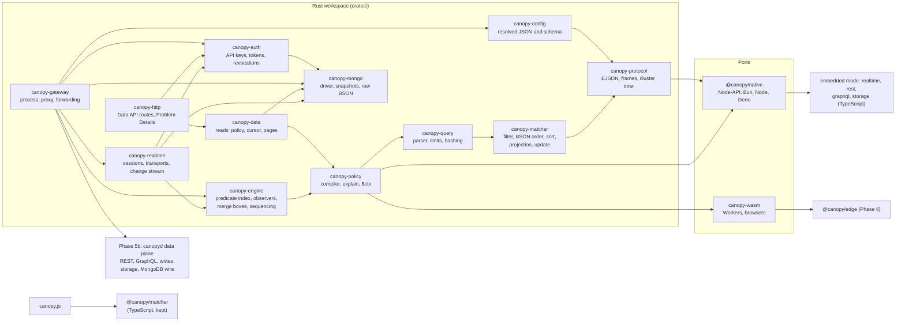

# 14: Native core and data plane in Rust

> **Status (2026-11-20):** Phase 5 ([12 §3.5](12-roadmap.md#35-phase-5-native-core-in-rust--v06-10-weeks))
> has three implemented port stages awaiting acceptance evidence. The initial spikes are recorded and the
> native read path is cut at its performance gate. See [§8](#8-stages-and-gates) for the remaining work.
> Decision: [ADR-0014](../adr/0014-rust-native-core.md).
>
> **Amended 2026-11-22 ([ADR-0017](../adr/0017-rust-data-plane.md)):** the maintainer chose a Rust data plane
> for every data path. REST, GraphQL, the write path and storage move to Rust in Phase 5b
> ([12 §3.5b](12-roadmap.md#35b-phase-5b-native-data-plane--v07-12-weeks)) through the stages of
> [§8.1](#81-data-plane-stages). The execution plan is [plan 004](../plans/004-rust-data-plane.md).

## 1. Why, and the rule that bounds it

Supabase is not one language. Its self hosted stack runs Realtime and Supavisor on Elixir, the REST API on
Haskell (PostgREST) and its Edge Runtime on Rust (built on `deno_core`), while TypeScript lives at the edges: the
SDKs, Studio and the CLI. Each service is written in the language that fits its job.

Canopy is TypeScript end to end today ([ADR-0001](../adr/0001-typescript-6-and-bun.md)). That was the right
start: one language let the matcher, the policy compiler and the client share code, and the differential
suites keep that code honest. It also puts the hottest loops of the system (decoding every change event,
matching it against every candidate subscription, writing it to every socket) on a single garbage collected
thread.

This plan moves the **data plane** to Rust and keeps the **developer surface and control plane** in
TypeScript:

- **Rust** for every request that reads or writes application data, from the socket to MongoDB and back:
  change stream decoding, matching, the predicate index, merge boxes and fan out (Phase 5), then the REST
  and GraphQL handlers, the transactional write path, storage and the MongoDB wire endpoint (Phase 5b,
  [ADR-0017](../adr/0017-rust-data-plane.md)). One owner per request removes the loopback hop and the per
  document language crossing that capped stage 4.
- **TypeScript** for what developers write and touch, and for work that changes often with the product or
  must run in a browser: `canopy.js` and its bindings, the policy, schema and config DSLs, type generation,
  the CLI, Studio, and the control plane service (built in auth, the admin API, policy publishing,
  migrations, webhooks). The TypeScript data packages stay as embedded mode and as the equivalence reference.

Phase 5 first kept the request handlers in TypeScript because S3 found them bound by MongoDB round trips.
Stage 4 and S3 together showed that this was not the whole story: the CPU of a request sits in the
JavaScript driver, in BSON handling and at the boundary between languages, and only a single Rust owner
removes all three.

Two rules bound every port:

1. **Measure, then port.** A component moves to Rust only when a gate in §8 shows a measured gain on the same
   hardware. A port that misses its gate is dropped, not shipped "for later".
2. **One semantics.** The Rust and TypeScript versions of anything that touches DLS are proven equivalent
   (§5) before the Rust one becomes the default. A DLS bypass is still the worst possible bug, and a second
   implementation is a new way to write one.

## 2. What the measurements say today

| Evidence | Source | What it means for Rust |
|---|---|---|
| A transactional update costs **1.78 ms of CPU** and one process saturates at **about 640 writes/s**. Canopy's own packages are **4.5 %** of CPU; the driver is 15 %, `bson` 6 %, socket writes 5 %. | [S3](../spikes/S3-write-path-cost.md) | Porting the policy or query code would not make REST writes faster. The cost is the JavaScript driver, BSON handling and MongoDB round trips. |
| The compiled matcher runs at **8 % to 59 %** of the speed of a hand written JavaScript predicate on the same documents. | `bench/baselines/matcher/baseline.json` | The matcher runs once per change event and candidate subscription. It is the inner loop of realtime and has a lot of headroom. |
| At 1k connections, delivery p50 is within **10 % to 17 %** of a plain change stream. | `bench/baselines/realtime/baseline.json` | Fine at small scale. Behaviour at 10k to 100k connections has never been measured ([S5](../spikes/S5-websocket-server-choice.md)). |
| Change events and snapshots are read with `promoteValues: false`, so every number becomes a wrapper object, and every event is fully materialized before the predicate index can reject it. | `packages/realtime/src/snapshot.ts`, `packages/rest/src/driver.ts` | Allocation per event grows with document size, not with how much of it a predicate reads. Raw BSON with lazy field access removes that. |
| The memory targets (≤ 32 KiB per idle connection, ≤ 4 KiB per subscription) and the 100k connection goal of the scale phase are unmeasured. | [10 §7](10-operations.md#7-performance-targets-and-benchmarking) | Memory per connection is where a garbage collected runtime pays the most and Rust the least. |
| Storage already ships a Rust image library through Node-API (`@napi-rs/image`), with prebuilt binaries for every supported platform. | `packages/storage/package.json` | The distribution model in §6 already works in this repository. |

## 3. Where Rust pays, and where it does not

| Component | Shape of the work | Expected gain | Verdict |
|---|---|---|---|
| Change stream ingestion and event decoding | Per event, allocation heavy | **High.** Raw BSON, lazy field access, no garbage collector | Port (gateway, §4.3) |
| Predicate index, event matching, visibility transitions, merge boxes | Per event and candidate | **High.** Compiled predicates over raw documents | Port (`canopy-engine`) |
| WebSocket fan out, encode once, backpressure | Per connection and frame | **High.** Memory per connection, no collection pauses in p99 | Port (gateway) |
| Policy compiler (MongoDB filter and matcher forms), query parser, canonical hashing | Per policy version or new query, then cached | **Low** for speed, **required** for correctness: the gateway needs it, and two compilers that drift are a DLS risk | Port, and make Rust the server's source of truth |
| EJSON and wire protocol codec | Per frame and per REST response | **Medium.** Raw BSON to EJSON text in one pass, without building JavaScript objects | Port; REST read path use is gated (stage 4) |
| REST and GraphQL handlers, the transactional write path, idempotency | Round trips plus the JavaScript driver, BSON and a loopback hop (S3, stage 4) | **Medium to high** once one Rust owner holds the whole request; **none** through a per document port | Port as whole routes in Phase 5b (§8.1, stages D1 to D3) |
| Auth: JWT verification, API keys, revocations | Per request; already in the gateway | **Medium** | Done in the gateway; the data plane reuses it |
| Auth: Better Auth flows, sessions, key issuance | Product logic, not per request | **None** | Keep in TypeScript, in the control plane |
| Storage: policies, metadata, object streaming, image transformations | Per byte for transfers; image work already Rust | **Medium** | Port in Phase 5b (D4) |
| Edge Durable Objects (DLS on relayed events) | Billed by CPU time, 128 MB memory per isolate | **Medium** | WebAssembly build of the core, decided with the S8 calibration in Phase 6 |
| Client SDK, framework bindings, Studio, docs site, CLI, config, the control plane | Browser code or product logic | **None, or negative.** WebAssembly in the SDK adds download size and an asynchronous start | Keep. The client keeps the TypeScript matcher: on the client it only predicts optimistic results and is not a security boundary |
| Functions runtime (the counterpart of Supabase's Edge Runtime) | User code in isolates | Not a speed question | Out of scope for Phase 5. Functions are HTTP endpoints today (plan 002 F5). A `deno_core` based runtime is listed after 1.0 ([12 §8](12-roadmap.md#8-after-10)) |
| Canopy's own outbound MongoDB wire client | Replaces the official driver | **None** for network hops; unmeasured for CPU | Not planned. The official Rust driver with raw BSON cursors and pushed down filters stays ([plan 004 §4](../plans/004-rust-data-plane.md#4-working-close-to-mongodb-on-docker-and-on-atlas)) |

## 4. Target architecture

### 4.1 Crates

The Rust crates under `crates/` share a Cargo workspace. The core follows the TypeScript layering from
protocol through matcher, query, policy and engine. These crates perform no I/O and build for native targets
and WebAssembly. The native server composes them with the configuration, realtime, MongoDB and authentication crates.

| Crate | Ports from | Content |
|---|---|---|
| `canopy-protocol` | `@canopy/protocol` | EJSON (canonical and relaxed) to and from raw BSON, wire protocol v1 frames, cluster time, close codes, the `CanopyError` codes. The codes are generated from one shared source so the two languages cannot disagree. |
| `canopy-matcher` | `@canopy/matcher` | Filters compiled to closures over `RawDocument`, BSON ordering (numeric comparison across int32, int64, double and Decimal128 ported from `numeric.ts`), sort, projection, the update engine, regular expressions (a port of the TypeScript engine, see stage 1 in §8). |
| `canopy-query` | `@canopy/query` | Parser, allowlists, limits, canonical hashing. Hashes are byte identical to the TypeScript ones, checked by vectors. |
| `canopy-policy` | `@canopy/policy` | The stored policy format read from the meta database, the compiler to both forms, explain, field rules, `$ctx` lookups, immutable fields. Policy linting stays TypeScript (tooling, not a hot path). |
| `canopy-engine` | the core of `@canopy/realtime` | Predicate, membership and path indexes, observers, merge boxes, per connection sequencing, resume buffers, echo correlation. No I/O: it consumes normalized events and emits frames, so the simulation suite can drive it directly. |
| `canopy-mongo` | `canopy-gateway` | MongoDB driver, snapshot sessions, raw BSON cursors, stored policy loading and change stream checkpoints. |
| `canopy-auth` | `canopy-gateway` | JWT and JWKS verification, API keys, revocations and Studio view tokens. |
| `canopy-realtime` | `canopy-gateway` | WebSocket, SSE and long polling transports, session routing and MongoDB change stream ingestion. |
| `canopy-config` | `canopy-gateway` | Resolved data plane configuration, the JSON parser and its [JSON Schema](../../crates/canopy-config/schema/config.schema.json). |
| `canopy-data` | `@canopy/rest` (read path) | Read execution of `find`: caller, read policy and field rules, `$ctx` lookups, limits, the keyset cursor, one `find` per page on raw BSON, EJSON encoding. |
| `canopy-http` | `@canopy/rest` (handler) | The Data API routes over plain request and response types (no server): authentication, negotiation, `ETag`, Problem Details. Checked against `conformance/http/find`. |
| `canopy-gateway` | the `canopy-realtime` binary | Native server process, CLI and environment, client addresses, reverse proxy and mutation forwarding (§4.3). |

Phase 5b begins by extracting `canopy-mongo`, `canopy-auth`, `canopy-realtime` and `canopy-config` from `canopy-gateway`. The
remaining data plane crates and the `canopyd` binary rename are proposed in
[plan 004 §7](../plans/004-rust-data-plane.md#7-proposed-repository-layout).

### 4.2 Ports

A "port" is a library that exposes the crates to another language. Phase 5 builds two:

- **`@canopy/native`** (Node-API through napi-rs). One npm package with a prebuilt optional dependency per
  platform (§6) and a WebAssembly (`wasm32-wasip1-threads`) fallback package for any platform without one.
  Bun and Node load Node-API addons natively; Deno loads them with `--allow-ffi` and otherwise falls back to
  WebAssembly. It exposes the policy compiler, the matcher for events, query canonicalization and the EJSON
  codec, with batch entry points so that one call crosses the boundary per batch of events, not per document.
- **`canopy-wasm`** (`wasm32-unknown-unknown` through wasm-bindgen) for Cloudflare Workers and any browser
  tool that needs the exact server semantics (Studio's policy simulator, for one). Phase 5 builds and tests
  it; the edge starts using it in Phase 6.

The TypeScript server packages keep their public APIs. Inside, `realtime`, `rest`, `graphql` and `storage`
choose an engine: `native` (the Node-API port), `wasm` (its fallback) or `ts` (the current code). The
default stays `ts` until the gates of §8 pass, then becomes `native`. The `ts` engine is kept through 1.0 as
the escape hatch, as the reference of the equivalence suites, and so that a contributor without a Rust
toolchain can still run `bun install` and `bun run test:all` (Q11 in [12 §7](12-roadmap.md#7-open-questions)).
From Phase 5b these packages are embedded mode for Node applications and the reference of the data plane's
equivalence suites; the deployed services use the Rust data plane ([ADR-0017](../adr/0017-rust-data-plane.md)).

The same crates make later ports cheap: UniFFI for the Swift and Kotlin SDKs and PyO3 for a Python server
library, both after 1.0.

### 4.3 The native gateway

`canopy-gateway` is a drop in replacement for the `canopy-realtime` sidecar, speaking wire protocol v1
unchanged, so every SDK and binding works against it without a release of their own.

- **Runtime:** Tokio, Hyper, and a WebSocket library chosen in S11 by throughput, memory per connection and
  license.
- **MongoDB:** the official Rust driver (`mongodb` crate, Apache 2.0). One change stream per deployment, as
  [ADR-0004](../adr/0004-single-change-stream-in-process-matching.md) requires, with the same `auto`,
  `updateLookup` and `images` modes and the same checkpoints in `canopy.checkpoints`. Snapshots at a known
  cluster time as in [S2](../spikes/S2-snapshot-cluster-time.md); S12 checks the driver exposes what that
  needs.
- **Auth:** JWT verification through JWKS, API key lookup, revocations through the existing revocation
  collection, and the rate limits of the sidecar. These are small but security relevant, so the gateway is in
  the scope of the outside audit.
- **Writes are forwarded until stage D2.** A `mut` frame goes to the TypeScript write path (REST, with the
  caller's credentials), which keeps one implementation of transactional `check` enforcement and idempotency.
  The gateway holds the `ack` until the change events of that mutation are delivered, which keeps
  echo before ack ([ADR-0007](../adr/0007-cluster-time-reconciliation.md)). Stage D2 of §8.1 moves the write
  path itself into Rust and ends the forwarding; the edge keeps delegating writes to the core
  ([ADR-0010](../adr/0010-edge-is-fanout-only.md)).
- **Config:** the config file is TypeScript, which Rust cannot evaluate. `canopy-server` (the control plane
  after stage D6, and `canopy dev`) resolves it and starts the gateway as a child process with the resolved
  config as JSON on standard input. Standalone, the gateway reads the same JSON or the environment variables
  the sidecar reads today. In Phase 5b the JSON gets a schema of its own (`canopy-config`), so both languages
  validate the same document.
- **Deployment:** in the all in one image, either the gateway owns the public port, serves `/realtime/v1`
  and proxies every other path to the TypeScript server on loopback, or the ingress routes `/realtime/v1` to
  the gateway's own port. S11 decides; both keep a single public origin. In Phase 5b each promoted route stops
  being proxied, and after stage D6 only control plane paths (`/auth/v1`, `/admin`) leave the data plane.
- **Hub mode (Phase 6):** gateways are the gateway nodes of [03 §13](03-realtime-engine.md#13-scaling-out),
  consuming the bus instead of a change stream.

## 5. One semantics in two languages

The guarantees of [02](02-document-level-security.md) and the invariants I1 to I6 of
[09 §4.2](09-security.md) must hold for both implementations. MongoDB remains the oracle.

- **Three way differential.** The differential harness in `@canopy/testing` runs every generated filter,
  update, sort and projection against MongoDB, the TypeScript matcher and the Rust matcher (through
  `@canopy/native`). Gate: 0 mismatches at the nightly volume (1M cases per operator).
- **Shared vectors.** Generated cases and their MongoDB results are committed as JSON vectors that
  `cargo test` runs without Node or MongoDB, so a Rust only change is checked on every pull request.
- **Compiler equality.** For generated policy sets and callers, both compilers produce byte identical MongoDB
  filters (canonical EJSON) and identical matcher decisions. Any difference fails, even when both happen to
  return the same documents.
- **Protocol.** The vectors in `conformance/protocol/` run through the Rust codec and the gateway;
  frames are byte identical.
- **Realtime.** The seeded simulation (10k seeds nightly) and the chaos tests (step down, kill) run against
  the gateway as well as the TypeScript engine. The cross entry point test
  (`packages/server/test/dls-equivalence.test.ts`) adds the gateway as a fourth entry point.
- **Properties and fuzzing.** The invariants run as `proptest` properties in Rust; `cargo fuzz` targets
  cover EJSON, filter, update and regex parsing and frame decoding, nightly, next to the existing TypeScript
  fuzzers.
- **Fail closed in Rust.** Core crates use `#![forbid(unsafe_code)]`; only the port crates contain generated
  unsafe code. Library code never calls `unwrap`, `expect` or `panic!` (Clippy denies them). A panic that
  still happens is caught at the port boundary and becomes a `CanopyError`, which denies; in the gateway it
  closes the affected subscription with `resync`, never delivers the event.
- **Mutation testing** (Stryker today) gains `cargo mutants` on `canopy-matcher` and `canopy-policy`.

## 6. Platforms, toolchain and distribution

The platform promise of [01 §8](01-architecture.md#8-runtime-strategy) does not change: nothing a user installs
may require a Rust toolchain, and every supported platform gets a prebuilt binary.

| Target | Node-API port | Gateway binary |
|---|---|---|
| Windows x64 and arm64 (MSVC) | yes | yes |
| Linux x64 and arm64, glibc | yes | yes |
| Linux x64 and arm64, musl (Alpine) | yes | yes (static, used by the container image) |
| macOS x64 and arm64 | yes | yes |
| Anything else, and Deno without `--allow-ffi` | WebAssembly fallback | not shipped |
| Cloudflare Workers, browsers | `canopy-wasm` | not applicable |

- **Toolchain:** stable Rust pinned in `rust-toolchain.toml`, edition 2024, with a stated minimum supported
  version. Cross builds for musl and Windows arm64 are settled in S10.
- **Install:** the install test (plan B4) covers `@canopy/native` with Bun, pnpm, Yarn and npm on Linux,
  Windows and macOS, and checks that a missing native package falls back to WebAssembly instead of failing.
- **Single binary:** S10 checks that `bun build --compile` embeds the addon in the `canopy` executable
  ([S9](../spikes/S9-single-binary.md)).
- **Images:** the container image gains the static musl gateway. A `canopy-gateway` image is published next
  to `canopy` and `canopy-realtime`, signed and with an SBOM like them.
- **Licenses:** `cargo deny` enforces the same allowed set as npm (MIT, Apache 2.0, BSD, ISC) on everything
  a published artifact links. Some common crates also carry Unicode 3.0 or CDLA Permissive 2.0 (root
  certificates); each needs the maintainer's decision, as BlueOak did for Stryker (Q12).

## 7. Engineering changes

- **Layout:** `crates/` next to `packages/`, with the root `Cargo.toml` (workspace), `Cargo.lock` (the Rust
  lockfile; `bun.lock` stays the only JavaScript lockfile), `rust-toolchain.toml`, `deny.toml` and
  `clippy.toml`. Port crates live beside their npm package (`packages/native/` holds the napi crate and the
  JavaScript loader).
- **Standards:** the code rules of `CLAUDE.md` apply to Rust as written: no unneeded comments, rustdoc on
  every public item (`missing_docs` denied), no punctuation dashes, MongoDB vocabulary, real tests. Errors use
  one `thiserror` enum per crate mapped to the stable `CanopyError` codes. `rustfmt` and Clippy with
  `-D warnings`.
- **Checks:** `tools/repo-check` learns the Cargo workspace (every crate listed, `publish = false`, license
  set, dashes in `.rs` files). `bun run check` gains `cargo fmt --check`, `cargo clippy` and `cargo test`
  when a Rust toolchain is present.
- **CI on every pull request:** fmt, Clippy, tests and `cargo deny` on Linux, Windows and macOS; the
  TypeScript suites once with `engine: "ts"` and once with `engine: "native"`; the three way differential at
  pull request volume. **Nightly:** every cross target of §6, the WebAssembly builds under Node and workerd,
  `cargo fuzz`, `cargo mutants`, and the gateway benchmarks with their gates.
- **Builds:** Turborepo gets a `build:native` task, cached like the others. Crates are not published to
  crates.io before 1.0; the npm packages and binaries carry the versions, through Changesets as today.
- **Benchmarks:** the existing matcher, fan out and REST benchmarks run against both engines and gate the
  ratios of §8 with `packages/testing/scripts/bench-gate.ts`.

## 8. Stages and gates

Phase 5 is ten weeks with the three person team of [12 §1](12-roadmap.md#1-assumptions): engineer A leads the
engine and gateway, B the policy and query crates and their equivalence suites, C the ports, distribution and
install tests. Stages overlap where the dependencies allow.

| Stage | Weeks | Delivers | Gate (all on the reference hardware of [10 §7](10-operations.md#7-performance-targets-and-benchmarking)) |
|---|---|---|---|
| 0. Spikes | 1 to 2 | S10, S11 and S12 ([12 §4](12-roadmap.md#4-technical-spikes)) | Go or no go recorded for each. A no go on S11 ends stage 3 and keeps the TypeScript engine. |
| 1. Core crates | 2 to 5 | `canopy-protocol`, `canopy-matcher`, `canopy-query`; the shared vectors; the regex engine decision (the `regex` crate behind a translator as in TypeScript, `fancy-regex`, or PCRE2 itself, which is MongoDB's own engine) | Three way differential at 0 mismatches over 1M cases per operator. Rust matcher at least 3 times the events per second of the TypeScript matcher on every matcher benchmark scenario. |
| 2. Policy and the Node-API port | 4 to 7 | `canopy-policy`; `@canopy/native` with the WebAssembly fallback; the `engine` option in `realtime`, `rest`, `graphql` and `storage` | Compiler equality on the generated corpus. The full suite, the bypass corpus and the I1 to I6 properties green with `engine: "native"` on Bun and Node, on Linux, Windows and macOS. Install test green with all four package managers. |
| 3. Native gateway | 6 to 10 | `canopy-engine`, `canopy-gateway`: subscribe, snapshot, stream, resume, resync, forwarded mutations with echo before ack, auth, limits, metrics, `/healthz` and `/readyz` | Protocol vectors, 10k simulation seeds and the chaos tests green; the gateway in the DLS equivalence test. At 10k connections, 50k subscriptions and 1k events/s: fan out p99 ≤ 25 ms using at most half the CPU of the TypeScript engine, and ≤ 8 KiB per idle connection. |
| 4. Native read path | 8 to 10 | Raw BSON from the driver encoded to EJSON text by `canopy-protocol` on the REST and GraphQL read paths | REST simple read throughput per vCPU at least 1.5 times the TypeScript path with identical response bytes. Otherwise dropped. |

**Stage 0 status (2026-11-19).** All three spikes are recorded: [S10](../spikes/S10-ports-and-distribution.md)
go for `@canopy/native` with a batch shaped API, [S11](../spikes/S11-native-gateway.md) a conditional go for
stage 3, [S12](../spikes/S12-rust-driver-fidelity.md) go for every driver capability the gateway relies on.

**Stage 1 status (2026-11-19).** `canopy-protocol`, `canopy-matcher` and `canopy-query` are built, with shared
vectors that `cargo test` replays and the three way differential in CI and nightly. Regular expressions: the
crate ports the TypeScript engine (a linear time Pike VM over code points that accepts the RE2 subset of
PCRE and refuses backtracking features) instead of the `regex` crate, `fancy-regex` or PCRE2, so both
languages accept and refuse exactly the same patterns and no new dependency enters the matcher. The speed
gate holds on a Windows x64 laptop (Ryzen 5 5600H, Node 26, not yet the reference hardware): the Rust matcher
is 3.8 to 5.1 times the TypeScript one per change event and 5.7 to 10.2 times in batches of 1000
(`bun --filter @canopy/bench matcher:events`, gated by the floors in `bench/baselines/matcher/event-baseline.json`).

**Stage 2 status (2026-11-19).** `canopy-policy` and `@canopy/native` (Node-API with the
`wasm32-wasip1-threads` fallback) are built; compiler equality runs in `cargo test` and in the port's tests,
and CI runs the suites with `engine: "native"` and `engine: "wasm"` and the install test with all four package
managers. The engine is chosen once by the server (`server.engine` or `CANOPY_ENGINE`): realtime takes it as
an option, while `rest`, `graphql` and `storage` receive the policy engine it creates, so none of them needs an
option of its own until stage 4 gives REST a native codec. `canopy-wasm` is built (`packages/wasm`,
`@canopy/wasm`, through wasm-bindgen) on `canopy-port`, the crate that holds what both ports do at the
boundary, and the port tests run it under Node beside the addon and the WASI fallback; running it in workerd is
still open. `cargo fuzz` covers EJSON, BSON, filters, updates, regular expressions and client frames nightly
(`fuzz/`), each target with a property beyond not panicking.

**Stage 3 status (2026-11-19).** `canopy-engine` and `canopy-gateway` are built; the conformance, chaos and DLS
equivalence suites run on them and on the TypeScript engine. On Linux (not yet the reference hardware) the
gateway meets the performance gate: p99 21.4 ms, 30 % of the TypeScript engine's CPU per event, and 6.2 to
6.7 KiB per idle connection. A broadcast frame costs it what it costs `Bun.serve`, so S11's broadcast condition
is not met. Details in the [S11 addendum](../spikes/S11-native-gateway.md#addendum-stage-3-on-linux).

**Stage 4 status (2026-11-20): gate not met, TypeScript read path kept.** Before building the native read path,
its ceiling was measured: the client CPU of reading a page through the official driver and encoding it as
relaxed EJSON, once as REST does today (decoded documents, `encode`, `JSON.stringify`) and once from raw BSON
(`raw: true`) through `bsonToEjson` of `canopy-protocol`. HTTP, policies and the envelope are left out, so this
ratio bounds what a whole request can gain. On the Windows x64 laptop of stage 1 (Ryzen 5 5600H, Node 26,
MongoDB 8.0.34 replica set, release build of the addon, 20 000 orders, eight concurrent readers, median of three
rounds) the native path reached 0.92 times the TypeScript throughput per CPU for pages of 20 documents and 0.99
times for pages of 100, with identical bytes on all 400 compared pages. The driver's raw read plus one
Node-API call per document costs about what decoding and encoding in JavaScript does, so a full request cannot
reach the 1.5 times gate, and the native read path is not built: REST and GraphQL keep the TypeScript codec. A run on the reference Linux hardware, or a batched codec call per page, would reopen it only
if the ceiling there exceeds 1.5.

**Port completion (2026-11-21).** The gateway is now a full drop in for both TypeScript realtime servers:
SSE and long polling with tickets and CORS, `sub.o.explain` (byte equal reports, checked against
`explainAccess` in the conformance suite), stored API keys with revocation, built in auth session revocations,
trusted proxies, and Studio view tokens. `realtime.server: "gateway"` (`CANOPY_REALTIME_SERVER`) runs it as the
front door of `canopy-server` (§4.3, S11's recommended shape): the TypeScript server listens on loopback, the
gateway proxies every other path including WebSocket upgrades, socket writes reach the REST write path, GraphQL
subscriptions follow live queries through the gateway, and its metrics are appended to the server's. The
release builds the gateway for all eight targets, the `canopy-realtime` image carries it, a standalone
`canopy-gateway` image exists, and `cargo mutants` runs nightly. `server.engine` defaults to `auto` (the addon,
else WebAssembly, else TypeScript), which is how the "native becomes the default" step is taken without
breaking a checkout that has no Rust toolchain; explicit `native` still refuses to start without its build.

### Remaining acceptance work (2026-11-21)

The stage count is **one spike stage recorded, three port stages implemented, and one stage cut**. The
correctness gates of stages 1 to 3 are recorded on `dbaa428`; what is left is measurement on the reference
hardware, which the manually triggered `Benchmarks` workflow (`.github/workflows/bench.yml`) runs on the runner
label it is given (a self hosted reference machine, or a hosted runner for a rehearsal), against the reference
replica set when the `CANOPY_BENCH_MONGODB_URI` secret is set.

1. **Stage 1, core crates.** Done: the nightly three way differential ran at one million cases per operator
   with zero mismatches on `dbaa428`. Open: the matcher throughput gate on the reference hardware (the
   workflow's `matcher` job, gated by `bench/baselines/matcher/event-baseline.json`). The recorded figures are
   from the Windows laptop.
2. **Stage 2, policy and distribution.** Done on `dbaa428`: the native and WebAssembly suites, compiler
   equality, the bypass corpus and I1 to I6 across the CI matrix, the release artifacts and the install test
   with all four package managers. With stage 1's throughput gate this promotes the server default, which
   `server.engine: "auto"` already takes.
3. **Stage 3, gateway.** Done on `dbaa428`: protocol vectors, 10,000 simulation seeds, the failover tests and
   DLS equivalence. Open: the latency, CPU and idle memory figures on the reference hardware (the workflow's
   `gateway` job). **Release decision (2026-11-21):** S11's broadcast condition (CPU per delivered frame at
   most half of `Bun.serve`'s) is not a condition of the opt in release. The gateway ships opt in for v0.6 on
   the stage 3 gate alone, and the broadcast condition joins Q13's conditions for becoming the default. The
   gateway now writes all the frames a connection has queued in one `write`, and `realtime.coalesceMs`
   (`CANOPY_GATEWAY_COALESCE_MS`, off by default) holds the frames that follow a write for a window, so a
   broadcast pays one `write` per window instead of one per frame. At the S11 broadcast shape (one frame per
   viewer every 50 ms) only a window longer than 50 ms merges frames, so the workflow measures windows of 0
   and 100 ms by default; whether a default window is worth its latency is decided on those figures.

The Stage 4 cut leaves REST and GraphQL on the existing TypeScript codec until Phase 5b moves whole routes (§8.1). The wasm-bindgen package
exists, and its workerd validation belongs to Phase 6. The roadmap's additional
[S13 spike](../spikes/S13-inbound-wire.md) has fixture results from all four drivers and a read cost
comparison. Its open measurements are sustained concurrency, writes and change streams. Track
production inbound wire work under [MongoDB depth](15-mongodb-depth.md).

**Defaults after the phase.** When stages 1 and 2 pass, `engine: "native"` becomes the default of the server
packages. When stage 3 passes, the gateway ships opt in for v0.6 and becomes the default realtime server one
release later if no P0 or P1 issue is open against it (Q13).

**Not in Phase 5:** the Rust write path and Data API (Phase 5b, §8.1), the functions runtime, native SDKs,
and the edge's use of `canopy-wasm` (Phase 6).

### 8.1 Data plane stages

Phase 5b ([12 §3.5b](12-roadmap.md#35b-phase-5b-native-data-plane--v07-12-weeks)) moves every data path into
the Rust binary, one route at a time, each behind explicit routing with the TypeScript route as the fallback.
Every gate runs on the reference hardware against a local replica set and a same region Atlas cluster and
reports both. Details and the repository layout are in [plan 004](../plans/004-rust-data-plane.md).

| Stage | Delivers | Gate |
|---|---|---|
| D0. Baseline | The REST read, write and fan out workloads on local and Atlas, with commands, bytes, pool waits, query plans, CPU, allocations and latency percentiles; the `dns-resolver` build for `mongodb+srv` | Report recorded; query plan and round trip fixes made in both languages first |
| D1. Reads | `find`, then `count`, `distinct` and `aggregate`, end to end in Rust | Deterministic responses byte identical; DLS equivalence and bypass corpus green; at least 1.5× simple read throughput per vCPU with stable tails |
| D2. Writes | The transactional write path, idempotency, batches and commit times in Rust; socket mutations no longer forwarded | Replay, stepdown, ambiguous commit and policy change suites green; echo before ack with 0 violations in 100k mutations; at least 1.5× write throughput per vCPU |
| D3. GraphQL | Schema generation and execution on the D1 and D2 services (library chosen in spike S15) | The GraphQL suite passes unchanged; one execution per operation |
| D4. Storage | Storage policies, backends, signed URLs, resumable uploads | Existing objects and URLs keep working; policy suite green |
| D5. MongoDB wire endpoint | M3 of [15](15-mongodb-depth.md#43-m3-a-mongodb-wire-protocol-endpoint) on the shared execution core | The wire endpoint gates of Phase 7 |
| D6. Control plane split | The `control` service and image; the `canopy` image becomes the data plane | Stack, `sdk-e2e` and Playwright suites green; a failing control plane leaves data routes serving |
| D7. Defaults | The data plane is the default for promoted routes; the TypeScript data packages are frozen as embedded mode | No P0 or P1 issue open for one release; Q17 decided |

Stage D1 routing. A gateway answers a Data API route itself only when it is selected by
`CANOPY_DATA_PLANE_ROUTES` (or `dataPlane.routes` in the launcher document). The routes are `find`
(`GET /rest/v1/{collection}`) and `count`, `distinct`, `aggregate`, `query` and `explain` (`POST
/rest/v1/{collection}/_count`, `_distinct`, `_aggregate`, `_query` and `_explain`, and from stage D2 `writes`
for the write routes, with the request body limited by `rest.maxBodyBytes` and `$search` allowed on the
collections of `rest.search`), each with the `OPTIONS` and `405` answers of its path. The setting is empty by default
and a name the gateway does not know stops it at startup. Everything else, and every request while no route is
selected, goes through the existing reverse proxy to the TypeScript server unchanged, so turning the route off
is the rollback. The gateway starts listening only after its policies are loaded, applies a policy change to the
route and to the realtime engine together, and reads the policies again whenever the policy watch reopens. A
request the route cannot answer, such as one whose database is unreachable, fails with the Problem Details the
TypeScript handler gives (`503 CANOPY_UNAVAILABLE`) and never with data, and is never retried on the upstream.
The routes apply the HTTP request rate limits as the TypeScript handler does (`rateLimits.requests` per caller,
`failedAuthentications` per client address, `429` with `Retry-After`, held to `@canopy/auth` by
`conformance/auth/rate-limits.json`). Each process counts on its own, so while some Data API routes run in the gateway and the rest in the TypeScript server, a caller has a budget in each, up to twice the configured rate across both. The requests they answer are sampled into `request_log` of the meta database as the server samples its own, at the `requestLogSampleRate` of the admin settings (read again every ten seconds). With `telemetry.tracing` the
gateway records the server's spans (a server span per request a Rust route answers, continuing `traceparent`, a
client span per MongoDB command and `canopy.policy.load`), exported over OTLP/HTTP by the `OTEL_*` variables;
`explainDenials` concerns writes, which stay in TypeScript until D2. The cross entry point DLS test and the bypass corpus run the routes
(`packages/server/test/dls-equivalence.test.ts`), and `packages/server/test/data-plane-switch.test.ts` shows the
switch against the recorded `conformance/http/find` and `conformance/http/reads` requests. The aggregation
sanitizer is held to the TypeScript one by `conformance/policy/pipeline.json`.

## 9. Risks

| Risk | Mitigation |
|---|---|
| The two implementations drift and one admits a document the other refuses | §5: MongoDB as the oracle, three way differential, byte identical compiled filters, the gateway in the cross entry point test, the outside audit covering the crates |
| A native build fails on one platform or package manager | Prebuilt binaries for all eight targets, WebAssembly fallback, the `ts` engine through 1.0, the install test on every pull request |
| The Rust driver lacks something the engine relies on (snapshot time, expanded change events, pre and post images on 7.0) | S12 before any gateway work; the gateway falls back to the forwarded or TypeScript path for a missing feature, or stage 3 stops |
| Rust experience and bus factor on a three person team | Two code owners per crate, the crates mirror the TypeScript packages one to one, reviews require one owner from each language |
| Phase 5 delays 1.0 by ten weeks | The cut lines of [12 §5](12-roadmap.md#5-cut-lines): stage 4 goes first, then the gateway moves after 1.0 while the native core stays |
| Phase 5b rewrites the largest surface, and two stacks run side by side for months | One route at a time behind routing with a tested rollback; D1 and D2 first; the TypeScript route stays the fallback until its Rust replacement passes every gate ([plan 004 §8](../plans/004-rust-data-plane.md#8-risks)) |
