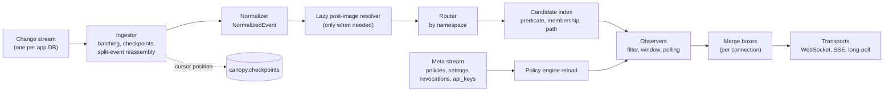
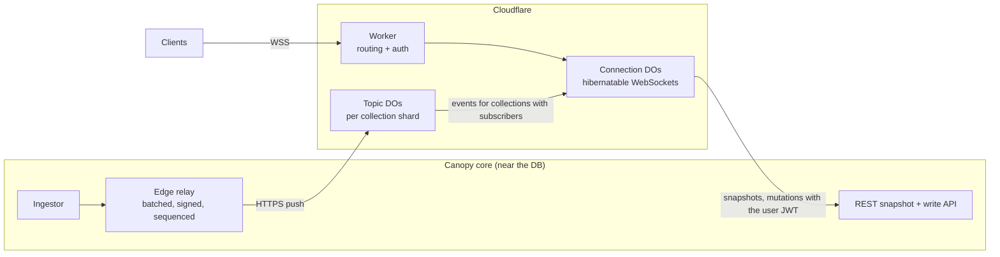

# 03: Realtime engine

> `@canopy/realtime` is Concept 1. It turns MongoDB change streams into authorized, ordered and resumable live
> query results for thousands of WebSocket clients. It runs alone (sidecar), embedded in a Node server, or as
> part of the Canopy server.

## 1. Responsibilities and guarantees

| # | Guarantee | How |
|---|---|---|
| G1 | **No unauthorized data.** A client only receives documents and fields that its current DLS context allows. | The same compiled `USING(read)` and field rules as REST ([02](02-document-level-security.md)); re-evaluation when claims, policies or `$ctx` change |
| G2 | **Consistent snapshots.** The initial results and the following events neither overlap nor leave a gap. | Register first, then snapshot at a known cluster time; buffered events at or before the snapshot time are discarded (§5.3) |
| G3 | **Ordered delivery.** Per connection, messages are totally ordered (`seq`) and per document they follow cluster-time order. | Single ordered ingest and per-connection FIFO queues (§8) |
| G4 | **Convergence.** After each processed batch, a subscription's client view equals its query's result at the latest delivered cluster time. Polling observers equal the result at poll time. | Visibility transitions (§7), window refills, polling diffs |
| G5 | **Explicit failure.** If G2 to G4 can't be maintained (gap, overflow, history lost), the client gets `resync`. The engine never silently diverges. | Sequence numbers, resume buffers, history-lost handling (§11) |
| G6 | **Read-your-writes.** A mutation sent over the socket is acknowledged only after the events it caused were delivered on that socket. | Echo-before-ack (§9) |
| G7 | **No schema changes.** Nothing is written to the app DB. | Checkpoints, mutation records and leases live in the meta DB |

## 2. Pipeline overview



## 3. Ingestion

### 3.1 Streams

| Stream | Scope | Purpose |
|---|---|---|
| **App stream** | `db.watch()` on the app DB with a `$match` on `operationType ∈ {insert, update, replace, delete, drop, rename, dropDatabase, invalidate}` and `ns.coll ∈ (realtime-enabled ∪ $ctx sources)` | Data events |
| **Meta stream** | `db.watch()` on the meta DB, filtered to `policies`, `settings`, `api_keys` and `revocations` | Hot reload and revocation |

When the set of collections changes, the app stream is reopened at the current resume token with a new
`$match`, so no events are lost. Each node uses two streams in total, and no cluster-wide privileges are needed
([10 §5](10-operations.md#5-least-privilege-mongodb-roles)). Each stream uses `showExpandedEvents: true` for
`disambiguatedPaths` and DDL awareness, and ends its pipeline with `$changeStreamSplitLargeEvent`.

### 3.2 Getting the full document (`realtime.fullDocument`)

| Mode | Change-stream options | Cost | When |
|---|---|---|---|
| **`auto`** (default) | `fullDocument: 'whenAvailable'`, `fullDocumentBeforeChange: 'whenAvailable'`, plus a lazy resolver | Images are used when the collection has them. Otherwise post-images are fetched **only for events some observer needs**, in one batched `find({_id: {$in}})` per collection per batch. | Zero-config and mixed setups |
| `updateLookup` | `fullDocument: 'updateLookup'` | One server-side lookup per update event | Simple setups, debugging |
| `images` | `'required'` / `'required'` | Exact pre- and post-images; requires `changeStreamPreAndPostImages` on every realtime collection | High-churn collections, edge mode |

Pre- and post-images are opt-in (`canopy realtime enable-images <coll…>` runs `collMod` with admin credentials
after confirmation). They make every observer stateless with respect to membership. Without them the engine
tracks membership (§5.1). Both lookup strategies return the *current* majority-committed document, which may
be newer than the event. That is safe because state only moves forward, and a `null` result (deleted since)
is resolved by the delete event that follows in stream order.

### 3.3 Checkpoints and restarts

- Every 1 s, or every 1,000 events (whichever comes first), and on graceful shutdown, the ingestor writes
  `{ _id: 'app:<db>', token, ct, node, at }` to `canopy.checkpoints`. It uses the stream's post-batch resume
  token, so idle streams keep advancing.
- On start, the ingestor resumes with `startAfter: token`. Resuming is mainly about **not missing DDL and
  `$ctx` invalidations**. Client sessions are in-memory and resync after a restart anyway (§11).
- In read-only sidecar deployments (no meta-DB write permission), checkpoints go to a local file or are disabled
  (start from "now"), and the restriction is documented.

### 3.4 Errors and special events

| Condition | Handling |
|---|---|
| Resumable errors (network, primary step-down) | The driver resumes automatically. The engine records `canopy_changestream_restarts_total{reason}`. |
| `ChangeStreamHistoryLost` (286) or invalid resume token | Restart from now and broadcast `resync` to every session with jittered timing (§11). Alert. |
| `drop` / `rename` of a realtime collection | All subscriptions on that collection get `nosub` with `CANOPY_COLLECTION_DROPPED`; the schema cache is invalidated |
| `dropDatabase` / `invalidate` | Reopen the stream, then send `resync` to everyone |
| Split events (`splitEvent: {fragment, of}`) | Reassemble fragments by resume token order. If a fragment is missing, drop the event and resync that document. |
| Event larger than the outbound message limit | Send `changed` with `refetch: true`. The client fetches the document over REST. |

Lag is measured as `now − event.wallTime` (`canopy_changestream_lag_seconds`).

## 4. Normalized events

```ts
interface NormalizedEvent {
  ct: bigint;                     // clusterTime as uint64 (seconds << 32 | increment). NOT unique per event (§9).
  token: ResumeToken;
  wallTime: Date;
  ns: { db: string; coll: string };
  op: 'insert' | 'update' | 'replace' | 'delete';
  id: BsonValue;                  // documentKey._id
  key: Document;                  // full documentKey (includes the shard key on sharded clusters)
  pre?: Document | null;          // undefined = not requested/unavailable; null = no pre-image (insert)
  post?: Document | null;         // as above; may be resolved lazily
  diff?: {                        // update events only
    set: Record<string, unknown>; // updateDescription.updatedFields (absolute values, so idempotent)
    unset: string[];
    truncated?: { field: string; newSize: number }[];
    paths?: Record<string, (string | number)[]>; // disambiguatedPaths
  };
  txn?: { lsid: string; txnNumber: bigint };
}
```

## 5. Observers

An **observer** maintains the live result of one *effective query*. Subscriptions whose effective queries are
identical share one observer (multiplexing). The observer key is

```
hash( ns, canonical(effectiveFilter), sort, limit, projection ∩ readable, collation )
```

Policies that bind `$auth.sub` produce per-user observers. Tenant-wide and public queries share observers.

### 5.1 Observer types

| Type | Used for | State | Notes |
|---|---|---|---|
| **FilterObserver** | Matcher-safe filter, optional sort, **no limit** | None with pre-images. Otherwise a membership set of `_id`s, capped at `maxTrackedDocs` (10k by default). | Above the cap the subscription is refused with `CANOPY_SUBSCRIPTION_TOO_LARGE`. The client should add a `limit` or enable images. |
| **WindowObserver** | Matcher-safe filter + sort + `limit` (≤ 1,000) | An ordered window of `limit` docs plus a look-ahead buffer of up to `min(limit, 100)` docs, with their sort keys | When a doc leaves the window, the head of the buffer is promoted. If the buffer runs out, the observer re-queries `limit + buffer` and diffs, at most every 50 ms. Sort order follows BSON comparison order (arrays use min/max element semantics). |
| **PollingObserver** | Anything else: non-matcher-safe operators, non-simple collation, `$text`, geo, live `aggregate` | The last result set (IDs plus content hashes) | Re-runs on any event in the namespace, throttled (minimum 250 ms, backing off to 2 s under load). Flagged as "expensive" in Studio. |

**Lifecycle.** An observer is created on the first subscribe and destroyed after the last unsubscribe plus a
30 s *linger*, which absorbs route changes in single-page apps.

### 5.2 Choosing an observer

```
if not matcherSafe(effectiveFilter) or collation is not simple or pipeline:  PollingObserver
else if limit present:                                                        WindowObserver
else:                                                                         FilterObserver
```

### 5.3 Snapshot consistency (register, then snapshot)

```ts
async function subscribe(conn: Connection, sub: Subscription) {
  const obs = observers.getOrCreate(sub.key);      // events for obs.ns are now buffered for this subscriber
  const pending = obs.attachBuffered(conn, sub);
  const { docs, snapshotCt } = await snapshotQueue.run(() =>
    readSnapshot(sub.effective, sub.sort, sub.limit, sub.projection), // snapshot session: server-chosen atClusterTime
  );
  conn.mergeBox.load(sub, docs, snapshotCt);        // emits `added` and then `ready`
  for (const e of pending.drain()) if (e.ct > snapshotCt) obs.applyFor(conn, sub, e); // ≤ snapshotCt is already included
}
```

- A snapshot at time `T` includes every write with `ct ≤ T`, so buffered events with `ct ≤ T` are discarded
  and events with `ct > T` are applied. **Spike S2** confirms how to obtain `T` from the Node driver (the
  snapshot session's `atClusterTime`, or the response `operationTime` as a fallback) and proves there is no gap
  or overlap under concurrent writes.
- Snapshot reads may use `readPreference: secondaryPreferred` because they are point-in-time reads. This takes
  load off the primary during resync storms.
- A **snapshot queue** limits concurrent snapshot queries (32 per node by default, fair per collection). It is
  the main defense against reconnect storms.
- If the observer already exists and is stateful (window, or a filter with membership tracking), new
  subscribers are served from its state at its current `ct` without querying the database.

## 6. Candidate selection: the predicate index

Evaluating every subscription for every event costs `O(events × subscriptions)`. The engine narrows the set
first, using three indexes per collection:

1. **Predicate index (by value).** At registration, the engine extracts top-level equality conjuncts from the
   effective filter, such as `ownerId = "u_1"` from the policy or `status = "active"` from the user, and `$in`
   lists with ≤ 32 values. It registers the observer under its most selective field, preferring fields bound to
   `$auth`/`$ctx`.
   `byField: Map<path, Map<canonicalValue, Set<Observer>>>`. Array-valued document fields are indexed per
   element, which matches MongoDB equality semantics.
2. **Membership index.** `docRefs: Map<docKey, Set<Observer>>` lists the stateful observers that currently
   contain a document. It is needed for `leave` and for deletes without pre-images.
3. **Path index.** `byPath: Map<topLevelField, Set<Observer>>` lists the fields each observer's filter and sort
   reference. If an update without images touches no referenced field, it cannot change membership for
   observers that don't already contain the document.

```
candidates(e) =
    predicate[pre] ∪ predicate[post]            // when full documents are known
  ∪ docRefs[e.id]                               // observers that already show the doc
  ∪ byPath[e.diff paths]                        // for image-less updates: could the doc have entered?
  ∪ unindexed                                   // observers without an indexable equality
```

Only candidates are evaluated with the compiled matcher. The lazy resolver (§3.2) fetches a post-image only if
some candidate needs it. Metrics expose `canopy_realtime_candidates_per_event` and the share of observers that
can't be indexed, so policy authors can see when an unindexable rule is costing them.

## 7. Visibility transitions

For each candidate observer with effective filter `F` and an event `e`:

- `before`: `F(e.pre)` if a pre-image exists; otherwise membership in `docRefs` (always false for inserts).
- `after`: `F(e.post)` for insert, update and replace; false for delete.

| Operation | before | after | Message to the observer's subscribers |
|---|:---:|:---:|---|
| insert | n/a | ✓ | `added` (full readable doc) |
| update / replace | ✗ | ✓ | `added` (full readable doc) |
| update | ✓ | ✓ | `changed` with readable `set`/`unset` from `diff`. Suppressed if empty after projection. |
| replace | ✓ | ✓ | `changed` with the full readable doc (`replace: true`) |
| update / replace | ✓ | ✗ | `removed` |
| delete | ✓ | n/a | `removed` |
| any | ✗ | ✗ | nothing |

- **Window observers** also update the window and may emit a `removed` for a document pushed out and an `added`
  for one pulled in from the buffer.
- **Unknown `after`** (lazy lookup returned `null`): emit nothing and wait for the delete event that follows.
- **Pre-images make leave decisions precise without per-subscription state.** Without them, the membership set
  provides the same precision. A `removed` is never sent for a document the client never had, so the existence
  of invisible documents is not leaked.

## 8. Fan-out

- **Merge box per connection.** `Map<docKey, { subs: Set<subId>, ct, fields }>`.
  - `changed` is **document-level**: sent once per connection, however many of its subscriptions contain the doc.
  - `added`/`removed` carry the IDs of the subscriptions entering or leaving.
  - When two subscriptions on one connection project different fields, the connection receives the union. That
    union is always readable by the same user, and the SDK projects per query locally.
- **Encode once.** Within a batch, the serialized payload for `(docKey, ct, projectionHash)` is cached and reused
  across connections. Serialization is usually the largest CPU cost of fan-out.
- **Micro-batching.** If a connection's queue is empty, its message goes out immediately. Otherwise messages
  are coalesced into one frame for up to 5 ms or 64 KiB.
- **Coalescing for slow readers.** Consecutive unsent `changed` messages for the same document are merged
  (latest values win; `set` and `unset` are reconciled). Coalescing never moves a message across a *barrier*
  (`ready`, `ack`, `resync`), so ordering guarantees hold.
- **Ordering.** Ingest is single-threaded per stream and every connection queue is FIFO, which gives G3.

## 9. Mutations over the socket and echo-before-ack

Mutations sent as `mut` frames go through the same transactional write path as REST
([02 §9.3](02-document-level-security.md#93-write-path-transactional)). The ack is held back until its echo
has been delivered:

```ts
async function onMut(conn: Connection, m: MutMessage) {
  const result = await writePath.execute(conn.ctx, m);             // commit returns operationTime T and modified IDs
  if (result.modified === 0) return conn.send(ack(m, result));     // nothing changed, so no event will come
  await echoWaiter.wait({ ns: m.ns, ids: result.modifiedIds, ct: result.ct }, { timeoutMs: 2000 });
  conn.send(ack(m, result));                                      // enqueued after the fan-out of those events
}
```

- The `echoWaiter` resolves once the ingestor has processed, for every modified `_id`, an event on that
  namespace with `ct ≥ T`. If any later event with `ct > T` has been processed, it resolves as well, since the
  stream is ordered. Fan-out for an event is enqueued **before** waiters are resolved, so the `ack` always
  follows its echo on that connection.
- **Cluster time is not a unique event ID.** Events in one transaction share a `clusterTime`, and since
  MongoDB 8.0 unrelated events may share one too. The waiter therefore matches on `(ns, _id, ct ≥ T)` per
  document, never on `ct` alone. `lsid` plus `txnNumber` identify transaction events when that is needed.
- **Timeout (2 s by default).** The gateway acks anyway. The ack then carries post-images and `echo: false`,
  and the SDK treats those documents as confirmed state ([05 §6](05-client-sdk.md#6-optimistic-mutations)).
- Change streams only return majority-committed changes. An echoed ack therefore also means the write is
  durable.
- Per connection, mutations are executed **in arrival order**. They may be pipelined, but they commit in
  sequence, which preserves the client's causal order (for example, insert followed by update of the same
  document).

## 10. Connection auth and policy changes

- **`hello`** carries the publishable key and an optional user JWT ([04](04-wire-protocol.md)). The JWT is
  verified with `jose` against a cached JWKS, with a pinned algorithm, `iss`/`aud` checks and ±60 s clock skew.
  The connection records the token's `exp`.
- **Refresh:** an `auth` message replaces the token. If the claims relevant to DLS changed, the connection's
  effective filters are recompiled and affected subscriptions move to new observers (re-snapshot plus a diff
  against the merge box, so only real differences are sent).
- **Expiry:** the gateway sends `err CANOPY_TOKEN_EXPIRED`, allows a 30 s grace period for an `auth`, then sends
  `nosub` for every subscription and closes with code `4001`.
- **Revocation:** "sign out user" and "ban user" write to `canopy.revocations` (TTL = maximum token lifetime).
  Nodes see it through the meta stream and close matching sockets within about a second.
- **Policy publish:** affected subscriptions are re-evaluated through the snapshot queue. Clients see
  `added`/`removed` for documents whose visibility changed. Large re-evaluations are spread out with jitter.
- **API key revoked:** connections that used that key are closed with code `4003`.

## 11. Delivery guarantees, resume and resync

- Every server message on a connection carries `seq`, a monotonically increasing integer.
- **Sessions outlive brief disconnects.** When a socket drops, the session (subscriptions, merge box, outbound
  ring buffer) is kept for `resumeWindow` (120 s by default). Its subscriptions stay attached, so events keep
  accumulating, up to 2 MiB of encoded frames.
- **Resume:** `hello { resume: { sid, seq } }`. If the session exists and the buffer still holds `seq + 1`
  onwards, the frames are replayed and streaming continues with no gap. Otherwise the server sends `resync`, and
  the client re-subscribes and diffs ([05 §9](05-client-sdk.md#9-resume-and-resync)).
- **Multi-node deployments:** sessions are node-local. Sticky routing (a cookie or `sid`-hash affinity at the
  load balancer) maximizes resume hits. Without it, the client resyncs.
- **Graceful shutdown:** the node stops accepting connections, sends each session
  `reconnect { retryAfterMs: random(0, drainWindow) }`, checkpoints and exits. Clients spread their reconnects
  over the drain window (30 s by default).
- **History lost or ingestor restart:** a global `resync` is sent with per-session jitter. The snapshot queue
  limits pressure on the database.

## 12. Backpressure and limits

All values are defaults and configurable.

| Limit | Default | When exceeded |
|---|---|---|
| Subscriptions per connection | 100 | `nosub CANOPY_LIMIT_SUBSCRIPTIONS` |
| Connections per subject | 20 | close `4029` |
| Connections per IP (anon) | 50 | close `4029` |
| Docs per snapshot (filter observer) | 10,000 | `nosub CANOPY_SUBSCRIPTION_TOO_LARGE` |
| `limit` on a window observer | 1,000 | `nosub CANOPY_INVALID_QUERY` |
| Inbound frame size | 256 KiB | close `4009` |
| Outbound queue, soft | 4 MiB | Coalescing becomes aggressive |
| Outbound queue, hard | 16 MiB | Session dropped as a slow consumer and closed with `4040`. The client resumes or resyncs. |
| Snapshot concurrency (per node) | 32 | Requests wait in the queue |
| Pending mutations per connection | 256 | `ack` error `CANOPY_RATE_LIMITED` |
| permessage-deflate | off by default; on for frames > 1 KiB when enabled | Decompressed size limited to 1 MiB to prevent compression bombs |

Ingest never waits for a slow client. Slow connections are coalesced, then dropped.

## 13. Scaling out

| Mode | How it works | Good for | Limits |
|---|---|---|---|
| **Single node** | One process | Development, small production | Vertical scaling only |
| **Independent replicas** (default) | N nodes, each with its own change stream. A load balancer with WebSocket support (preferably sticky) spreads clients. | Most production deployments, up to about 10 nodes | Every node processes every event; MongoDB serves N streams |
| **Hub** | K ingestors (one leader per stream, elected through a lease document in `canopy.leases`, renewed every 5 s with a 15 s TTL) publish normalized events to a bus (NATS JetStream or Redis Streams adapter). M gateway nodes subscribe. | Very high connection counts; feeding Canopy Edge | Extra infrastructure; the bus becomes critical |

In hub mode, a newly elected leader resumes from the checkpoint. Duplicates during failover are harmless,
because merge boxes ignore events with `ct` lower than the document's current `ct`, and applying `set` values
is idempotent.

**CPU model (to be calibrated in spike S5):** cost per node ≈ `events/s × (decode + candidates/event ×
match cost) + frames/s × encode cost (amortized by encode-once)`. The main levers are the selectivity of the
predicate index and encode-once reuse.

## 14. Canopy Edge

Change streams need a long-lived connection close to the database, so the edge is a **fan-out tier only**
([ADR-0010](../adr/0010-edge-is-fanout-only.md)).



- **Topology.** Connection Durable Objects hold up to about 1,000 sockets each, sharded by
  `hash(subject) % N`. Topic DOs (one per collection shard) receive relayed batches and forward them to the
  connection DOs that have subscriptions on that collection.
- **Hibernation.** Sockets are accepted with `ctx.acceptWebSocket(ws, tags)` so idle connections don't pin the
  DO in memory. Each socket's attachment holds `{ sid, subject, exp, policyHash }`; `serializeAttachment` allows
  up to 16 KiB. Subscription descriptors and merge-box summaries live in DO SQLite storage and are rebuilt when
  the DO wakes.
- **Requirement.** Collections served from the edge must have **pre-/post-images enabled**. Visibility
  decisions are then stateless (§7), which suits hibernation. The relay forwards `pre`/`post` documents.
- **Policy bundles.** The edge fetches the signed bundle (compiled policies plus hash) from the core and caches
  it. A bundle hash in the relay stream triggers a refetch. JWKS is cached at the edge.
- **Snapshots and writes** are delegated to the core REST API with the user's JWT, so DLS on reads and writes
  stays authoritative in the core. Snapshot reconciliation and echo-before-ack work as in §5.3 and §9, using
  `ct` values from the relay.
- **Relay protocol:** see [04 §11](04-wire-protocol.md#11-edge-relay-protocol).
- **Other platforms** (Deno Deploy, Bun, other serverless runtimes with WebSockets) can later run the same
  gateway build fed by the hub bus.

## 15. Embedding API

```ts
import { createRealtime } from '@canopy/realtime';

const realtime = await createRealtime({
  mongo,                                  // an existing MongoClient (pool shared with your app)
  database: 'app',
  auth: { jwksUrl, issuer, audience },    // or { builtin: true } inside Canopy server
  policies: { dir: './canopy/policies' }, // or { source: 'database' }
  fullDocument: 'auto',
  limits: { maxSubscriptionsPerConnection: 100 },
  logger,                                 // pino-compatible
});

const { fetch, websocket } = realtime.bun();            // Bun.serve adapter (primary runtime)
realtime.attach(httpServer, { path: '/realtime/v1' });  // Node http(s) server: WebSocket upgrade + SSE + long-poll
app.route('/realtime/v1', realtime.hono());             // Hono app: SSE and long-poll only, on any runtime
await realtime.close({ drainMs: 30_000 });              // graceful drain
```

## 16. Metrics

| Metric | Type | Meaning |
|---|---|---|
| `canopy_changestream_lag_seconds` | gauge | `now − wallTime` of the last processed event |
| `canopy_changestream_events_total{coll,op}` | counter | Ingested events |
| `canopy_changestream_restarts_total{reason}` | counter | Resumes, reopens, history lost |
| `canopy_realtime_connections` / `_subscriptions` / `_observers{type}` | gauge | Live counts |
| `canopy_realtime_candidates_per_event` | histogram | Effectiveness of the predicate index |
| `canopy_realtime_match_evaluations_total` | counter | Matcher calls |
| `canopy_realtime_lazy_lookups_total` | counter | Post-images fetched by the lazy resolver |
| `canopy_realtime_fanout_latency_seconds` | histogram | Event received → frame written |
| `canopy_realtime_messages_total{type}` / `_bytes_total` | counter | Outbound traffic |
| `canopy_realtime_snapshot_seconds` / `_snapshot_queue_depth` | histogram / gauge | Snapshot cost and pressure |
| `canopy_realtime_slow_consumers_total` / `_resyncs_total{reason}` | counter | Health signals |
| `canopy_ack_echo_wait_seconds` / `canopy_ack_echo_timeouts_total` | histogram / counter | Echo-before-ack behavior |
| `canopy_policy_denials_total{surface,coll,op}` | counter | DLS denials |

## 17. Testing the engine

- **Deterministic simulation.** A seeded generator produces documents, writes, subscriptions, disconnects and
  policy changes. After every step, each subscription's client-visible state is compared with an oracle query
  against MongoDB at the same `ct`. Failing seeds are saved as regression tests. This is the main correctness
  tool for G2 to G5.
- **Differential matcher tests** run against MongoDB 7.0, 8.0 and the latest 8.x
  ([11 §6](11-engineering.md#6-testing-strategy)).
- **Chaos tests:** `rs.stepDown()`, `kill -9` of the primary and of Canopy, Toxiproxy partitions and latency,
  and forced history loss (a tiny oplog). Expected outcomes: no lost updates, no leaks, and resyncs only where
  documented.
- **Soak:** 24 h at moderate load with heap snapshots, so leaks surface before users find them.
- **Load:** see [10 §7](10-operations.md#7-performance-targets-and-benchmarking).
