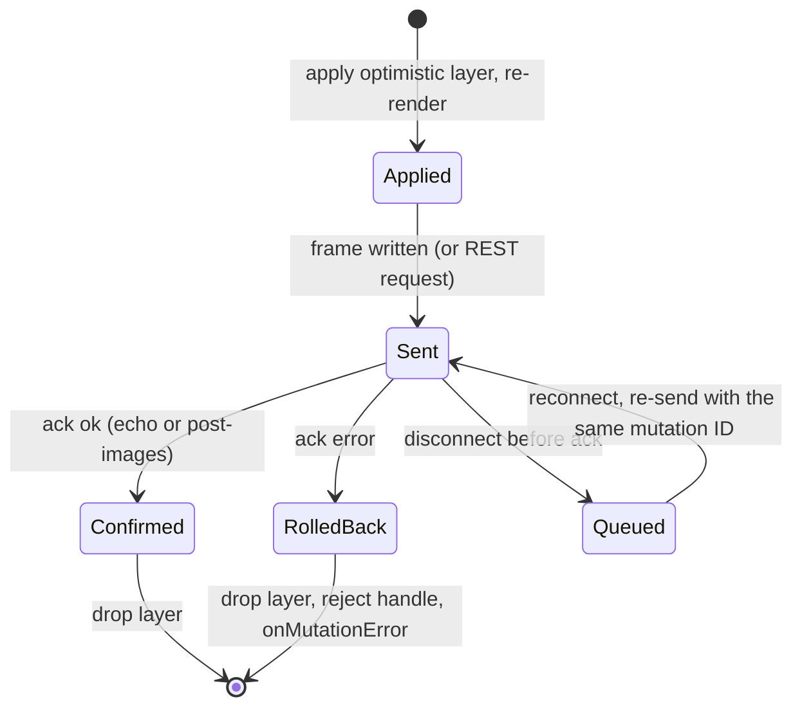
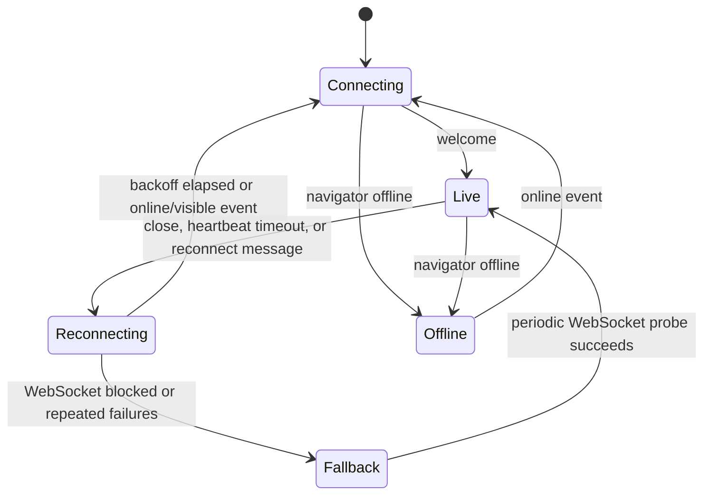

# 05: Client SDK

> `@canopy/client` is Concept 3. It is a small, typed, framework-agnostic SDK: live queries that stay current,
> mutations that feel instant, and a connection layer that recovers by itself. Framework bindings (`@canopy/react`
> first) are thin layers on top.

## 1. Goals

1. **Live by default.** `useQuery` results update on every relevant change, whoever made it.
2. **Instant writes.** Every mutation is applied optimistically, reconciled with the server, and rolled back on
   failure, without flicker.
3. **Resilient.** Reconnection, resume, resync and transport fallback happen automatically. The application only
   sees a status value.
4. **Correct.** The client converges to the server's result for every query. Gaps are repaired. Server-side DLS
   is authoritative; the client never tries to enforce it.
5. **Typed.** Types are generated from the database. There is no bundle size budget: the maintainer dropped it on 2026-11-13.
6. **Works in drop-in mode** against a team's existing API (§13).

## 2. Packages and entries

| Package / entry | Contents |
|---|---|
| `@canopy/client` | Store, live queries, mutations, WebSocket transport, EJSON-lite, matcher subset, REST query builder |
| `@canopy/client/auth` | Built-in auth client (sessions, refresh, OAuth redirects) |
| `@canopy/client/fallback` | SSE and long-poll transports (lazy-loaded) |
| `@canopy/client/persist` | IndexedDB / AsyncStorage persisters |
| `@canopy/react` | Provider, hooks, `createReactDb` |
| `@canopy/vue`, `@canopy/svelte`, `@canopy/solid` | Bindings |

Bundle size budgets were dropped by the maintainer on 2026-11-13, and CI no longer measures bundle size. All packages are ESM-only,
`sideEffects: false`, and have no runtime dependencies beyond workspace packages.

## 3. API tour

```ts
// canopy.schema.ts: the collections, declared once (`canopy pull` writes the first version from the database)
import { collection, defineSchema, t } from '@canopy/schema/define';

export const schema = defineSchema(
  collection('todos', {                                // no _id builder: a client-generated ObjectId
    title: t.string(),
    status: t.enum(['active', 'done', 'archived']).default('active'),
    ownerId: t.string(),
    createdAt: t.date(),
  }),
);

declare module '@canopy/client' {
  interface Register { schema: typeof schema }         // types createClient, the hooks and Doc<'todos'>
}

// src/canopy.ts
import { createClient } from '@canopy/client';
import { createRestClient } from '@canopy/client/rest';
import { schema } from '../canopy.schema';

export const canopy = createClient({
  url: 'https://api.example.com',
  publishableKey: 'canopy_pk_8f…',
  schema,                                              // the same value that produced the types
  // Built-in auth: auth: createAuth({ url }). With your own provider, a token source instead:
  // auth: { getToken: () => clerk.session?.getToken() ?? null },
});
export const rest = createRestClient({ url: 'https://api.example.com', publishableKey: 'canopy_pk_8f…', schema });

// One-off read over HTTP, no socket (DLS applied on the server). The cursor is opaque.
const open = rest.from('todos').find({ status: 'active' }).fields({ title: 1 }).sort({ _id: 1 }).limit(20);
const first = await open.page({ signal });
if (first.page.next !== null) render((await open.page({ after: first.page.next, signal })).data);

// Live query (framework-agnostic). A query is a read description: it has no write methods.
const active = canopy.from('todos').find({ status: 'active' }).sort({ createdAt: -1 }).limit(50);
const stop = active.subscribe(({ data, status, error }) => render(data, status, error));

// Optimistic mutations live on the collection. Each returns a thenable handle immediately.
const todos = canopy.from('todos');
const created = todos.insert({ title: 'Ship v0.1', ownerId: me, createdAt: new Date() });
created.id;                                         // Id<'todos'>: the ObjectId, usable right away
await created;                                      // resolves on ack, rejects if a policy refused it
await todos
  .update(created.id, { $set: { status: 'archived' } }, { where: { status: 'done' } }) // compare-and-set
  .catch((e) => { if (e instanceof ConflictError) toast('Someone changed it first'); });
```

React, matching the original concept's `db.useQuery({ status: 'active' })`:

```tsx
import { CanopyProvider, createReactDb, useCanopyStatus } from '@canopy/react';
import { canopy } from './canopy';

export const db = createReactDb(canopy);  // typed hooks per collection: db.todos.useQuery(...)

function ActiveTodos() {
  const { data: todos = [], status } = db.todos.useQuery({ status: 'active' }, { sort: { createdAt: -1 }, limit: 50 });
  const connection = useCanopyStatus();   // 'connecting' | 'live' | 'reconnecting' | 'fallback' | 'offline'
  return (
    <ul aria-busy={status === 'loading'}>
      {todos.map((t) => (
        <li key={t._id.toString()} onClick={() => db.todos.update(t._id, { $set: { status: 'done' } })}>
          {t.title}
        </li>
      ))}
      {connection !== 'live' && <li role="status">Offline: changes will sync</li>}
    </ul>
  );
}

export const App = () => <CanopyProvider client={canopy}><ActiveTodos /></CanopyProvider>;
```

## 4. Local store

The store is a normalized document cache, one map per collection:

```ts
interface DocEntry {
  server?: Document;          // last confirmed server state (undefined when unknown or deleted)
  ct: bigint;                 // cluster time of `server`
  tombstone?: boolean;        // deleted on the server as of `ct`
  subs: Set<SubId>;           // server-confirmed subscription membership
  pending: MutationId[];      // optimistic layers touching this doc, oldest first
  view?: Document;            // memoized fold(pending, server)
}
```

- **Server state only moves forward.** Incoming state is applied only if `incoming.ct ≥ entry.ct`. Ties are
  applied because `set` values are absolute ([04 §6](04-wire-protocol.md#6-server--client-messages)). This makes
  duplicates, replays and REST/WebSocket races harmless.
- **Tombstones** are kept for at least 60 s, and as long as any pending mutation references the document, so
  stale messages can't bring it back.
- **Garbage collection.** Entries with no subscriptions and no pending mutations move to an LRU of 5,000
  documents by default. They serve as a warm cache for instant re-subscription and are shown as stale until
  `ready`.
- **Structural sharing.** Unchanged documents keep their object identity, so memoized UI rows don't re-render.

## 5. Live queries

Each live query has a server subscription plus a local view:

```
members(Q) = { d | (pending(d) = ∅ and Q ∈ d.subs)                          // trust server membership
               or (pending(d) ≠ ∅ and matcherSafe(Q) and match(Q.filter, view(d))) // predict for touched docs
               or (pending(d) ≠ ∅ and not matcherSafe(Q) and Q ∈ d.subs) }  // can't predict: keep server's answer
result(Q)  = members(Q) |> sort(Q.sort, BSON order) |> take(Q.limit) |> project(Q.fields)
```

- **Predictions only cover documents touched by pending mutations.** For every other document the server's
  `added`/`removed` messages are authoritative. Predictions never drift, because they end when the mutation is
  confirmed.
- **Incremental maintenance.** A change to document `d` re-evaluates only `d` against the live queries of its
  collection. Sorted results are maintained by binary insertion. Subscribers are notified once per microtask
  batch.
- **Limit windows.** If an optimistic change pushes a document out of a `limit` window, the window shows
  `limit − 1` items until the server fills it. `o.buffer` (for example `useQuery(q, { buffer: 10 })`) asks the
  server for look-ahead documents, so the window refills locally at once.
- **Statuses:** `loading` (no `ready` yet; cached rows may be shown), `ready`, `stale` (resyncing or polling
  fallback), `error`.

## 6. Optimistic mutations



- **Layers are pure functions.** An update layer applies MongoDB update operators with the same `updater` used
  in tests against MongoDB (`@canopy/matcher`). Inserts and deletes are layers too. The view of a document is
  `fold(pendingLayers, serverState)`, recomputed whenever the server state changes. This is a rebase model:
  someone else's `$inc` arriving while ours is pending gives the correct sum.
- **Ack handling:**

  | Ack | Client action |
  |---|---|
  | `ok, echo: true` | Drop the layer. The server state already includes the effect. |
  | `ok, echo: false, res.docs` | Apply `docs` as server state at `ack.ct`, then drop the layer |
  | `ok, echo: false`, no docs (bulk) | Keep the layer until each affected cached doc has state with `ct ≥ ack.ct`, or 5 s pass. Then drop it and refetch the affected queries. |
  | `ok: false` | Drop the layer, re-derive views, reject the handle with a typed error (`PolicyViolationError`, `ConflictError`, `ForbiddenError`, `ValidationError`, `RateLimitError`) and fire `onMutationError` |

- **Ordering.** There is one FIFO queue per client across all collections, which preserves causality (insert
  then update, for example). Up to 32 mutations may be in flight over a WebSocket; the server commits them in
  order. Over REST, mutations are sent strictly in sequence, or grouped through `POST /rest/v1/_batch`.
- **Conflicts.** The default is last-writer-wins *per field*, which is what MongoDB `$set` does. Use
  `{ where }` for compare-and-set. If the precondition fails, the server returns `CANOPY_CONFLICT` and the client
  rolls back.
- **Client-generated `_id`s** keep optimistic inserts stable: ObjectId (BSON-spec generator, no `bson`
  dependency) for `idType: 'objectId'`, UUIDv7 for `'uuid'`, and caller-supplied values for `'string'`.
- **Idempotency.** The mutation ID (UUIDv7) is the server-side idempotency key
  ([02 §9.3](02-document-level-security.md#93-write-path-transactional)), so re-sending after a reconnect is
  safe.

## 7. Connection management



- **Backoff:** full jitter, `delay = random(0, min(30 s, 250 ms × 2^attempt))`. The client retries immediately on
  `online`, on `visibilitychange` to visible, and on focus when the last attempt was more than 5 s ago.
  `retryAfterMs` and close-code rules from [04 §7](04-wire-protocol.md#7-errors-and-close-codes) are honored.
- **Tokens.** Built-in auth refreshes at 80 % of the token's lifetime. BYO mode calls `getToken()` before
  expiry: the SDK reads `exp` without verifying the signature, which is only safe because the server verifies.
  New tokens are sent with `auth` without reconnecting.
- **Heartbeats** as in [04 §9](04-wire-protocol.md#9-heartbeats-and-liveness).
- **Multi-tab (Phase 4).** The opt-in `shared: 'leader-tab'` option uses the Web Locks API to elect one tab
  that holds the socket. Other tabs proxy through a `BroadcastChannel`, which cuts connection counts for apps
  that users open in many tabs.

## 8. Fallback transports and fallback syncing

1. **Transport ladder:** WebSocket → SSE + POST → long-poll ([04 §10](04-wire-protocol.md#10-fallback-transports-sse-and-long-polling)).
   The SDK moves down after two failed WebSocket handshakes within 10 s, or immediately when it gets a
   proxy-shaped failure (an HTTP response instead of `101 Switching Protocols`). While on a fallback, it probes
   WebSocket again every 60 s.
2. **Fallback syncing.** If realtime is unavailable altogether (disabled on the server, or every transport
   failing), live queries switch to **polling over REST**: they refetch every 10 s by default, with
   `If-None-Match` against a result hash so unchanged results return `304`. Status becomes `stale` and the
   connection status becomes `fallback`. Mutations keep working through REST with the same IDs.
3. Moving back up the ladder is seamless: the client re-subscribes and reconciles (§9).

> **Implementation notes (Phase 2).** Each fallback transport implements the same `WebSocketLike` surface, so
> the client handles every rung alike. `fallback: () => import("@canopy/client/fallback")` loads SSE and
> long-polling lazily; REST polling is `restPolling()` from `@canopy/client/rest-polling` (or
> `withRestPolling(ladder)`). The `fallback` connection status is used on every rung below WebSocket, and
> queries are `stale` only while REST polling.

## 9. Resume and resync

- **Resume** (server still holds the session): nothing is visible to the application; replayed messages are
  deduplicated by `seq`.
- **Resync** (new session, or a `resync` message):

```
for each active subscription S:
  mark every current member of S as unconfirmed(S)
  send sub(S) with the same id
on added(d, S):  confirm d in S (state update if newer ct)
on ready(S):     every member still unconfirmed(S) → remove from S; notify once
then:            re-send pending mutations in order, with the same IDs
```

  The cache stays in place during a resync, so the UI changes only where data really changed. Lists never flash
  empty.

## 10. Offline queue and persistence

- `@canopy/client/persist` provides `indexedDbPersister()` (web) and `asyncStoragePersister()` /
  `mmkvPersister()` (React Native). Persisted data:
  - **pending mutations**, required for durability across reloads;
  - optionally the **document cache**, for instant startup. It is shown as `stale` until `ready`.
- **Replay** happens on startup and reconnect, in order, with the original IDs.
- **Stale-mutation guard.** Server idempotency records expire after `CANOPY_MUTATION_TTL` (24 h by default).
  The SDK will not auto-replay a mutation older than TTL minus 4 h. Such mutations are surfaced as `stale`
  through `onStaleMutations`, and the application decides whether to retry or discard. This prevents a
  non-idempotent `$inc` from being applied twice.
- Persisted data is **not encrypted** by the SDK, and the documentation says so. Apps can supply an encrypting
  persister.

> **Implementation notes (Phase 2).** `persist` takes a string key value `Persister` (`indexedDbPersister()`,
> `memoryPersister()`, `asyncStoragePersister()`); entries are scoped to the token's `sub`, and mutation keys
> sort like their UUIDv7 IDs, so the stored order is the send order. Nothing is sent before the restore
> finishes. Stale mutations come with `retry()` (a new mutation ID) and `discard()`. The document cache is
> opt in (`cacheDocuments`). The client reports `offline` on the browser's `offline` event and does not
> retry until `online`.

## 11. Framework bindings

| Binding | API | Notes |
|---|---|---|
| React (`@canopy/react`) | `CanopyProvider`, `useQuery(query, opts)`, `createReactDb(client)` → `db.<coll>.useQuery(filter, opts)`, `useDocument(coll, id)`, `useMutation(fn)`, `useCanopyStatus()`, `useSession()` | Built on `useSyncExternalStore`. `{ suspense: true }` opt-in. SSR helpers `prefetch()`, `dehydrate()`, `<Hydrate>`. |
| Next.js / RSC | Server Components call `canopy.from(...).find()` with the user's token through `createServerClient({ cookies })`, then pass `{ docs, ct }` to a client component, which hydrates and subscribes | The snapshot `ct` lets the client discard older events |
| Vue (`@canopy/vue`) | `useQuery()` returns `ShallowRef`s; `useMutation()` | Phase 4 |
| Svelte 5 (`@canopy/svelte`) | `createQuery()` returns a rune-friendly reactive object | Phase 4 |
| Solid (`@canopy/solid`) | `createQuery()` with signals | Phase 4 |
| React Native / Expo | Same as React, plus `AppState`-driven reconnect and AsyncStorage/MMKV persisters | Phase 4 |
| TanStack DB adapter (`@canopy/tanstack-db`, optional) | Exposes Canopy collections as TanStack DB collections (sync from realtime, writes through Canopy mutations) | Evaluate API stability first |

## 12. Types

Types come from the schema in code (section 3): `collection()` builders in the app's `canopy.schema.ts`, which
`canopy pull` writes once from a validator, the config or sampled documents and the developer then owns. The
file augments the client's `Register`, so `createClient`, `createRestClient`, the framework bindings and the
helpers are typed without a type argument:

```ts
import type { Doc, Id, NewDoc, Patch } from '@canopy/client';

type Todo = Doc<'todos'>;        // { _id: ObjectId; title: string; status: 'active' | 'done' | 'archived'; ownerId: string; createdAt: Date }
type TodoId = Id<'todos'>;       // ObjectId, the same builder that makes the client generate one
type Draft = NewDoc<'todos'>;    // _id and status optional: generated and defaulted
type Change = Patch<'todos'>;
```

- `Filter<T>`, `UpdateFilter<T>` and `Projection<T>` are derived from the document type. Typos in field names
  and operators are compile errors, and a literal projection narrows the result type.
- The `_id` builder decides both the type and the runtime value: an omitted `_id` or `t.uuid()` is generated
  by the client, `t.string()` and the other caller id types make `_id` required unless `.generate(fn)` is set.
- Types reflect the **collection**, not **permissions**. Runtime DLS decides each request;
  `canopy schema diff --role <role>` reports the fields a role cannot read or write.
- `canopy schema diff` compares the file with each collection's validator and a sample (and exits non zero on
  drift, for CI); `canopy dev` warns on drift; `canopy schema push` applies the file as a `$jsonSchema`
  validator, an explicit, audited admin action.
- `canopy gen types` and its `Database` interface keep working for one release, with a deprecation notice that
  points at `canopy pull`.

## 13. Drop-in mode (writes through your existing API)

In sidecar mode, writes go through the team's own endpoints. The SDK still provides optimistic UI:

```ts
const op = canopy.optimistic('todos', todo._id, (d) => ({ ...d, status: 'done' }));
try {
  const res = await fetch(`/api/todos/${todo._id}/complete`, { method: 'POST' });
  const { operationTime } = await res.json();  // optional: your API returns the session's operationTime
  op.confirmAfter(operationTime);              // drop the layer once a change event with ct ≥ operationTime arrives (or after 5 s)
} catch (e) {
  op.rollback();
}
```

On the server, `toCt(session.operationTime)` from `@canopy/realtime` converts the driver's `Timestamp` into
the protocol's `ct` string. Without an `operationTime`, `op.settle()` drops the layer on the next change event
for that document, or after the timeout.

## 14. Devtools

- `@canopy/devtools` (Phase 4) is an in-page panel, later also a browser extension. It shows the connection and
  transport, subscriptions with their observer type and counts, a store inspector, the pending-mutation queue
  (with replay and discard actions), and a protocol log with `seq`/`ct`.
- Development builds warn about common mistakes: a subscription with no `limit` on a large collection, a query
  that isn't matcher-safe (so no predictions), and mutations rejected by DLS.

## 15. Testing the SDK

- **Protocol vectors** ([04 §12](04-wire-protocol.md#12-conformance-and-evolution)) run in Node and in real
  browsers (Playwright: Chromium, Firefox and WebKit).
- **Property-based rebase tests (fast-check).** For any interleaving of server events, local mutations, acks,
  failures and reconnects, once every ack has arrived the client state equals the server's final state, and no
  intermediate view ever contains a document the server never sent (apart from optimistic inserts).
- **Simulated network:** latency, drops, duplicate deliveries on resume, slow consumers, and token expiry
  mid-session.
- **End-to-end:** multi-tab and multi-user scenarios against a real Canopy and MongoDB (Testcontainers), run
  on every PR.
