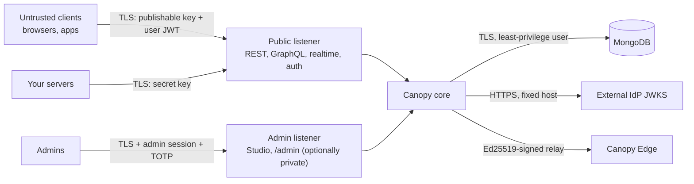

# 09: Security

> Canopy is an authorization product. A DLS bypass is the worst bug it can have, so security work is part of
> the design from the start, not a final checklist.

## 1. Security principles

1. **Fail closed.** Unknown operators, missing variables, policy errors and timeouts all lead to denial
   ([02 §5](02-document-level-security.md#5-variables)).
2. **One enforcement engine.** REST, GraphQL, realtime, Studio and edge share compiled policies, so there is
   only one thing to get right, and the differential tests check it.
3. **The database is the final judge on writes.** `check` rules are evaluated by MongoDB inside the write
   transaction. Canopy does not re-implement update semantics on the server.
4. **Least privilege everywhere:** MongoDB roles per mode ([10 §5](10-operations.md#5-least-privilege-mongodb-roles)),
   admin RBAC, separate admin accounts, and an optional private admin listener.
5. **Secure defaults:** nothing exposed, `service` role never granted from external JWTs, introspection
   disabled for `anon` in production, a setup token for first-run claiming, and dev-only flags that refuse to
   start in production.

## 2. Assets and trust boundaries

| Asset | Where it lives | Impact if compromised |
|---|---|---|
| Application data | App DB | Data breach, the primary risk |
| Credentials and sessions | `canopy_auth` | Account takeover |
| Signing keys, secret API keys, master key | Meta DB (encrypted), environment | Full impersonation or DLS bypass |
| Policies | Meta DB and Git | Silent loss of authorization |
| Admin accounts | Meta DB | Full control |
| Availability | Canopy nodes, MongoDB | Outage, data staleness |

## 3. Threat model (STRIDE)

| Category | Threat | Mitigation | Verified by |
|---|---|---|---|
| **Spoofing** | Forged JWT (`alg: none`, HS/RS confusion, `kid` or `jku` injection) | Pinned algorithms, JWKS only from configured hosts, `jose` verification, `iss`/`aud` required | Auth test corpus |
| | Leaked secret key used from a browser | Requests carrying a secret key **and** an `Origin` header are rejected by default; usage metrics and alerts; rotation | Integration tests |
| | Cross-site WebSocket hijacking | Token auth in the first frame (not cookies). Cookie-authenticated sockets require an allowlisted `Origin`. | E2E |
| | Claiming a fresh instance | One-time setup token printed to server logs | E2E |
| | Spoofed edge relay | Ed25519 signature plus timestamp window | Unit and integration |
| **Tampering** | Operator injection (`$where`, `$function`, `$accumulator`, pipeline stages) | Operator and stage allowlists in `@canopy/query`; banned expressions ([02 §9.2](02-document-level-security.md#92-aggregation-sanitizer)) | Bypass corpus, fuzzers |
| | Prototype pollution through JSON (`__proto__`, `constructor`) | Parser rejects these keys and builds null-prototype objects | Fuzzers |
| | EJSON type confusion | Strict EJSON parsing; schema-aware coercion only | Property tests |
| | Field-rule bypass through `$rename`, ancestor writes, positional paths, `arrayFilters`, upserts | Path analysis ([02 §8](02-document-level-security.md#8-field-level-security)) | Exhaustive unit tests |
| | Policy tampering | Admin RBAC, optimistic concurrency, audit, Git as the source of truth, drift detection | E2E, nightly drift job |
| | Reusing another user's mutation ID | Mutation records are bound to the subject; a mismatch returns `409` | Integration |
| **Repudiation** | Unattributed admin or policy changes | Append-only `audit_log` (no update or delete API) with actor, diff and commit SHA; OTel log export | E2E |
| **Information disclosure** | DLS bypass through `$lookup`, `$unionWith`, `$facet` | Sanitizer injects the foreign collection's policies; `$graphLookup` rejected in 1.0 | Bypass corpus |
| | Inference by filtering or sorting on hidden fields | References to unreadable paths are rejected | Unit, bypass corpus |
| | Existence leaks | `404` for invisible documents; no `removed` for documents a client never had; unique-index side channel documented and linted | Simulation tests |
| | Stale realtime access after a role, policy or claim change | Re-evaluation on change; token expiry enforcement; revocation stream | Simulation and chaos |
| | Schema leaks | Role-filtered OpenAPI and GraphQL; introspection off for `anon` in production; generic error details for non-service callers | Integration |
| | Secrets in logs | pino redaction for `authorization`, `apikey`, tokens and cookies; a test fails if a known secret appears in captured logs | Unit |
| **Denial of service** | Expensive queries | `maxTimeMS`, page limits, limits on depth, `$in` and stages, `allowDiskUse: false`, rate limits | Load tests |
| | ReDoS in the in-process matcher | Only linear-time-compatible regexes evaluated in-process ([02 §12](02-document-level-security.md#12-realtime-specific-rules)) | Fuzzers |
| | Subscription floods, reconnect storms | Per-connection, per-subject and per-IP limits; snapshot queue; jittered resync | Load and chaos tests |
| | Oversized frames, compression bombs | Size and inflate limits | Fuzzers |
| | Slow consumers | Queue caps, then disconnect | Load tests |
| | Brute force on auth endpoints | Rate limits, backoff, optional CAPTCHA | Integration |
| | GraphQL complexity | Depth, complexity and alias limits | Unit |
| **Elevation of privilege** | Role claims through user-editable metadata | Built-in tokens never derive roles from `user_metadata`; linter error | Lint tests |
| | `service` asserted through an external JWT | Disabled by default | Unit |
| | Admin API exposed publicly | Optional private listener, RBAC, TOTP for owners, IP allowlist | E2E |
| | SSRF through JWKS URLs (and webhooks after 1.0) | URLs come from config, HTTPS only, private address ranges denied unless allowed | Unit |
| | Supply-chain compromise | §4.8 | CI policy |

## 4. Controls by area

### 4.1 Input handling (`@canopy/query`)

- Size limits for request bodies and frames are enforced before parsing.
- The JSON parser rejects `__proto__`, `constructor` and `prototype` keys, uses null-prototype objects, and caps
  depth (16) and key count.
- Strict EJSON: unknown `$`-wrappers are errors.
- Operators and stages go through allowlists, per context (filter, update, pipeline, policy `using`, policy
  `check`).
- Inserted and replacement documents may not contain `$`-prefixed or dotted keys.

### 4.2 Policy engine

- Fail closed, with missing variables never matching.
- Policies are validated when they are compiled.
- Regexes evaluated in-process must be linear-time.
- Matcher behavior is verified against MongoDB with differential tests.
- These **invariants** are checked continuously as property tests:
  - **I1:** a non-service read never returns a document that fails `USING(read)` for its context.
  - **I2:** a non-service write never leaves a document that fails `CHECK(op)`.
  - **I3:** a non-service response never contains a field outside `readable(roles)`.
  - **I4:** a realtime client never receives a document or field that it could not fetch through REST with the
    same context at the same `ct`.
  - **I5:** any exception during policy evaluation produces a denial.
  - **I6:** no secret value ever appears in logs, metrics labels or error responses.

### 4.3 Transport

- TLS is terminated at the load balancer or by Canopy, with HSTS guidance.
- CORS uses an allowlist (`CANOPY_CORS_ORIGINS`). There is no wildcard with credentials.
- WebSocket: `Origin` is checked for cookie authentication; there are message and inflate limits and heartbeats.
- SSE uses `fetch()` with headers. EventSource falls back to single-use tickets, so tokens never appear in URLs
  ([04 §10](04-wire-protocol.md#10-fallback-transports-sse-and-long-polling)).

### 4.4 Secrets and keys

- `CANOPY_MASTER_KEY` (32 random bytes, base64) is the key-encryption key. Secrets stored in the meta DB (OAuth
  client secrets, SMTP passwords, relay private key) are encrypted with AES-256-GCM.
- How Better Auth protects its stored JWKS private keys is verified in spike S6, and documented.
- Signing keys rotate every 30 days with a grace period. Secret API keys are stored hashed. Master-key rotation
  re-encrypts every stored secret and is audited.

### 4.5 Logging and privacy

- Structured logs with redaction, configurable sampling, and no request or response bodies by default.
- The audit log is append-only, with optional retention TTL and SIEM export.
- GDPR helpers for **auth data** (export and erase a user in `canopy_auth`) are exposed in the admin API. App
  data stays the application's responsibility, which is documented with recipes.
- Anonymous usage telemetry is **opt-in** (`CANOPY_TELEMETRY=on`). Its exact payload is documented, and it
  never includes data, queries or identifiers.

### 4.6 Admin surfaces

See [08 §6](08-studio-and-cli.md#6-studio-security): separate cookie, CSRF, CSP, optional private listener,
TOTP, RBAC and audit.

### 4.7 Deployment hardening

- Distroless image, non-root UID, read-only root filesystem, no shell, all Linux capabilities dropped.
- Example Kubernetes `NetworkPolicy` resources.
- Least-privilege MongoDB roles. Admin-only operations (`collMod`, index creation) are done by the CLI with
  separate credentials.
- `CANOPY_DEV_INSECURE` refuses to start when `CANOPY_ENV=production`.

### 4.8 Supply chain

- Bun with a frozen `bun.lock`, the isolated linker, and an explicit `trustedDependencies` list (no arbitrary
  install scripts).
- Renovate with a minimum release age and grouped updates.
- License allowlist (MIT, Apache-2.0, BSD, ISC).
- npm publishing with provenance through OIDC trusted publishing.
- Multi-arch container images signed with cosign, with an SBOM (Syft) attached.
- GitHub Actions pinned to commit SHAs, OpenSSF Scorecard, CodeQL, OSV-Scanner.
- `CODEOWNERS` requires two maintainer reviews for `packages/{query,policy,matcher,auth}`.

## 5. Security testing program

| Activity | Cadence |
|---|---|
| Unit tests for every rule in [02 §7 to §9](02-document-level-security.md#7-evaluation-semantics) | Every PR |
| Differential tests (matcher and updater vs MongoDB 7.0, 8.0 and the latest 8.x) | PR subset, full run nightly |
| **Bypass corpus** (curated attack payloads against REST, GraphQL and WS; grows with every report) | Every PR |
| Property tests for invariants I1 to I6 | PR (short), nightly (long) |
| Fuzzing (fast-check generators for the parser, EJSON codec and protocol decoder; optional coverage-guided fuzzing) | Nightly |
| Mutation testing (Stryker) on `policy`, `query` and `matcher` | Weekly |
| SAST (CodeQL), dependency and secret scanning | Every PR |
| DAST (OWASP ZAP baseline against the example app) | Nightly |
| External audit | Before 1.0 (§7) |
| Bug bounty | After 1.0 |

## 6. Vulnerability disclosure

- `SECURITY.md` points to GitHub private vulnerability reporting. Reports are acknowledged within 48 hours and
  triaged within 5 working days.
- Coordinated disclosure within 90 days by default, faster when a fix ships earlier.
- CVEs are issued through GitHub Security Advisories. Fixes are backported to every supported line
  ([13 §7](13-open-source.md#7-release-and-support-policy)).
- A public changelog section lists security fixes and credits reporters who want credit.

## 7. Pre-1.0 audit plan

- **Scope:** `@canopy/query` (parser, sanitizer), `@canopy/policy` (compiler, semantics), the realtime
  authorization path (observers, re-evaluation, merge boxes), the auth integration (token minting, claims hook,
  keys), the admin API and Studio session handling, the edge relay and edge policy evaluation, the Rust crates and the gateway, the MongoDB wire
  protocol endpoint, and policies on Queryable Encryption fields.
- **Timing:** start of Phase 8, after a feature freeze. Budgeted in the roadmap.
- **Gate:** no open high or critical findings at the 1.0 release. Mediums need a documented plan.
