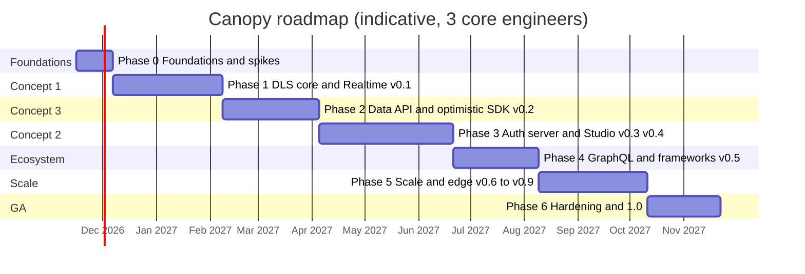

# 12: Roadmap

## 1. Assumptions

- **Team:** 3 core engineers.
  - **A, realtime and database:** ingestor, observers, matcher.
  - **B, API, security and auth:** query, policy, REST, auth, server.
  - **C, client and Studio:** SDK, bindings, Studio, examples.

  Part-time help: product design (Studio), docs/DevRel, and a security reviewer. With 2 engineers, add about
  40 % to every duration. With 5, Phases 3 and 4 can overlap.
- **Start:** 2026-11-16. Durations include testing and docs. Holiday buffers are not included.
- **The wedge comes first.** Concept 1 (drop-in realtime + DLS) ships as v0.1, because existing MongoDB projects
  can adopt it without migrating. Concepts 3 and 2 follow on the same core.

## 2. Timeline

| Release | Target | Headline |
|---|---|---|
| **v0.1 "Drop-in realtime"** | Feb 2027 | Concept 1: Canopy Realtime sidecar and middleware, DLS, read-only live queries in React |
| **v0.2** | Apr 2027 | REST API, optimistic mutations, fallback transports, offline queue |
| **v0.3** | May 2027 | Built-in auth, the all-in-one `canopy` server, `$ctx` lookups |
| **v0.4** | Jun 2027 | Canopy Studio v1 |
| **v0.5** | Aug 2027 | GraphQL, Vue/Svelte/Solid/React Native, 2FA and passkeys |
| **v0.6 to v0.9** | Aug to Oct 2027 | Hub mode, Canopy Edge, certification, performance |
| **1.0** | late Nov 2027 | External audit passed, v1 APIs and protocol frozen, MongoDB 8.0+ required |

## 3. Phases

### 3.0 Phase 0: Foundations and spikes (3 weeks)

**Deliverables**

- Naming and trademark check, npm scope, GitHub organization, domain
  ([13 §5](13-open-source.md#5-naming-and-trademarks)). License ratified. `CODE_OF_CONDUCT.md`, `SECURITY.md`,
  `CONTRIBUTING.md` and `GOVERNANCE.md` drafted.
- Monorepo set up **by hand** ([11](11-engineering.md)): Bun workspaces, Turborepo, TS 6 project references, Biome,
  Vitest, Changesets, and a CI skeleton with a MongoDB replica-set service.
- ADRs 0001 to 0012 reviewed and accepted, or revised.
- The DLS spec ([02](02-document-level-security.md)) and protocol ([04](04-wire-protocol.md)) reviewed by at
  least two outside reviewers: one with Postgres RLS experience and one who knows MongoDB internals.
- Spikes S1 to S7 (§4), each time-boxed to 3 days or less, written up in `docs/spikes/`.

**Exit criteria:** CI green. A go/no-go recorded for every spike. Any design changes merged back into these docs.

### 3.1 Phase 1: DLS core and Canopy Realtime → v0.1 (9 weeks)

**Deliverables**

- `@canopy/protocol`: codec, messages, test vectors v1.
- `@canopy/matcher`: the operators in [02 §6](02-document-level-security.md#6-allowed-operators), BSON
  ordering, sort, projection, updater, and the differential harness.
- `@canopy/query`: parser, allowlists, canonical hashing.
- `@canopy/policy`: DSL, stored format, compiler, explain, file and meta-DB loaders with hot reload, core lint
  rules, and the test runner (in-memory and MongoDB).
- `@canopy/realtime`:
  - ingestor (`auto`, `updateLookup` and `images` modes) and checkpoints;
  - filter, window and polling observers, plus the predicate, membership and path indexes;
  - merge boxes, WebSocket transport, BYO JWT through JWKS;
  - limits, resume buffers, resync and metrics;
  - `attach()` for Node http, Express, Fastify and Hono;
  - the `canopy-realtime` image.
- `@canopy/client` read path (store, live queries, reconnect, resume, resync) and `@canopy/react`
  (`useQuery`, `createReactDb`).
- CLI: `canopy doctor`, `canopy policies lint|test`.
- The `express-dropin` example (Express + Mongoose + Auth0 turned into a live dashboard) and the sidecar
  quickstart.

**Exit criteria**

- Drop-in works on Atlas and on a self-hosted replica set with **zero changes to the app DB**. An automated test
  compares collections and indexes before and after.
- Differential suite: at least 1M generated cases per supported operator nightly, with **0 mismatches**.
- 10k simulation seeds green. Step-down and kill chaos tests green.
- Bypass corpus (≥ 200 payloads to start) green.
- Fan-out p99 ≤ 25 ms at 5k connections.
- An outside developer finishes the sidecar quickstart in ≤ 10 minutes. The 1.0 goal is 5.

### 3.2 Phase 2: Data API and optimistic SDK → v0.2 (8 weeks)

**Deliverables**

- `@canopy/rest`: every endpoint in [06](06-data-api.md) except GraphQL, with:
  - the transactional write path and idempotency records;
  - the aggregation sanitizer with `$lookup`/`$unionWith` rewriting;
  - cursors and Problem Details;
  - OpenAPI per role.
- `@canopy/schema` (inference) and `canopy gen types`.
- WebSocket `mut` with echo-before-ack ([03 §9](03-realtime-engine.md#9-mutations-over-the-socket-and-echo-before-ack)).
- SDK:
  - optimistic layers, rebase, ack handling, rollback, compare-and-set and typed errors;
  - predicted membership;
  - SSE/POST and long-poll transports, and REST polling as fallback syncing;
  - the offline queue with IndexedDB persistence and the stale-mutation guard.
- The `todo-react` example (optimistic, offline-capable).

**Exit criteria**

- Rebase-convergence property tests green.
- Playwright multi-tab and multi-user end-to-end tests (conflicts, rollback, offline replay) green.
- OpenAPI validates.
- Write overhead within the targets set by S3.
- SDK core ≤ 15 kB gzip. Dropped: the maintainer removed the size budget on 2026-11-13.

**Status (2026-11-07).** M3 to M11 are implemented on `master` (not pushed). Exit criteria:

| Criterion | State |
|---|---|
| Rebase-convergence property tests | Green (`packages/client/test/store.test.ts`) |
| Playwright multi-tab and multi-user tests | Green, 7 scenarios, repeated 4× without flakes (`examples/todo-react/e2e`) |
| OpenAPI validates | Green (OpenAPI 3.1 validator in `packages/rest/test/openapi.test.ts`) |
| Write overhead within S3 | Met: p99 overhead at 250 writes/s about 0 ms (update) and 3 ms (insert), against ≤ 15 ms |
| SDK core ≤ 15 kB gzip | **Dropped.** The core measured 20.3 kB at the time; the maintainer removed the size budget on 2026-11-13. |

Two cuts brought the core from 27.9 kB to 20.3 kB: `@canopy/matcher/lite` drops the regex translator
(3.7 kB), and the update engine is a separate entry, `@canopy/matcher/update`, that the client imports
dynamically right after creation (about 4.8 kB of its own), so update layers made in the first moments
show once it arrives (`client.updateEngine`). What remains is the filter (9 kB minified), the client and
store (24 kB) and the protocol codec (18 kB). The maintainer dropped the size budget on 2026-11-13, so
the gap is no longer an open decision.

Deviations from the plan made during Phase 2:

- REST is a Web standard `fetch` handler (`createRestHandler`) rather than Hono; Hono and Express can mount it.
- `canopy gen types` samples the newest documents by `_id` instead of `$sample`, so its output is
  deterministic and `--check` works in CI.
- Problem Details `type` URIs default to `urn:canopy:error:<code>` while the project name is open.
- An aggregation over the result cap fails with `400` instead of truncating.
- `insertMany` returns post images.
- A `$lookup` may only join on a foreign field the caller can read.
- An `ack` carries `echo: false` and post images whenever the echo cannot be promised: replays,
  subscriptions that are loading, waiting for a requery or polling, bulk writes and timeouts.
- A single document write over the socket that finds no visible document fails with `CANOPY_NOT_FOUND`, as
  over REST.
- A resume from a new connection takes over a session whose old connection is still attached (half open
  sockets, transport switches); the per subject connection limit counts only connected sessions.
- REST polling lives in its own entry, `@canopy/client/rest-polling`, so `@canopy/client/fallback` fits 2 kB.
- `ETag` and `304` are on `GET /rest/v1/{collection}` only, since conditional `304` belongs on GET.
- The SDK moves down the ladder after two failed handshakes within 10 s; browsers do not expose the HTTP
  status of a failed WebSocket handshake, so there is no immediate move on a proxy shaped failure.
- Persisted mutations and the document cache are kept per user (the token's `sub`).

### 3.3 Phase 3: Auth, platform server and Studio v1 → v0.3, v0.4 (11 weeks)

**Deliverables**

- `@canopy/auth`:
  - Better Auth integration: email/password, magic link/OTP, OAuth, anonymous sign-in;
  - EdDSA JWTs with JWKS and rotation; the claims hook;
  - publishable and secret keys; revocations; rate limits; email adapters and templates.
- `@canopy/server`:
  - config loader, meta-DB migrations;
  - admin API with RBAC and audit;
  - setup-token claim flow and private admin listener;
  - the `canopy` image and Docker Compose.
- `$ctx` context lookups with live invalidation ([02 §10](02-document-level-security.md#10-context-lookups-ctx-membership-rules-without-joins)).
- Studio v1, covering every area in [08 §2](08-studio-and-cli.md#2-information-architecture), including the
  simulator, "view as" and event trace.
- CLI: `init`, `dev --with-mongo`, `policies push|pull|diff|history|rollback`, `keys`, `admin`,
  `realtime enable-images`, `indexes advise`, `migrate`, `login`.
- Spike S9 (single-binary distribution).

**Exit criteria**

- 5 outside developers each build an authenticated realtime todo app from `docker compose up` in ≤ 15 minutes
  (moderated usability test).
- Studio end-to-end tests cover the critical flows.
- Internal security review of the auth and admin surfaces, with no high findings open.

### 3.3a Review gate after Phase 3 (2026-11-07)

A code quality and test coverage review of `master` at `bbf4cc9`, done before Phase 4 starts. It covers
every package, `apps/studio` and the examples. Method:

- The whole Vitest suite with V8 coverage against the dev replica set (MongoDB 8.0.34), with timeouts
  raised to 60 s because instrumentation slows hashing. Result: 1226 of 1227 tests passed; the one failure
  is a timing assertion (see T4).
- A scan of every function for length and cyclomatic complexity, a scan for functions defined in more than
  one place, and a scan for exports nothing imports.
- A diff of the routes Studio calls against the routes `createAdminApi` serves, and of Studio's mock admin
  against the real one.

IDs (`R`, `D`, `C`, `X`, `T`, `O`) are for tracking. Priority: **P1** before Phase 4 starts, **P2** during
Phase 4, **P3** when the code is next touched.

#### Phase 3 status

| Deliverable | State |
|---|---|
| Built in auth (email and password, magic link, OTP, OAuth, anonymous, claims hook, EdDSA keys with rotation, email over SMTP and SES, templates) | Done (`packages/auth-builtin`) |
| Keys, revocations, rate limits | Done; revocation propagation has two bugs (R1) |
| Server: config loader, meta DB migrations, admin API with RBAC and audit, setup token claim, private admin listener, image and Compose | Done (`packages/server`, `deploy/`) |
| `$ctx` lookups with live invalidation | Done (`packages/policy/src/context.ts`, invalidation in `packages/realtime/src/realtime.ts`) |
| Studio v1, every area of [08 §2](08-studio-and-cli.md#2-information-architecture) | **Partly.** Four screens call admin endpoints the server does not have (R2). GraphQL explorer belongs to Phase 4. |
| CLI: `init`, `dev --with-mongo`, `policies push/pull/diff/history/rollback`, `keys`, `admin`, `realtime enable-images`, `indexes advise`, `migrate`, `login` | Done (`packages/cli`) |
| Spike S9 (single binary) | Built and smoke tested in CI (`deploy/binary/build.ts`), but there is no write-up in `docs/spikes/` and no decision in §4 |

| Exit criterion | State |
|---|---|
| 5 outside developers, `docker compose up` to an authenticated todo app in ≤ 15 minutes | Not run, no record |
| Studio end-to-end tests cover the critical flows | 9 Playwright scenarios (`apps/studio/e2e/studio.spec.ts`); live data, providers and the danger zone are not covered because they cannot work yet (R2) |
| Internal security review of auth and admin, no high findings open | Not recorded. R1 should be treated as a high finding. |

#### Test coverage

V8 coverage over `packages/*/src` and `apps/*/src`, all suites merged. Total: **87.2 % lines, 75.8 %
branches, 83.6 % functions.**

| Package | Lines | Branches | Functions |
|---|---|---|---|
| `protocol` | 97.0 | 85.4 | 96.1 |
| `rest` | 95.1 | 83.6 | 97.2 |
| `policy` | 94.0 | 84.5 | 97.3 |
| `schema` | 93.8 | 84.1 | 96.0 |
| `client` | 92.0 | 75.6 | 86.5 |
| `config` | 89.9 | 79.7 | 91.0 |
| `cli` | 89.2 | 75.1 | 91.1 |
| `query` | 88.7 | 80.3 | 96.2 |
| `auth-builtin` | 87.6 | 75.9 | 84.6 |
| `matcher` | 84.2 | 72.6 | 84.9 |
| `server` | 84.1 | 72.2 | 79.4 |
| `realtime` | 82.4 | 70.6 | 77.3 |
| `apps/studio` | 80.9 | 70.2 | 75.2 |
| `auth`, `react`, `studio`, `testing` | ≥ 91 | ≥ 82 | ≥ 86 |

The weakest files with real logic:

| File | Lines | Branches | Why |
|---|---|---|---|
| `packages/realtime/src/bin/canopy-realtime.ts`, `packages/server/src/bin/canopy-server.ts` | 0 | 0 | Only run as child processes (examples, CI smoke), so never measured (T2) |
| `packages/matcher/src/path.ts` | 46.8 | 51.8 | Two exported helpers have no callers (X1) |
| `packages/realtime/src/transports.ts` | 63.0 | 46.9 | `bunHandlers`, the primary runtime's socket path, has no test (T1) |
| `packages/auth-builtin/src/revocation-store.ts` | 73.9 | 45.0 | The change stream error and retry paths are untested (R1, T3) |
| `packages/matcher/src/regex.ts`, `update.ts` | 76.0, 77.6 | 60.0, 66.7 | Rare operators and error paths; the nightly differential runs use more cases than this run |
| `packages/policy/src/variables.ts` | 76.3 | 57.5 | Coercion branches of `coerce` |
| `packages/realtime/src/ingestor.ts` | 78.2 | 61.5 | Drop, rename and invalidate handling |
| `apps/studio/src/features/policies/policy-form.tsx` | 49.5 | 40.0 | Field rules and `$ctx` parts of the form |

The matcher and realtime are below the rest while being the parts where a mismatch is a DLS bug. Aim for
90 % lines and 80 % branches in `matcher`, `query`, `policy` and `realtime` and enforce it in CI with
per package `coverage.thresholds`; this also gives the public quality dashboard (§9) its coverage number.

#### R: correctness bugs and missing logic

| ID | P | Finding | Fix |
|---|---|---|---|
| R1 | P1 | **Revocations can be lost.** `RevocationStore.start()` (`packages/auth-builtin/src/revocation-store.ts`) reads the revocations in force, then opens the change stream; a revocation inserted between the two is never seen by that instance. After a stream error it calls `start()` again once, and if that fails (MongoDB still down) it only logs and never retries, so the instance accepts revoked tokens until restart. `revoke()` resolves even when every write retry failed, so a ban or sign out reports success while other instances keep accepting the token. | Open the stream first with `startAtOperationTime` from the read's `operationTime` (or open it, then read), retry `start()` with backoff until closed, and reject `revoke()` (or return a status) when the write gives up. Expose a `canopy_revocations_lagging` gauge. |
| R2 | P1 | **Studio calls four admin endpoints the server lacks:** `POST /admin/v1/realtime/token` (live mode of the Data page, `features/data/documents.tsx`), `GET` and `PUT /admin/v1/auth/providers` (Auth, Providers), `POST /admin/v1/settings/revoke-all-sessions` and `POST /admin/v1/settings/rotate-master-key` (Settings, danger zone). Studio shows "not available" on 404. The mock admin serves three of them only under `extras`, and none serves `realtime/token`, so live mode has never run. | Implement the four routes in `packages/server/src/admin/api.ts` with audit entries (the mock already defines the confirm phrases and audit actions), or remove the screens and record the cut in [08](08-studio-and-cli.md). Then add the contract test of T5. |
| R3 | P2 | **Two different `equalityFields`.** The lint rule (`packages/policy/src/lint.ts:59`) ignores `$and` and counts `_id`; `canopy indexes advise` (`packages/cli/src/indexes.ts:24`) descends into `$and`, skips `_id` and accepts nested literal documents. Lint and the advisor disagree on the same policy. | Keep one implementation in `@canopy/policy`, export it, and use it from the CLI. |
| R4 | P2 | **Credentials file on Windows.** `writeFileStore` (`packages/cli/src/credentials.ts:101`) renames a temporary file over the target; on Windows this fails with `EPERM` when another process (indexer, antivirus) holds the file, which happened in this review's run of `packages/cli/test/login.test.ts`. A read error other than "not found" is treated as an empty store and the file is then overwritten, losing other projects' tokens. Windows has no keychain backend, so tokens always go to a plain file there. | Retry `rename` on `EPERM`, `EACCES` and `EBUSY` with a short backoff; return `{}` only for `ENOENT` and surface other errors; add Windows Credential Manager support (or document the file as the Windows store and its ACL). |
| R5 | P3 | `jsonLogger` in both binaries maps an unknown level to `debug` (`indexOf` returns −1, then `Math.max(0, …)`), so a typo such as `warning` turns on the most verbose logging. Fields in the logged object can also overwrite `level`, `time` and `msg`. | Reject unknown levels in config resolution (`LOG_LEVELS` already exists in `packages/config/src/resolve.ts`) and spread the object before the fixed fields. |
| R6 | P3 | The Node bridges in `packages/realtime/src/transports.ts` and `packages/studio/src/node.ts` write headers with `setHeader`, so a response with several `Set-Cookie` headers keeps only the last one; the REST and server bridges use `appendHeader`. Harmless today, a trap later. | Fixed for free by D1. |

#### D: duplication

| ID | P | Duplicated code | Proposal |
|---|---|---|---|
| D1 | P2 | Four Node `http` to `fetch` bridges: `packages/rest/src/node.ts`, `packages/server/src/node-bridge.ts`, `packages/studio/src/node.ts` and `toNodeHandler` in `packages/realtime/src/transports.ts`. They differ in streaming, abort handling and header writing (R6). | One bridge (streaming, abort on close, `appendHeader`, client IP), in a small private server side package or exported by `@canopy/rest`, used by all four. |
| D2 | P2 | IPv4, IPv6 and CIDR parsing is copied from `packages/auth/src/client-address.ts` into `apps/studio/src/lib/ip.ts`; `packages/server/src/admin/ip.ts` wraps the original with a renamed alias (`isAllowRule` is `isAddressRule`). | Export the parser from a browser safe subpath (for example `@canopy/auth/address`, no `node:` imports) and use it in both; drop the alias. |
| D3 | P2 | `jsonLogger`, `onShutdown` and argument parsing are copied between `packages/realtime/src/bin/canopy-realtime.ts` and `packages/server/src/bin/canopy-server.ts`. | Move them to one module both binaries import (for example `@canopy/config/node`), and test it (T2). |
| D4 | P3 | `mongoContextReader` in `packages/realtime/src/context-reader.ts` and `packages/rest/src/context-reader.ts` differ only in how the BSON options are spelled. | Keep one, in `@canopy/policy` behind a driver free `ContextReader` contract, or in `rest` and import it from `realtime`. |
| D5 | P3 | Small helpers: `sha256` three times (`server/src/admin/accounts.ts`, `server/src/admin/tokens.ts`, `auth-builtin/src/email/ses.ts`); `escapeHtml` twice (`auth-builtin/src/email/templates.ts`, `server/src/admin/email-templates.ts`); `toDriver` and `abortCheck` in both `rest/src/read-path.ts` and `write-path.ts`; `databaseOf` in `cli/src/cli.ts` and `databaseFromUri` in `config/src/resolve.ts`; the CLI's prefix based `closest` next to the edit distance `suggest` that `@canopy/config` already exports. | Share each once; use `suggest` in the CLI for flags and for unknown commands, which get no suggestion today. |
| D6 | P2 | Studio has two schema layers for admin responses: `apps/studio/src/api/contract.ts` (553 lines) and `apps/studio/src/api/wire.ts` (360 lines). At least ten schemas in `contract.ts` are never used (`apiKeysSchema`, `auditSchema`, `historySchema`, `collectionsSchema`, `policyDocumentSchema`, `publishResultSchema`, `deleteResultSchema`, `documentResultSchema`, `bulkInsertResultSchema`, `collectionSchemaSchema`), and `wireApiKeys` validates nothing (`array(json)`). | Keep one layer. Better: have `packages/server` export the admin response types and validators, and have Studio import them. |
| D7 | P2 | `apps/studio/mock/admin.ts` (over 2,500 lines) reimplements the admin API for Studio's tests, which is how R2 went unnoticed. | Contract test (T5). Longer term, run the Studio component tests against `createAdminApi` with an in memory policy store and a fake MongoDB layer. |

#### C: complexity that can be simpler

| ID | P | Where | Proposal |
|---|---|---|---|
| C1 | P2 | `createAdminApi` (`packages/server/src/admin/api.ts:189`) is one closure of 1,784 lines holding 73 routes; its `serve` has complexity 40. | One module per area (session and admins, data, policies and contexts, users and auth, realtime, ops and settings), each `register(router, deps)`. The route table stays declarative and is easy to diff (T5). |
| C2 | P2 | `run` in `packages/cli/src/cli.ts:266` has complexity 84: argument validation, then a long `if (name === …)` chain. | Put a `handler` in each `COMMANDS` entry and dispatch from the table; `run` keeps only parsing and flag checks. |
| C3 | P2 | `normalize` (230 lines, complexity 59) and `normalizeBuiltin` (204 lines, 50) in `packages/config/src/resolve.ts` repeat defaults and enum checks although `ROOT` already declares the shape as a `Spec`. | Move defaults, enums and ranges into the `Spec` nodes so the walker applies them; keep only rules across fields (production checks, HTTPS, provider pairs) in code. |
| C4 | P2 | `createCanopy` (`packages/server/src/canopy.ts:195`, 571 lines, complexity 44) wires every subsystem in one function. | Split into `connect`, `buildAuth`, `buildData`, `buildRealtime`, `buildAdmin` and `listen`, each with its own teardown, so the shutdown order is explicit. |
| C5 | P3 | The matcher picks its regex engine through module state (`withRegexEngine`, `packages/matcher/src/filter.ts:102`) so the lite entry can leave the translator out; it is also public API. | Pass the engine as a parameter of an internal `compileWith(filter, options)`; each entry binds its own. Same bundle split, no hidden state, and `withRegexEngine` leaves the public API. |
| C6 | P3 | Studio components of 250 to 420 lines: `DocumentsPage` (416, complexity 37), the policy `Editor` (301), `Simulator` (257), `TemplateEditor` (246), `UserDetail` (227). | Pull the data logic into hooks (`useDocumentsQuery`, `useLiveDocuments`) and split toolbars and panels into components. |

#### X: dead code

| ID | P | What | Action |
|---|---|---|---|
| X1 | P2 | `getPath` and `collectPathValues` in `packages/matcher/src/path.ts`, exported from `@canopy/matcher`, have no callers; Studio has its own `getPath`. | Remove from the public API (before 1.0 freezes it) or use them from Studio. |
| X2 | P2 | `parseEnv` in `packages/config/src/env.ts`: exported, no callers, no tests. | Remove, or test and use it. |
| X3 | P3 | Studio: `styleSingleton` (`lib/style-singleton.ts`), `formatCompact` (`i18n/index.ts`), unused UI parts (`CardFooter`, `DialogClose`, `DialogTrigger`, `DropdownMenuGroup`, `SelectGroup`, `Kbd`), the unused schemas of D6, and the live documents path (`features/data/live.tsx`), which cannot run until R2. | Remove the first three groups; keep `live.tsx` only if R2 is implemented. |
| X4 | P3 | Exported but unused anywhere in the repository: `ZERO_CT` and `BsonTypeTag` (`protocol`), `NumericKind` (`matcher`), `PolicyInput` (`server`), `withRegexEngine` (C5). | Decide per symbol whether it is public API; if not, stop exporting it. Add an unused export check (for example Knip) to CI. |

#### T: test gaps

| ID | P | Gap | Proposal |
|---|---|---|---|
| T1 | P1 | Bun is the primary runtime, yet `bunHandlers` (the `Bun.serve` WebSocket path used by `canopy-server` and `canopy-realtime` on Bun) has no test, and the CI binary smoke test only calls REST. | A test under `bun --bun vitest` that serves `bunHandlers` and runs a subscribe, mutate and resume round trip; add a WebSocket step to the binary smoke test. |
| T2 | P2 | Both binaries have 0 % measured coverage: argument parsing, signal handling and shutdown are only checked by the Linux smoke test (`"msg":"stopped"`); on Windows CI the process is killed without checking a clean stop. | After D3, unit test the shared module; on Windows send the `"shutdown"` IPC message and check the drain. |
| T3 | P1 | Revocation store failure paths (R1). | Tests that inject a stream error, a failing reload and failing writes, and check a revocation inserted during a reload is still applied. |
| T4 | P2 | Wall clock assertions: `packages/auth-builtin/test/password.test.ts:131` (medians within 20 ms) failed in both coverage runs; `flows.test.ts:391` (under 380 ms) is similar. They will flake on loaded CI runners. | Measure the work done (for example the number of hash calls on both paths) instead of time, or run timing tests serially with more samples and a relative bound. |
| T5 | P1 | No contract test between Studio and the server (R2, D7). | A test that lists the routes of `createAdminApi`, every path `apps/studio/src/api/client.ts` calls, and the mock's routes, and fails on any difference not on an explicit allowlist. |
| T6 | P3 | Studio tests use `toBeTruthy()` 85 times, mostly on `getBy…` and `findBy…` results; those already throw when nothing matches, so the assertion adds nothing and hides intent. | Use `@testing-library/jest-dom` matchers (`toBeVisible`, `toHaveTextContent`, `toBeDisabled`). |
| T7 | P2 | Coverage is not measured in CI, so it can drop unnoticed. | Run V8 coverage in one Node job and enforce the thresholds above. |

#### O: open items carried over

| ID | Item | Note |
|---|---|---|
| O1 | SDK core 20.3 kB against 15 kB | Dropped: the maintainer removed the size budget on 2026-11-13. |
| O2 | S7 on sharded clusters | Still open; needed before hub mode and certification in Phase 5. |
| O3 | S9 decision | Write up `docs/spikes/S9-single-binary.md` with sizes, startup times and the 3 OS results, and record the decision in §4. |
| O4 | Phase 3 exit criteria | The usability test and the internal security review need to happen and be recorded here. |

#### Gate before Phase 4

Phase 4 starts when R1, R2 (implemented or cut), T1, T3 and T5 are done and O4 is recorded. The P2 items
fit into Phase 4: D1 to D3 and C1 to C4 should land before GraphQL adds another entry point on top of
the admin API and the Node bridges.

#### Progress (2026-11-07, stopped here)

Done on `master`: R1, R2 with T3 and T5, R3, R4, R5 with D3 and part of T2, R6 with D1 (new package
`@canopy/node-http`), D2, D4, D5, D6, X1, X2, X3, X4, C1 (`packages/server/src/admin/routes/`), C2, C3,
C4, C5, T7 and the unused export check (Knip, `bun run lint:exports`). The full suite passes against a
MongoDB 8.0.34 replica set on Node and on Bun (127 files, 1262 tests), and every CI job is green.

- Two findings were wrong: `wireApiKeys` was validated item by item in `apps/studio/src/api/client.ts`
  (it now validates the list itself), and `styleSingleton` is the API of the shimmed
  `react-style-singleton`, so it stays.
- X4: `ZERO_CT` stays public and replaces the literal zero cluster times in the client and the realtime
  engine; `PolicyInput` stays as the type of the exported `policyInput` validator; `BsonTypeTag`,
  `NumericKind`, `withRegexEngine` and `RegexEngine` are removed.
- R5: log lines start with `level`, `time` and `msg` again, as the drain checks and the Compose smoke test
  expect; fields with those names are dropped instead of moved behind them.
- D6: `apps/studio/src/api/wire.ts` holds every schema the client parses with; `contract.ts` holds only
  types. Exporting the admin response types from `packages/server` is still the better end state.
- T7: measured against MongoDB 8.0 on Node: `matcher` 85.4 % lines and 73.7 % branches, `policy` 94.0 and
  84.8, `query` 88.7 and 80.3, `realtime` 82.5 and 71.7 (87.5 % lines and 76.4 % branches overall). The
  floors in `vitest.config.ts` sit just under these; the target stays 90 % lines and 80 % branches.

Still open: D7, C6, T1, T2 on Windows CI, T4, T6 and O2 to O4.

### 3.4 Phase 4: GraphQL, ecosystem and developer experience → v0.5 (7 weeks)

**Deliverables**

- `@canopy/graphql` (generated schema, relations, subscriptions, limits) and GraphiQL in Studio.
- Bindings for Vue, Svelte 5 and Solid. React Native/Expo support with persisters. SSR helpers for Next.js RSC,
  Nuxt and SvelteKit.
- Multi-tab leader election and the devtools panel.
- TOTP and passkeys. User import (`canopy auth import`).
- Optional TanStack DB adapter.
- A complete docs site and migration guides (Atlas App Services, Parse, Firebase).
- Spike S8 (Durable Objects fan-out).

**Exit criteria**

- Protocol vectors pass through every binding.
- GraphQL conformance and limit tests green.
- Every public export is documented (checked in CI).

**Status (2026-11-12).** Every deliverable is on `master`: `@canopy/graphql` with the Studio
explorer (CodeMirror with `cm6-graphql` instead of GraphiQL, whose Monaco editor conflicts with Studio's CSP),
the Vue, Svelte 5 and Solid bindings, React Native support, the SSR helpers, leader tab sharing,
`@canopy/devtools`, TOTP, passkeys and `aal2`, `canopy auth import`, `@canopy/tanstack-db`, the docs site in
`apps/docs` with the three migration guides and a generated API reference, and S8. Exit criteria:

- Protocol vectors pass through the React, Vue, Svelte and Solid bindings.
- GraphQL conformance and limit tests pass (38 tests against MongoDB 8.0).
- `bun run lint:docs` passes (1,000 of 1,000 public exports documented) and runs in CI, which also builds the
  docs site.

Against a MongoDB 8.0.34 replica set on Node with CI's 60 s timeouts, 1,447 tests pass, 1 fails and 4 are
skipped; the failing `realtime/test/context.test.ts` case and `cli/test/remote.test.ts` (whose setup hook timed
out) pass when run alone, so both flake only under heavy machine load. On Bun 1,451 of 1,452 pass; the failure is the wall clock
assertion of T4 in `auth-builtin/test/password.test.ts`. With
the default 5 s timeout, the slow auth and binary tests time out on a loaded Windows desktop, as they already
did before Phase 4 (T4). Still open:
graphql-ws on Bun (Bun serves subscriptions over SSE), and the S8 calibration on Cloudflare.

### 3.5 Phase 5: Scale and edge → v0.6 to v0.9 (9 weeks)

**Deliverables**

- Hub mode (leader election, NATS JetStream and Redis Streams adapters, degraded fallback).
- Canopy Edge: signed relay with replay, topic and connection Durable Objects with hibernation, policy bundles,
  delegated snapshots and writes, echo-before-ack at the edge, and the `edge-cloudflare` example.
- Diff payloads, encode-once tuning, an optional uWebSockets.js adapter, compression tuning.
- Helm chart, Grafana dashboard and alert rules.
- Compatibility certification ([10 §2](10-operations.md#2-compatibility-matrix)).
- Load tests at 100k connections and a global edge test. The full chaos suite.

**Exit criteria**

- The targets in [10 §7](10-operations.md#7-performance-targets-and-benchmarking) are met.
- 100k connections in hub mode with fan-out p99 ≤ 50 ms.
- The compatibility matrix is verified and published.

### 3.6 Phase 6: Hardening and 1.0 (6 weeks)

**Deliverables**

- Feature freeze, then an external audit and remediation ([09 §7](09-security.md#7-pre-10-audit-plan)).
- v1 API and protocol freeze.
- Performance regression gates; LTS and support policy.
- Docs polish; launch materials; bug bounty setup.
- **MongoDB 8.0+ required.**

**Exit criteria**

- No open high or critical audit findings.
- Every goal in [00 §6](00-vision.md#6-goals-for-10-measurable) met, or explicitly waived by the maintainers.
- A two-week release-candidate soak with no P0 or P1 issues.

## 4. Technical spikes

| ID | Question | Method | Success criteria | When |
|---|---|---|---|---|
| **S1** | What is the best full-document strategy: `updateLookup`, pre-/post-images, or lazy batched lookups? | 3-node MongoDB 8.x replica set at 1k/5k/20k writes/s; measure lag, CPU and oplog load | A default chosen. `auto` mode keeps lag ≤ 1 s at 5k writes/s on the reference hardware. | Phase 0 |
| **S2** | Can the Node driver reliably give us the snapshot cluster time (snapshot sessions, `atClusterTime`, `operationTime`)? | Randomized concurrent-write test comparing snapshot plus stream against an oracle | Zero gaps or duplicates in 10k runs. API path documented. | Phase 0 |
| **S3** | What does transactional `check` enforcement plus idempotency records cost? | Benchmark the write path against plain writes at 1k writes/s | p99 overhead ≤ 15 ms. Fast-path rules defined. | Done 2026-11-06: go; one process sustains about 600 transactional writes/s, so 1k/s needs more gateway processes ([write-up](../spikes/S3-write-path-cost.md)) |
| **S4** | Should the matcher be custom-built or adopted (for example Mingo or sift)? | Prototype the core operators, run the differential harness, compare speed and bundle size | Custom wins on fidelity and speed, or the adopted library passes the differential tests within budget ([ADR-0005](../adr/0005-custom-matcher-with-differential-testing.md)) | Phase 0 |
| **S5** | `Bun.serve`, `ws` or uWebSockets.js: what does fan-out cost? | 10k to 50k connections; measure memory per connection, messages/s and p99 latency | Defaults chosen for Bun and for Node. CPU model in [03 §13](03-realtime-engine.md#13-scaling-out) calibrated. | Phase 0 |
| **S6** | Does Better Auth fit, including the MongoDB adapter in its own DB, the JWT plugin, rotation, custom claims, anonymous and magic link, and a base path under `/auth/v1`? | Thin prototype plus a gap list against a GoTrue-like feature set | No blocking gaps, or a decision to build a custom provider | Phase 0 |
| **S7** | Is echo-before-ack correct, including correlation on 8.0+ (shared `clusterTime`) and on sharded clusters? | Fuzz writes, transactions and concurrent clients, and verify that ack ordering holds | 0 ordering violations in 100k mutations | Done 2026-11-06 for replica sets on 7.0 and 8.0: 0 violations; sharded clusters still open ([write-up](../spikes/S7-echo-before-ack.md)) |
| **S8** | How should Durable Objects fan-out be designed (topic/connection topology, hibernation, cost)? | Prototype at 10k, then 100k simulated sockets | Cost model and topology accepted | Done 2026-11-12 with a local workerd prototype at 10k sockets and a calibrated model at 100k: subject sharded connection DOs, topic DOs with a routing index; calibration on Cloudflare moves to Phase 5 ([write-up](../spikes/S8-durable-objects-fan-out.md)) |
| **S9** | Single-binary distribution: `bun build --compile` or Node SEA, or containers only? | Build, measure size and startup, test on 3 OSes | Decision recorded | Phase 3 |

## 5. Cut lines

If the schedule slips, cut in this order:

1. **GraphQL** moves after 1.0. REST and the SDK cover most needs.
2. **Vue/Svelte/Solid bindings** become community-contributed. The protocol vectors make that safe.
3. **Canopy Edge** moves after 1.0. Hub mode covers scale.
4. **TOTP and passkeys** move after 1.0.
5. **Multi-tab leader election and devtools.**

**Never cut:** DLS correctness work, the differential, simulation and bypass suites, the external audit, and
docs for shipped features.

## 6. Risk register

| ID | Risk | Likelihood | Impact | Mitigation | Owner |
|---|---|---|---|---|---|
| R1 | DLS bypass bug leaks data | M | **Critical** | One engine; invariants I1 to I6; differential, bypass and mutation testing; external audit; bug bounty | B |
| R2 | Matcher semantics drift from MongoDB, so realtime and REST disagree | M | High | Differential tests, a restricted operator set, polling fallback | A |
| R3 | Change-stream lag at high write rates | M | Med | Lazy lookups, predicate index, pre-/post-images, hub mode, nightly benchmarks | A |
| R4 | Reconnect or resync storms overload MongoDB | M | High | Snapshot queue, jitter, secondary snapshot reads, resume buffers, sticky sessions | A |
| R5 | Scope creep across three products | H | High | Phase gates, cut lines, wedge-first v0.1 | All |
| R6 | Better Auth risk (API churn, security issues, project health) | M | Med | `AuthProvider` boundary, pinned versions, integration tests, exit plan ([07 §12](07-auth.md#12-why-better-auth-and-the-exit-plan)) | B |
| R7 | The driver doesn't expose the snapshot time cleanly | L | Med | S2; `operationTime` fallback; periodic reconciliation as a last resort | A |
| R8 | Transaction overhead makes writes slow | M | Med | S3, the fast path, batching | B |
| R9 | Edge platform limits or cost | M | Med | S8, sharding, hub mode as the alternative; edge is optional | A |
| R10 | Name or trademark conflict | M | Med | Phase 0 checks; no "Mongo" in the name | Maintainers |
| R11 | Maintainer bandwidth and bus factor | M | High | Governance, docs, ≥ 2 code owners per area, contributor funnel | Maintainers |
| R12 | Differences across Atlas tiers and MongoDB-compatible databases | M | Low | Certification; documented degradation | A |
| R13 | The TS 6 → 7 transition breaks tooling | L | Med | Compatibility job and switch criteria ([11 §11](11-engineering.md#11-typescript-7-readiness)) | C |
| R14 | Competitive moves (MongoDB launches a replacement, or another open-source project gains traction) | M | Med | Ship the wedge early; focus on DLS, drop-in adoption and openness | Maintainers |
| R15 | The MongoDB driver misbehaves on Bun (it officially targets Node) | M | High | Integration and differential suites on Bun and Node for every PR; pinned Bun version; upstream reports; Node as the supported fallback | A |

## 7. Open questions

Decisions needed from the maintainers. Each has a recommendation and a deadline.

| # | Question | Recommendation | Decide by |
|---|---|---|---|
| Q1 | Final project name | Short, distinctive, no "Mongo". Shortlist three and run checks. | End of Phase 0 |
| Q2 | License | Apache-2.0 for everything ([ADR-0012](../adr/0012-license-apache-2.md)) | Phase 0 |
| Q3 | Primary server runtime | **Decided 2026-11-06:** Bun primary, then Node.js 26 LTS (24 minimum), then Deno ([ADR-0001](../adr/0001-typescript-6-and-bun.md)) | Done |
| Q4 | Auth engine | Better Auth behind `AuthProvider`, pending S6 | After S6 |
| Q5 | Minimum MongoDB | 7.0 until 1.0, then 8.0 | Phase 0 |
| Q6 | Plans for a hosted cloud (affects multi-project meta-DB design and licensing) | Design for it, don't build it | Before Phase 3 |
| Q7 | Offline depth for 1.0 | Queue only. A local-first database comes after 1.0. | Before Phase 2 |
| Q8 | GraphQL priority | Phase 4, first item on the cut list | Phase 3 review |
| Q9 | One app DB per deployment, or several? | One for 1.0; the meta schema allows more later | Phase 1 |
| Q10 | Telemetry | Opt-in only, with a published payload | Phase 0 |

## 8. After 1.0

- **Storage:** S3-compatible file storage with DLS on objects (GridFS optional).
- **Server functions, database triggers, webhooks and cron:** sandboxed, running with a DLS context.
- **Broadcast and presence:** ephemeral realtime channels, as in Supabase Broadcast/Presence.
- **Search:** DLS-aware endpoints over Atlas Search and Vector Search, and MongoDB Community search where
  available.
- **Local-first mode:** a client database plus sync, for apps that must work offline for days.
- **Native SDKs** (Swift, Kotlin, Dart) built on the protocol spec and vectors.
- **Multi-project control plane and Canopy Cloud** (hosted), plus a Terraform provider.
- **Scoped secret keys, column masking, organizations in auth, and SSO for admins.**
- **A policy-authoring assistant in Studio** that explains, suggests and tests rules.

## 9. Tracking progress

- A GitHub Projects board with one milestone per release. Each phase's exit criteria are tracked as checklist
  issues.
- A weekly internal status, and a monthly public roadmap update in GitHub Discussions.
- Significant design changes go through RFCs ([13 §3](13-open-source.md#3-contribution-model)), and this plan is
  updated in the same PR.
- A public quality dashboard (benchmarks, differential case counts, coverage, open security issues by severity)
  published from CI.
