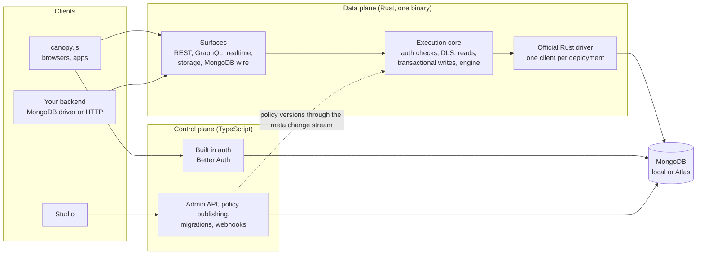

# 004: The Rust data plane

Decided on 2026-11-22: option C, a Rust data plane for every data path ([ADR-0017](../adr/0017-rust-data-plane.md)).
Written against checkout `275926e`. The design it changes is [14: Native core in Rust](../design/14-native-core.md);
the phase that delivers it is [Phase 5b](../design/12-roadmap.md#35b-phase-5b-native-data-plane--v07-12-weeks).
`apps/docs` and `apps/studio` are out of scope, except where they document or display what changes.

## 1. Goal

Canopy is a backend as a service for MongoDB, and its two long term promises are **speed** and a **developer
experience** that lets a team ship without thinking about the server. This plan serves both:

- **Speed:** one Rust service owns every request that touches application data, from the socket to MongoDB
  and back, with one connection pool and no language boundary inside a request.
- **Developer experience:** developers keep writing TypeScript (policies, schema, config, the app itself with
  `canopy.js`), run one binary that behaves the same on a laptop, in Docker and against Atlas, and can reach
  their data with REST, GraphQL, realtime or any official MongoDB driver, with the same DLS everywhere.

## 2. Where the work happens today

- The Rust workspace already holds protocol, matcher, query, policy, engine and port crates, the Node-API and
  WebAssembly ports, and `canopy-gateway`. In gateway mode the gateway owns the public listener, serves every
  realtime transport, verifies tokens, API keys, revocations and view tokens, and proxies every other path to
  the TypeScript server on loopback. Its [MongoDB reader](../../crates/canopy-gateway/src/mongo.rs) uses
  snapshot sessions and raw BSON cursors. Some operations still materialize every result into a Canopy
  document, and its filter conversion encodes a Canopy document and parses it back into a driver document;
  both are measurable costs to remove.
- REST [reads](../../packages/rest/src/read-path.ts) combine caller filters with policy, enforce field access,
  bind pagination cursors to the query, bound execution and handle BSON types. [Writes](../../packages/rest/src/write-path.ts)
  own policy checks, transaction retries, batch atomicity, idempotency and commit times; the gateway forwards
  socket mutations to them. [GraphQL](../../packages/graphql/src/handler.ts) takes read and write services as
  inputs, so one implementation of each can serve both APIs.
- Stage 4 of Phase 5 measured 0.92× and 0.99× the TypeScript throughput per CPU for pages of 20 and 100, with
  the Node driver and one native call per document ([14 §8](../design/14-native-core.md#8-stages-and-gates)).
  The [write spike](../spikes/S3-write-path-cost.md) put most of a transactional write's CPU in the JavaScript
  driver and BSON. [S13](../spikes/S13-inbound-wire.md) measured 11.53 µs per returned document through a
  wire listener on the gateway, against 23.97 µs through the Data API, for pages of 100.

## 3. Target architecture



| Plane | Owns | Language |
|---|---|---|
| **Data** | Every request that reads or writes application data: REST, GraphQL, realtime, storage objects and metadata, the MongoDB wire endpoint. Token, API key and revocation checks, DLS, execution, encoding | Rust |
| **Control** | Built in auth flows and key issuance, the admin API, policy and schema publishing, meta database migrations, webhooks, scheduled jobs | TypeScript (Bun primary) |
| **Developer surface** | `canopy.js` and bindings, the policy, schema and config DSLs, type generation, the CLI, Studio, embedded mode for Node apps | TypeScript |

The planes meet only through MongoDB (the meta database and its change stream) and through resolved config
as JSON. The control plane never proxies data requests, and the data plane never runs user TypeScript.

## 4. Working close to MongoDB, on Docker and on Atlas

**What "close" means.** Both official drivers already send native MongoDB commands over a socket, so a custom
driver saves no network hop. The cost to remove is everything Canopy does around the driver. The data plane:

1. pushes the effective filter (caller filter AND policy), the authorized projection, the sort and the limit
   into MongoDB, so the server does the selection and returns only allowed fields;
2. reads cursors as raw BSON and decodes only the fields a remaining check (a field rule, a `$ctx` lookup) or
   the encoder needs, encoding EJSON straight from bytes in one pass;
3. sizes cursor batches to the page, so a page costs one `find` and no `getMore`;
4. answers driver clients on the wire endpoint with BSON straight from MongoDB's reply whenever no field
   rule must rewrite the document;
5. commits writes in one transaction that also holds the idempotency record, as one round trip where the
   server allows it.

**One connection model.** One long lived `mongodb::Client` per deployment per process, shared by every
surface and the change stream. On the [development stack](../../deploy/compose/dev.yaml) it connects to the
advertised replica set members (`localhost:27017` for `rs0`; a sibling container needs a member name it can
resolve). On Atlas it uses the deployment's `mongodb+srv` URI, credentials, network access and TLS. The build
enables the driver's `dns-resolver` feature for SRV and TXT discovery, checked against the license rules.
Nothing else differs between the two: the same binary, the same policies, the same commands. Every benchmark
records topology, tier, region and network latency so local and Atlas results stay comparable, and the
capability probe ([15 §4.1](../design/15-mongodb-depth.md#41-m1-capability-probe)) switches features by what
the server reports ([Atlas command limits by tier](https://www.mongodb.com/docs/atlas/unsupported-commands/)).

**No generic command endpoint.** The driver's operation APIs serve reads, writes and sessions; a raw database
command is used only for a specific capability (snapshot reads at a chosen cluster time, for one). Nothing
public forwards an arbitrary command, because that would bypass the policy boundary.

## 5. Stages

Each stage ships behind explicit routing (`CANOPY_DATA_PLANE_ROUTES` or the config equivalent) with the
TypeScript route as the fallback, and is promoted only through its gate. All gates run on the reference
hardware against a local replica set **and** a same region Atlas cluster, and report both.

| Stage | Delivers | Gate |
|---|---|---|
| **D0. Baseline** | The REST read, write and fan out workloads on local and Atlas: commands and bytes per request, pool waits, query plans, documents examined, service CPU, allocations, throughput, p50, p95 and p99. The `dns-resolver` build | Recorded report; query plan or round trip findings fixed in both languages first |
| **D1. Reads** | `find` end to end in Rust (caller resolution, limits, field rules, pagination cursors, the response envelope, Problem Details), then `count`, `distinct`, `aggregate` with pipeline validation | Deterministic responses byte identical, the rest equal by contract (errors, malformed cursors, cancellation, policy changes); DLS equivalence and bypass corpus green; at least 1.5× simple read throughput per vCPU with stable tails |
| **D2. Writes** | The transactional write path in Rust: insert, patch, replace, delete, batch, idempotency records, the atomic single document fast path and its fallback, commit cluster times; socket mutations no longer forwarded | Duplicate mutation IDs across versions, ambiguous commits, primary stepdown, batch rollback and policy changes in the suites; echo before ack holds (S7 harness, 0 violations in 100k mutations); write throughput per vCPU at least 1.5× |
| **D3. GraphQL** | GraphQL schema generation and execution on the same read and write services, subscriptions on the engine. The library is chosen in spike S15 | The existing GraphQL suite passes unchanged against the data plane; nested queries cost one execution, not one internal request per resolver |
| **D4. Storage** | Storage policies on `storage.objects`, GridFS and S3 compatible backends, signed URLs, resumable uploads, image transforms | Existing URLs and stored objects keep working; policy suite green; transfer throughput and memory per upload measured |
| **D5. MongoDB wire endpoint** | M3 of [15](../design/15-mongodb-depth.md#43-m3-a-mongodb-wire-protocol-endpoint) on the shared execution core: handshake, `MONGODB-OIDC` and `SCRAM-SHA-256`, the command allowlist, cursors bound to their identity, change streams as subscriptions, writes on the D2 path | Allowlisted unified spec tests with the Node, Python, Go and Java drivers; endpoint in the cross entry point DLS test; bypass corpus over the wire with 0 bypasses; sustained concurrency, writes and change stream resume measured |
| **D6. Control plane split** | `packages/control`: built in auth, admin API, policy publishing, migrations and webhooks as one TypeScript service with its own image; the `canopy` image becomes the data plane binary; compose, Helm and Kubernetes manifests updated | The container stack passes `sdk-e2e`, the Studio and `todo-react` Playwright suites and the smoke tests with the new services; a failing control plane leaves data routes serving |
| **D7. Defaults and embedded mode** | The data plane becomes the default for every promoted route; the TypeScript data packages are frozen as embedded mode and equivalence reference | No P0 or P1 issue open against the data plane for one release; Q17 decided |

D1 and D2 are the critical path. D3, D4 and D5 can run in parallel once D2 lands, because they reuse its
services. D5 also closes Phase 7's dependency on the wire endpoint.

## 6. Developer experience deliverables

- **One binary, every platform.** The data plane ships prebuilt for the eight targets of
  [14 §6](../design/14-native-core.md#6-platforms-toolchain-and-distribution) as optional npm dependencies of
  the CLI, so `bunx --package @canopy/cli canopy dev` (or `npx`, `pnpm dlx`, `yarn dlx`) downloads it and starts it with no Rust or
  container needed; `canopy dev --with-mongo` adds the replica set as today.
- **Same behavior on Atlas.** `canopy link atlas` (M7) only writes the URI; `canopy doctor` reports what the
  capability probe found and which features are on.
- **Your driver is a Canopy client.** After D5, a backend in any language connects with its official
  MongoDB driver and a Canopy token, Compass and `mongosh` work for exploration, and DLS applies as on REST.
- **Nothing changes for apps.** REST paths, OpenAPI documents, error codes, wire protocol v1, GraphQL schema
  and `canopy.js` stay identical through every stage; the equivalence gates are what guarantees it.
- **Errors developers can act on.** Every data plane error keeps its `CANOPY_*` code and Problem Details
  shape, and `POST /rest/v1/{coll}/_explain` returns the same explain trace from Rust.
- **Hot reload stays.** Policies and config edited in the project folder reach the data plane through the
  meta database (policies) or a restart from `canopy dev` (config), in under a second on the dev stack.

## 7. Proposed repository layout

The layout below groups the repository by plane and gives language neutral test data its own home. It is a
proposal: each move lands with the stage that needs it, never as one large rename.

```
canopy/
├─ crates/                      Rust data plane, flat, one crate per directory
│  ├─ canopy-protocol/          EJSON, BSON, frames, cluster time, error codes       (core, no I/O)
│  ├─ canopy-matcher/           filters, BSON order, sort, projection, updates       (core, no I/O)
│  ├─ canopy-query/             parser, allowlists, limits, hashing                  (core, no I/O)
│  ├─ canopy-policy/            compiler to filter and matcher, explain, field rules (core, no I/O)
│  ├─ canopy-engine/            predicate index, observers, merge boxes, sequencing  (core, no I/O)
│  ├─ canopy-config/            resolved config types and their JSON Schema          (new, D1)
│  ├─ canopy-mongo/             driver client, sessions, raw cursors, capability probe (from canopy-gateway, D1)
│  ├─ canopy-auth/              JWKS, API keys, revocations, view tokens             (from canopy-gateway, D1)
│  ├─ canopy-data/              read and write execution, idempotency, echo correlation (new, D1 and D2)
│  ├─ canopy-storage/           storage policies, GridFS and S3 backends, signed URLs (new, D4)
│  ├─ canopy-http/              REST routes, Problem Details, OpenAPI document       (new, D1)
│  ├─ canopy-graphql/           GraphQL schema and execution                         (new, D3)
│  ├─ canopy-realtime/          WebSocket, SSE and long polling transports           (from canopy-gateway, D1)
│  ├─ canopy-wire/              MongoDB wire protocol endpoint                       (new, D5)
│  ├─ canopy-port/              what the Node-API and WebAssembly ports share
│  └─ canopyd/                  the data plane binary, surfaces composed by CANOPY_ROLE (canopy-gateway renamed, D6)
├─ packages/                    TypeScript
│  ├─ protocol/ matcher/ query/ policy/   universal core: synced to Canopy.js, equivalence reference
│  ├─ schema/ config/           DSLs, schema inference and type generation
│  ├─ cli/                      `canopy` CLI; carries `canopyd` as optional platform dependencies
│  ├─ control/                  control plane service (new, D6): from server, auth-builtin and the admin parts of auth
│  ├─ auth/                     the AuthProvider contract and token helpers shared by control and embedded mode
│  ├─ auth-builtin/             Better Auth provider, loaded only by control
│  ├─ embedded/                 embedded mode for Node apps (D7): from rest, realtime, graphql, storage, node-http
│  ├─ native/ wasm/             Node-API and WebAssembly ports (crate and npm package together, napi-rs layout)
│  ├─ studio/                   built Studio assets and the `canopy-studio` server
│  ├─ testing/                  private: harnesses, MongoDB oracles, simulation
│  └─ sdk-e2e/                  private: the stack tested end to end through canopy.js
├─ conformance/                 language neutral test data, read by Rust, TypeScript and Canopy.js (new)
│  ├─ protocol/                 frame vectors (from packages/protocol/vectors)
│  ├─ matcher/ query/ policy/   generated cases with MongoDB's answers (from crates/*/tests/vectors)
│  ├─ errors.json               the one source of CanopyError codes for both languages
│  └─ http/                     REST and GraphQL request and response pairs for the D1 to D3 gates
├─ apps/
│  ├─ studio/                   admin dashboard
│  └─ docs/                     documentation site
├─ examples/                    runnable apps with end to end tests
├─ bench/                       benchmark harnesses and gates (new)
│  ├─ workloads/                REST, write, fan out, wire workloads (from packages/*/bench and bench workflows)
│  ├─ baselines/                committed baselines the gates compare against
│  └─ spikes/                   spike prototypes (from docs/spikes/*-prototype)
├─ fuzz/                        cargo fuzz targets
├─ deploy/
│  ├─ compose/                  database, data, control, studio, edge
│  ├─ docker/                   canopy (canopyd), canopy-control, canopy-studio images
│  ├─ helm/ kubernetes/         the same services
│  ├─ binary/                   release builds of canopyd and the CLI
│  └─ dev/                      the `bun run dev` project
├─ docs/                        every document, nothing executable
│  ├─ README.md                 reading order, one page summary, glossary
│  ├─ design/                   the design, chapters 00 to 15
│  ├─ adr/                      decision records
│  ├─ spikes/                   spike write ups
│  ├─ reviews/                  security and usability reviews
│  └─ plans/                    work plans and their status (this file)
├─ api/                         public TypeScript API reports
└─ tools/repo-check/            repository rules for both languages
```

**What moves, and when.**

| Today | Target | Stage | Why |
|---|---|---|---|
| `docs/plan/`, `plans/` | `docs/design/`, `docs/plans/` | Done (2026-11-22) | All documents under one folder |
| `crates/canopy-gateway` | split into `canopy-mongo`, `canopy-auth`, `canopy-realtime`, `canopy-http`; binary renamed `canopyd` | D1 to D6 | Each surface reuses the same execution core; the binary becomes the data plane, not a gateway in front of one |
| `packages/server` | `packages/control` (admin, migrations, publishing, webhooks) plus `packages/embedded` (composition for embedding) | D6, D7 | The process that served everything splits by plane |
| `packages/rest`, `realtime`, `graphql`, `storage`, `node-http` | `packages/embedded`, frozen | D7 | One package for embedded mode, the equivalence reference |
| `packages/protocol/vectors`, `crates/*/tests/vectors` | `conformance/` | Done (2026-11-22) | Test data owned by neither language; Canopy.js vendors one folder |
| `packages/*/bench`, `docs/spikes/*-prototype` | `bench/` | Done (2026-11-22) | Benchmarks and prototypes are code, not documents; the gates read one baseline folder |
| `packages/native`, `packages/wasm` | unchanged | | napi-rs and wasm-bindgen expect the crate beside its npm package |

Constraints the moves respect: Cargo workspace members stay `crates/*` plus the two port packages; Bun
workspaces stay `packages/*`, `apps/*` and `examples/*`, plus the private `@canopy/bench` package in `bench/`
(added in D0, because Bun's isolated linker resolves the workloads' imports only for a workspace member);
`tools/` stays outside the workspace; every moved
path is updated in `tsconfig.json` references, `knip.json`, `biome.json`, the CI and bench workflows,
`tools/repo-check` and the Canopy.js `sync-core` script in the same change.

## 8. Risks

| Risk | Mitigation |
|---|---|
| A Rust route admits a document the TypeScript route refuses | MongoDB as oracle; the route joins the cross entry point DLS test and the bypass corpus before promotion; byte identical compiled filters |
| The rewrite stalls with two half finished stacks | One route at a time, each behind routing with a tested rollback; D1 and D2 before anything else |
| Idempotency or echo before ack breaks during the write path move | Replay suites across versions; one owner per live mutation; S7 harness as the D2 gate |
| A Rust library for GraphQL or storage misses a needed feature or license | S15 before D3; storage backends behind a trait with GridFS first |
| Atlas behaves differently from the local replica set | Every gate reports both; the capability probe decides features; tier limits recorded per run |
| Contributors without Rust lose access to server work | The control plane, DSLs, CLI, Studio and embedded mode stay TypeScript; crates mirror packages; two code owners per crate |
| The wire endpoint widens the attack surface | Allowlist that fails closed; `cargo fuzz` on the frame parser; in the pre 1.0 audit scope |

## 9. Options considered

| Option | What runs in Rust | Outcome |
|---|---|---|
| A. A native page operation inside the TypeScript service | One Node-API call per page | Rejected as the end state; at most an accelerator for embedded mode |
| B. REST operations in the existing gateway | Chosen routes end to end | Kept as the method: D1 is B, and C continues it |
| **C. Rust data plane** | Every data path | **Chosen** ([ADR-0017](../adr/0017-rust-data-plane.md)) |
| D. Canopy's own outbound MongoDB wire client | The driver itself | Rejected: no hop saved, and Canopy would own discovery, pooling, authentication, retries, failover and Atlas compatibility |
| Optional inbound MongoDB wire listener | Driver access with DLS | Adopted as D5, on the shared execution core |
