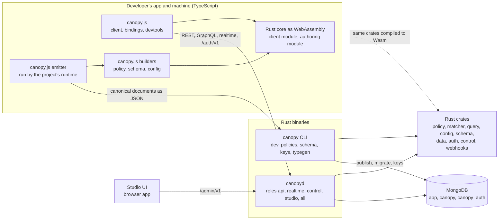
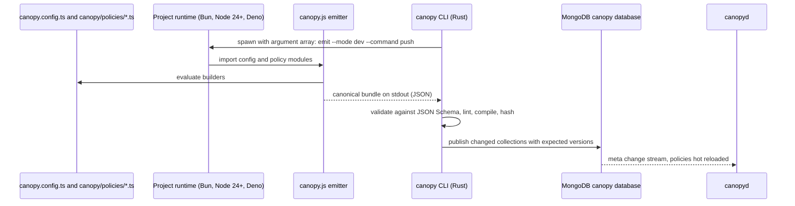
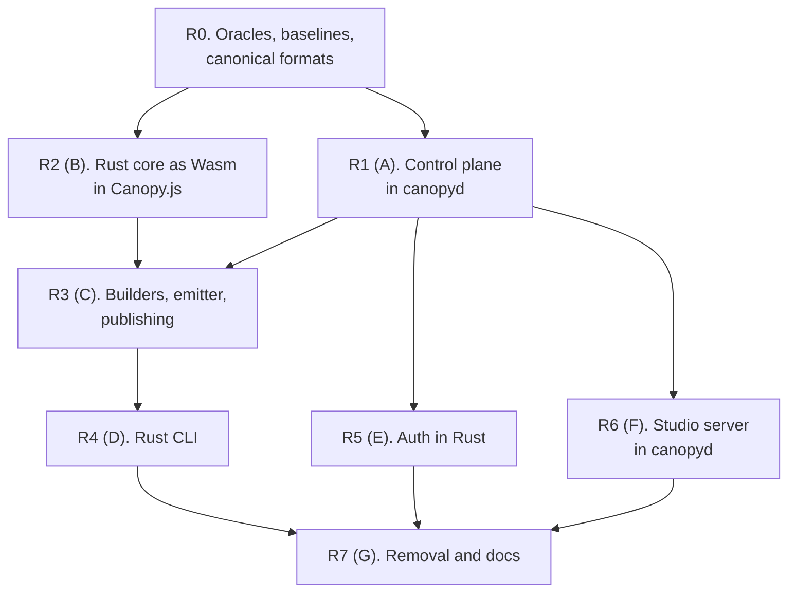

# 005: All server code in Rust, one shared core

Decided on 2026-11-25 ([ADR-0018](../adr/0018-all-server-code-in-rust.md)). Written against checkout `9e9c94f`
on `refactor/rust-port`, after stages D1 to D6 of [plan 004](004-rust-data-plane.md) passed their gates and D7
was done in code. The design chapters it changes are [01](../design/01-architecture.md),
[07](../design/07-auth.md), [08](../design/08-studio-and-cli.md), [11](../design/11-engineering.md) and
[14](../design/14-native-core.md); the roadmap gains a Phase 5c between Phase 5b and Phase 6
([12 §3.5b](../design/12-roadmap.md#35b-phase-5b-native-data-plane--v07-12-weeks)). The working context for
agents is [`docs/context/005-all-server-code-in-rust/`](../context/005-all-server-code-in-rust/README.md).

## 1. Goal

Canopy is a backend as a service and `canopy.js` is how applications talk to it. After this plan:

- **every line of server code is Rust:** `canopyd` serves data, realtime, auth, the admin API, webhooks,
  migrations, policy publishing and Studio's assets, and a Rust `canopy` binary is the CLI;
- **every rule has one implementation:** the Rust crates parse, validate and compile policies, match
  documents, canonicalize queries, resolve config and infer schemas, natively in `canopyd` and the CLI and as
  WebAssembly in Canopy.js;
- **TypeScript is where developers' code runs:** Canopy.js (client, bindings, devtools, typed builders), the
  Studio UI, the docs site, and the test and repository tooling.

Nothing changes for applications: REST, GraphQL, wire protocol v1, `/auth/v1` as `canopy.js/auth` uses it,
`/admin/v1`, error codes and the `canopy.js` API stay the same, and each stage proves it against an oracle.

## 2. Where the work starts

| Area | State on 2026-11-25 | Source |
|---|---|---|
| Data plane | `canopyd` serves REST, GraphQL, realtime, storage and the wire endpoint; D1 to D6 gates passed on CI | [context 004, 08-progress](../context/004-rust-data-plane/08-progress.md) |
| Control plane | `packages/control` (`canopy-control` image) on `packages/server`: built in auth, `/admin/v1`, policy publishing at startup, migrations, webhooks and cron | `packages/control/src/index.ts`, `packages/server/src/admin/`, `packages/server/src/webhooks/`, `packages/server/src/migrations.ts` |
| Built in auth | Better Auth with the MongoDB adapter, plugins admin, anonymous, bearer, email OTP, generic OAuth, JWT, magic link, two factor and passkey; Canopy's keyring, revocations, identifier guard, response floor, audit, legacy password verifiers | `packages/auth-builtin/src/` |
| CLI | `@canopy/cli` in TypeScript, 25 commands; finds `canopyd` through `@canopy/realtime`'s optional platform packages | `packages/cli/src/cli.ts`, `packages/realtime` |
| Studio | Built UI served by `canopy-studio` (`packages/studio`), a static file server with a strict CSP | `packages/studio/src/handler.ts` |
| Shared core | Rust crates `canopy-protocol`, `-matcher`, `-query`, `-policy`, `-config`, `-data` (schema inference); TypeScript `protocol`, `matcher`, `query`, `policy`, `config`, `schema`; Canopy.js vendors the TypeScript files into `src/core` | `crates/`, `packages/`, `../Canopy.js/scripts/sync-core.ts` |
| WebAssembly | `canopy-wasm` built through wasm-bindgen in `packages/wasm` (policy engine, matcher, query canonicalization, EJSON codec); 681 KB uncompressed, not size tuned | `packages/wasm/generated/` |
| Embedded mode | `@canopy/embedded` composes the TypeScript data packages as the frozen reference | `packages/embedded` |

## 3. Target architecture

| Runs as | Holds | Language |
|---|---|---|
| `canopyd` | Data plane (unchanged), control plane, built in auth, Studio's assets, migrations, webhooks and cron | Rust |
| `canopy` CLI | Every command of today's CLI; `canopy dev` runs the server crates in process | Rust |
| Canopy.js | Client, bindings, devtools, typed builders, the emitter, the Wasm core (generated artifacts) | TypeScript plus generated Wasm and `wasm2js` output |
| Studio UI | The admin dashboard | TypeScript (browser) |
| Tooling | `sdk-e2e`, Playwright suites, benchmark load generators, `tools/repo-check` | TypeScript |

The container stack keeps ADR-0016's services as roles of one image: `database`, `api` and `realtime`
(`canopy`), `control` (`canopy` with `CANOPY_ROLE=control`), `studio` (`canopy` with `CANOPY_ROLE=studio`) and
`edge` (Caddy). The `canopy-control` and `canopy-studio` images are removed.

## 4. The canonical documents and the authoring flow

The contract between Canopy.js and Rust is a set of **canonical documents**: versioned JSON, each described by
a JSON Schema generated from the Rust types (`schemars` or hand written, decided in R0) and checked into
`conformance/authoring/`.

| Document | Produced by | Consumed by |
|---|---|---|
| Policy set (collections, policies, field rules, contexts, version `1`) | `canopy.js/policy` builders | `canopy-policy` (parse, validate, lint, compile, hash); publishing; the Wasm authoring module |
| Config, unresolved (`env()` references kept symbolic, never resolved in JavaScript) | `canopy.js/config` `defineConfig` (an object, or a function called with the mode and command) | `canopy-config` resolution (defaults, `.env` files, environment, sources for `config print --sources`) |
| Collection schema | `canopy.js/schema` builders, or `canopy pull` | `canopy-schema` (new crate): inference, validators, JSON Schema, type generation, diff |
| Policy test cases (actors, operations, documents, expected outcome) | `canopy.js/policy` test helpers | the CLI (in memory and against MongoDB), and the Wasm module for in process tests |

`canopyd` never evaluates TypeScript. A deployment either publishes with `canopy policies push` in CI, or
mounts a bundle written by `canopy build` that `canopyd --role control` publishes at startup (today's
`canopy-control` behavior). Projects without a JavaScript runtime can write the canonical JSON by hand.

## 5. Stages

Stages are named R0 to R7 so they do not collide with plan 004's D stages or the spikes. The letters A to G of
the maintainer's brief map as shown. Each stage ships behind routing or a flag with the TypeScript path as
fallback until its exit gate passes, and nothing TypeScript is deleted before R7.

**Why this order.** R0 comes first because the oracles can only be recorded while the TypeScript code exists,
and because the canonical documents are the contract that R2, R3 and R4 build on. R1 (A) comes before auth
because it is smaller, and builds what R5 reuses: the `control` role in `canopyd`, the mailer, the TOTP
primitive (admin TOTP) and the leases. R2 (B) works in Canopy.js and runs beside R1. R3 (C) needs the Wasm
authoring module and Rust publishing. The CLI (D) comes after C because every CLI command that reads a project
needs the emitter and the canonical bundle. Auth (E) is the longest and riskiest stage and is the critical
path: R0, R1, R5, R7. Studio's server (F) is small and can land any time after R1.

| Stage | Delivers | Entry gate | Exit gate |
|---|---|---|---|
| **R0. Oracles, baselines, canonical formats** | HTTP oracles recorded from the TypeScript server: `conformance/http/auth/` (every `/auth/v1` flow on a fake clock with seeded randomness, mail captured, a mock OIDC provider, a software authenticator, the Set-Cookie names and attributes, and the documents left in `canopy_auth` and `canopy.audit_log`), `conformance/http/admin/` (every `/admin/v1` route for each admin role), `conformance/webhooks/` (deliveries, Standard Webhooks signatures, retry schedule, triggers, cron), `conformance/migrations/` (meta database after each migration from each starting version), `conformance/http/studio/` (headers, CSP, redirects). A `canopy_auth` fixture database written by the TypeScript server (`conformance/auth/documents/`): users with every password hash kind, sessions, accounts of every provider, two factor secrets, passkeys, EdDSA and ES256 signing keys. Authoring vectors (`conformance/authoring/`): DSL input to canonical document, invalid inputs with their error codes and paths; type generation and `canopy pull` output (`conformance/typegen/`); CLI golden outputs (`conformance/cli/`: arguments, stdout, stderr, exit code, files written) on a fixture project. The canonical document JSON Schemas. Canopy.js bundle size and startup baselines (§7). The TypeScript server packages are frozen: fixes only | ADR-0018 accepted | Every oracle records and passes its `--check` on MongoDB 8.0 and 9.0, Bun and Node 24 and 26; volatile values substituted and listed; maintainer review of the oracles and of the JSON Schemas; the Better Auth encryption and cookie formats confirmed from the fixture |
| **R1 (A). Control plane in canopyd** | New crates `canopy-control` (the `/admin/v1` routes of `packages/server/src/admin/routes`: core, data, ops, policies, realtime, session, webhooks; admin users in `canopy.admin_users` with their own sign in, TOTP and long lived admin tokens; RBAC; settings; email templates; lag and trace), `canopy-webhooks` (dispatcher, queue with leases, triggers on the change stream, cron scheduler), `canopy-migrations`, `canopy-mail` (templates, SMTP through `lettre`, Resend, Postmark, SES with SigV4), and policy publishing with versions, history, rollback, contexts and audit, including publish at startup from a canonical bundle. `CANOPY_ROLE=control` in `canopyd`. The TypeScript `canopy-control` keeps serving only `/auth/v1`, the JWKS and `/admin/v1/users` until R5; the edge routes the rest to `canopyd` | R0 admin, webhooks and migrations oracles recorded | `/admin/v1` oracle replays byte for byte after substitutions (users routes excepted until R5); migrations yield the recorded meta database from every starting version; webhook bodies, signatures and retry schedule equal the oracle; Rust publishing yields the stored documents, hashes and history TypeScript yields for the same bundle; compose, Helm and Kubernetes run `control` as a role of the `canopy` image; `sdk-e2e`, the Studio and `todo-react` Playwright suites and the split stack smoke pass; stopping `control` leaves data routes serving |
| **R2 (B). Rust core as Wasm in Canopy.js** | `canopy-wasm` split into a **client module** (matcher, sort, projection, update application) and an **authoring module** (policy parse, validate, lint, explain and compile; query canonicalization; config resolution; schema inference), batch APIs so a call covers many documents, and a `wasm2js` build of each for runtimes without WebAssembly (Hermes) and for pages whose CSP forbids it. Canopy.js replaces `src/core` with the generated artifacts, copied by a `sync-wasm` script with checksums and `--check`; `sync-core.ts` is deleted. Frame types generated from the Rust definitions | R0 baselines | Every conformance vector set that applies (matcher, query, policy, pipeline, schema, protocol) passes through the Wasm and `wasm2js` builds on Bun, Node 24 and 26, Deno, Chromium, Firefox, WebKit and Hermes; Canopy.js's suites green; the size and startup gate of §7 met; no TypeScript file in Canopy.js implements matcher, policy, query, config or schema semantics (checked by a script) |
| **R3 (C). Builders, emitter, publishing** | Canopy.js builders reduced to typed constructors of the canonical documents, validated by the authoring module (Rust error codes and paths); `canopy.js/emit`, run by the project's runtime, prints the canonical bundle (config object or function, policy folder, schema, policy tests) on stdout; policy test helpers produce test case documents; `canopy build` writes a bundle file for deployments; publishing from the bundle in the CLI and at `control` startup | R2 authoring module; R1 publishing | The bundle emitted for every fixture project (`deploy/dev`, the templates, the examples, the `sdk-e2e` fixtures) equals the R0 authoring vectors; invalid inputs fail with the recorded codes and paths; a canary test proves no resolved secret appears in a bundle; publishing a bundle from Rust and from TypeScript yields the same stored documents |
| **R4 (D). Rust CLI** | Crate `canopy-cli`, binary `canopy`, with every command of today's usage text: `init`, `dev` (the server crates in process, `--with-mongo` through Docker or the official binaries, a watcher that emits again on save), `doctor`, `policies` (lint, test, explain, diff, push, pull, history, rollback), `auth import`, `keys`, `admin`, `migrate`, `login` and `logout` (OS keychain), `pull`, `schema diff` and `push`, `config print`, `realtime enable-images` and `disable-images`, `indexes`, type generation. Runtime detection for the emitter in the order Bun, Node 24+, Deno, spawned with argument arrays and `.cmd` shims on Windows. Shipped in the existing eight platform packages beside `canopyd`, with `@canopy/cli` reduced to a generated launcher that finds the host package | R3 | The R0 CLI golden outputs replay on Windows x64 and arm64, Linux glibc and musl on x64 and arm64, and macOS on Apple silicon and Intel; type generation and `canopy pull` output byte identical to the R0 vectors; install tests with Bun (hoisted and isolated), pnpm, Yarn (node_modules and Plug'n'Play) and npm; `canopy dev` from file save to active policy under one second on the dev stack; `SIGINT`, `SIGTERM` and `SIGBREAK` stop it cleanly |
| **R5 (E). Auth in Rust** | Crate `canopy-authn` (name decided in R0): the `/auth/v1` routes, sessions and cookies compatible with today's, every flow of §6, `/admin/v1/users`, the JWKS and `/.well-known/jwks.json`; then the `canopy-control` image and `packages/control` stop serving | R0 auth oracle and fixture; R1 mail, TOTP and `control` role; spike S16 (WebAuthn) recorded | The full `/auth/v1` oracle replays; on the R0 fixture database every user signs in (and legacy hashes are rehashed to Argon2id), existing sessions continue, passkeys registered under TypeScript authenticate, tokens signed with TypeScript minted keys verify and the Rust minted ones verify in TypeScript's verifier; the W3C WebAuthn Level 3 vectors pass; every auth fuzz target runs 24 CPU hours in nightly with no finding; rate limit and audit vectors equal; `sdk-e2e` auth suites green against Rust auth; an external security review with no open P0 or P1 finding before the release that enables it |
| **R6 (F). Studio server in canopyd** | `CANOPY_ROLE=studio`: the built Studio assets from `CANOPY_STUDIO_DIR` (in the image and next to the CLI), the CSP and security headers, health, the redirect; `canopy dev` serves Studio. `'wasm-unsafe-eval'` joins Studio's CSP only if Studio loads the Wasm core rather than its `wasm2js` build | R1 | The R0 Studio header oracle replays; the Studio Playwright suite passes against `canopyd`; the `canopy-studio` image and `packages/studio`'s server are removed from the stack |
| **R7 (G). Removal and docs** | Delete `packages/auth`, `auth-builtin`, `control`, `server`, `rest`, `graphql`, `storage`, `realtime`, `node-http`, `embedded`, `native`, `cli`, `studio` (server), `protocol`, `matcher`, `query`, `policy`, `config`, `schema`; `packages/wasm` becomes a build only home of `canopy-wasm`. CI drops the TypeScript server matrix and Stryker; `cargo test`, `proptest`, `cargo llvm-cov` floors, `cargo mutants` and the fuzz targets take their place (§8). Examples run `canopyd` beside the app; those that only show `canopy.js` move to Canopy.js. Design chapters 01, 07, 08, 09, 11, 12 and 14, `docs/README.md` and `CLAUDE.md` updated | R1 to R6 exit gates passed; one release with no P0 or P1 issue open against the Rust replacements | `bun install --frozen-lockfile`, the repository checks, `cargo test` and the container stack suites pass with no TypeScript server package; Canopy.js passes against the published stack; Q17 and Q11 recorded as answered in 12 §7 |

## 6. Auth in Rust (R5)

### 6.1 Steps

| Step | Delivers | Evidence |
|---|---|---|
| R5.1 Core | Sessions (`canopy.session_token` and its signature, expiry and update age, revocation through `RevocationStore`), email and password sign up and sign in with uniform responses and the response floor, email verification, password reset, sign out, `/token` (access tokens with `aal`, `is_anonymous`, roles, `app_metadata`), the keyring (EdDSA and ES256, rotation with grace periods under a lease, decryption of Better Auth encrypted private keys), `/settings`, `/upgrade` | Oracle groups for these routes; tokens cross verified |
| R5.2 Email flows | Magic link, email OTP (sign in, verification, reset, email change), invites | Oracle groups; mail bodies equal |
| R5.3 Social and OIDC | Google, GitHub, Apple (client secret signed with ES256), Microsoft (tenant), Discord, generic OIDC through discovery; PKCE, state and nonce in `verifications`; account linking rules; redirect allowlist | Oracle groups against the mock provider; ID token validation negative cases |
| R5.4 Two factor | TOTP per RFC 6238 (SHA-1, 30 seconds, 6 digits, one step of skew), backup codes, `aal2` sessions, the ceremony cookie and its bearer header bridge, the fresh session rule (15 minutes) | RFC 6238 appendix B vectors; oracle groups |
| R5.5 Passkeys | Registration and authentication (§6.3), `aal2` sessions, listing, renaming and deleting passkeys | §6.3 |
| R5.6 The rest | Anonymous sign in and upgrade, admin plugin routes behind `/admin/v1/users`, bearer, identifier guard and rate limits in `rate_limits` and `identifier_limits`, audit events, `canopy auth import` verifiers (bcrypt, PBKDF2 SHA-1, SHA-256 and SHA-512, Firebase scrypt, Argon2id) and Better Auth scrypt, rehash on sign in | Oracle groups; imported fixture users sign in |

### 6.2 Documents carry over

The Rust code reads and writes the `canopy_auth` documents in the shapes the TypeScript server writes,
established by the R0 fixture, not by reading Better Auth's source. Each collection gets a Rust type that
keeps fields it does not know (a flattened remainder, so nothing written by TypeScript is lost on update) and
a test that loads every fixture document and writes it back unchanged. Field names, date types, identifier formats (Better Auth's string ids), cookie names, cookie
signature format and token claims are part of the oracle. No migration rewrites existing documents; a change
of shape, if ever needed, is a migration of its own with a rollback.

### 6.3 Passkeys: our own relying party

- **Scope.** WebAuthn Level 3 relying party operations for registration and authentication, with
  `userVerification: "required"` and `residentKey: "preferred"` as today, the relying party id from the public
  URL and the allowed origins from the public URL and `trustedOrigins`.
- **Parsing.** `clientDataJSON` (type, challenge, origin, `crossOrigin`, `topOrigin`), authenticator data
  (relying party id hash, flags UP, UV, BE, BS, AT, ED, the signature counter, attested credential data with
  AAGUID, credential id up to 1023 bytes and the COSE key, extensions), the CBOR attestation object. CBOR and
  COSE through `coset` and `ciborium`, or our own minimal decoder, decided in spike S16 by license, size and
  fuzz results; either way with depth, length and duplicate key limits.
- **Algorithms.** ES256 (COSE algorithm -7), EdDSA (-8) and RS256 (-257, 2048 bits and up) through `ring`.
- **Attestation formats.** `none`, and `packed` with self attestation or an `x5c` chain whose leaf
  signature, version 3, `CA:false`, subject requirements and AAGUID extension are checked. No trust anchors or
  metadata service: Canopy requests no attestation, so the statement is checked for integrity and stored as
  untrusted. Other formats are refused with a clear error (open question O8).
- **Counter.** A counter that is not zero and not greater than the stored one fails the ceremony as a possible
  clone; zero on both sides (synced passkeys) passes. The update is a conditional write on the stored counter,
  so two concurrent assertions cannot both pass.
- **Challenges.** Single use, stored with an expiry, bound to the ceremony cookie or its bearer header, as
  today.
- **Tests.** The W3C WebAuthn Level 3 test vectors; registrations and assertions recorded from the TypeScript
  server with a software authenticator in R0; negative cases for every check above; a `cargo fuzz` target each
  for `clientDataJSON`, authenticator data, the attestation object and the COSE key; browser tests through
  Playwright's virtual authenticator in the Studio or `todo-react` suites.

## 7. The Wasm core in Canopy.js: bundle and startup gate

The risk is honest: today the browser client imports a TypeScript lite matcher that tree shakes to a few
kilobytes, starts with the page and never crosses a language boundary. A WebAssembly module adds a download,
a compile and instantiate step, and a crossing per call. Stage 4 of Phase 5 showed that a crossing per
document can erase the gain, so the client module exposes batch calls (match a page, apply an update to a
set) and keeps documents on the Rust side where it can.

R0 records the baselines; R2 must meet these thresholds (confirmed by the maintainer on 2026-11-25):

| Measure | Profile | Gate |
|---|---|---|
| Client module size | Brotli | At most 80 KB; the authoring module never loads from the client root entry |
| Root entry growth | `canopy.js` with one live query, production build, brotli | At most 60 KB over the R0 baseline |
| Startup | Mid range Android profile (Chromium, 4× CPU slowdown), streaming compile | Compile and instantiate under 30 ms; time to first live query result at most 5 % over baseline |
| Matching | 1,000 documents, the six filters of `bench/workloads/matcher/event-cost.ts` | At most 1.2× the TypeScript lite matcher's time |
| Optimistic update | One update applied to one document | At most 3× the TypeScript time (2× until 2026-11-26, see below), and under 50 µs on the profile |
| Without WebAssembly | `wasm2js` build on Hermes and under `script-src 'self'` | Every vector passes; size and times reported, at most 3× the TypeScript times |

If a threshold fails, the stage stops and the maintainer chooses among: size work (feature flags, `wasm-opt`,
splitting the module further), a different split between client and authoring modules, or a narrower
client module. A TypeScript copy of the semantics is not one of the options (ADR-0018).

The optimistic update gate was missed at about 2.6× (the Rust cost is the allocation heavy document tree, not
the crossing), and on 2026-11-26 the maintainer accepted the measured ratio: the gate is at most 3× for this
stage, Rust stays the only updater, and a document representation with fewer allocations is later
performance work, not a condition of R2.

## 8. Keeping I1 to I6 tested without the TypeScript reference

The TypeScript reference compared one implementation with another. Without it, each invariant of
[09 §4.2](../design/09-security.md#42-policy-engine) is checked against MongoDB, against a small
specification model in test code, or against frozen vectors:

| Invariant | How it stays property tested |
|---|---|
| I1 reads never return a document failing `USING(read)` | `proptest` generates policy sets, contexts and documents; the compiled filter runs on MongoDB and the Rust matcher runs in memory; both must agree with each other on every document, and every read route (REST, GraphQL, wire, realtime snapshot) must return a subset |
| I2 writes never leave a document failing `CHECK(op)` | Generated writes go through the write path; afterwards MongoDB is queried with the `CHECK` filter on every written id; a mismatch must have been refused |
| I3 no field outside `readable(roles)` | Generated roles and field rules; response keys are compared with a deliberately small model of `readable` written in the test, not a port of the engine |
| I4 realtime never sends what REST would not | The simulation (`CANOPY_SIM_SEEDS`) moves to Rust: generated event sequences, deliveries compared with a REST read at the same cluster time |
| I5 errors deny | Generated malformed policy documents, missing variables, injected driver errors and timeouts must deny; fuzz targets on the policy, query and canonical document parsers |
| I6 no secret in logs, metrics or errors | Canary secrets in config, keys, passwords, tokens and two factor secrets; every suite scans logs, metrics labels, traces and Problem Details for them |

Supporting rules: the vectors in `conformance/` recorded from TypeScript are **frozen** (their `--check` fails
on any change); vectors whose answers come from MongoDB are recorded again from MongoDB; new oracles are recorded from Rust
only with a review checklist (who reviewed, which cases are new, why the expected values are right) in the
same pull request; `cargo mutants` runs on `canopy-policy`, `-matcher`, `-query`, `canopy-auth` and the auth
crate with surviving mutant floors as Stryker had; the Wasm and `wasm2js` builds replay the same vectors.
Short property runs on every pull request and long runs nightly, as 09 §5 already requires.

## 9. What moves, and when

| Today | Target | Stage |
|---|---|---|
| `packages/server/src/admin`, `webhooks`, `migrations.ts`, `policy-store.ts`, `packages/control` | `crates/canopy-control`, `canopy-webhooks`, `canopy-migrations` in `canopyd` | R1 |
| `packages/auth-builtin/src/email` | `crates/canopy-mail` | R1 |
| `packages/wasm` (one module, TypeScript wrapper) | Two modules plus `wasm2js`, artifacts vendored by Canopy.js | R2 |
| Canopy.js `src/core` (vendored TypeScript) | Generated Wasm artifacts and thin builders | R2, R3 |
| Config and policy loading in `packages/config`, `packages/cli/src/policies.ts` | `canopy.js/emit` plus `canopy-config` and `canopy-policy` | R3 |
| `packages/schema` (inference, type generation, diff, DSL writer) | `crates/canopy-schema` | R3, R4 |
| `packages/cli` | `crates/canopy-cli`; `@canopy/cli` becomes a launcher | R4 |
| `canopyd` platform packages as optional dependencies of `@canopy/realtime` | The same eight packages carry `canopy` and `canopyd`, optional dependencies of `@canopy/cli` | R4 |
| `packages/auth-builtin`, `packages/auth` | `crates/canopy-auth` (verification, already) and the new auth crate | R5 |
| `packages/studio` server, `canopy-studio` image | `canopyd --role studio` | R6 |
| Every remaining TypeScript server package, `@canopy/native`, `@canopy/embedded` | Deleted | R7 |

**What stays in TypeScript:** Canopy.js (client, framework bindings, devtools, builders, emitter), the Studio
UI in `apps/studio`, the docs site in `apps/docs`, `sdk-e2e` and the Playwright suites (they test the product
the way applications use it), the private `packages/testing` helpers those suites need, the benchmark load
generators in `bench/`, `tools/repo-check`, and the generated `@canopy/cli` launcher.

## 10. Risks

| Risk | Mitigation |
|---|---|
| Our own auth has a flaw Better Auth did not | Oracle replay of every flow; negative and fuzz tests; `cargo mutants` on the auth crate; external review before the release that enables it; the TypeScript auth stays the fallback until R7 |
| The WebAuthn relying party accepts a forged or replayed assertion | W3C vectors, negative cases per check, conditional counter writes, single use challenges, fuzz targets, Playwright virtual authenticator tests, in the external review scope |
| Existing users, sessions or passkeys stop working at cutover | The R0 fixture database is the gate; cookies, claims and documents byte compatible; a rollback to TypeScript auth stays possible until R7 because nothing rewrites documents |
| The Wasm core makes the browser client larger or slower | The §7 gate with baselines; batch APIs; client and authoring modules split; `wasm2js` for Hermes and strict CSPs |
| A divergence the TypeScript reference would have caught goes unnoticed | §8: MongoDB as the oracle, frozen vectors, reviewed Rust oracles, a specification model for field rules, mutation testing |
| The CLI breaks on a platform the TypeScript CLI ran on | Eight prebuilt targets with the install tests and golden outputs in CI on each; the launcher reports the missing platform package by name |
| Evaluating config and policies through the project's runtime is slow or fails in odd setups | A long lived emitter in `canopy dev`; clear errors naming the runtime found; hand written canonical JSON as the fallback |
| Claims hooks and config functions written in TypeScript lose their meaning | O3 and O4 decided in R0; the emitter refuses functions it cannot represent, with a message naming the replacement |
| Two repositories change in lockstep (Canopy.js builders and Rust schemas) | The JSON Schemas and vectors in `conformance/authoring/` are the contract; `sync-wasm --check` in Canopy.js CI |
| Contributors without Rust lose access to server work | Canopy.js, Studio and the docs stay TypeScript; the crates keep two code owners each |

## 11. Open questions

| # | Question | Recommendation | Decide by |
|---|---|---|---|
| O1 | Does the EJSON codec and frame handling of the client move into Wasm too? | **Decided 2026-11-25: yes.** The EJSON codec and the frame types come from the Rust core in the client module; the connection state machine stays client code in Canopy.js; R2 measures frame decoding against today's TypeScript codec and records the result | R2 |
| O2 | One binary for the CLI and the server, or two? | **Decided 2026-11-25: two binaries in the same platform package**, built from one workspace; `canopy dev` links the server crates and needs no second process | R4 |
| O3 | Claims hooks are TypeScript functions in the config (`builtin({ claims })`, 200 ms, 4 KiB). What replaces them? | **Decided 2026-11-25: an HTTPS claims hook** signed like webhooks, with the same time and size limits, failing closed with `CANOPY_AUTH_HOOK_FAILED` | R0 |
| O4 | Config written as a function of mode and command, and any other function in config | The emitter calls the config function once per command and mode; any function value left in the result is refused with an error naming the field | R0 |
| O5 | Policy tests with callbacks or custom assertions | Tests become data (actor, operation, document, expected outcome); callbacks are refused | R3 |
| O6 | Where the CLI launcher lives | `@canopy/cli` in this repository as a generated JavaScript file with no dependencies; `canopy.js` never depends on a binary | R4 |
| O7 | Is `wasm2js` good enough for React Native, or is a native module needed? | `wasm2js` if it meets §7; a native module through JSI only if it does not | R2 |
| O8 | Attestation formats beyond `none` and `packed` (`fido-u2f`, `tpm`, `android-key`, `apple`) | Refuse with a clear error; browsers replace the statement with `none` when no attestation is requested; add a format only when a user reports an authenticator that needs it | S16 |
| O9 | Keep the Node-API port `@canopy/native`? | Remove it in R7; Canopy.js uses Wasm on servers too | R2 |
| O10 | Which language does the Cloudflare edge worker of Phase 6 use? | Rust on the shared crates through `workers-rs`, if its license and size pass | Phase 6 start |
| O11 | Is `control` its own container, or part of `api`? | Its own container of the same image, so a failing auth or admin surface never takes data routes down | R1 |
| O12 | Name of the auth crate | `canopy-authn`, beside the existing verification crate `canopy-auth`; or rename `canopy-auth` to `canopy-verify` | R0 |
| O13 | Do `sdk-e2e` and the Playwright suites stay in this repository? | Yes, as test tooling; they test the stack through `canopy.js` the way applications do | R7 |
| O14 | Spike S14 planned Queryable Encryption with "the TypeScript engine as the fallback" (12 §4). What is the fallback now? | Queryable Encryption only through the Rust driver's in use encryption with prebuilt `libmongocrypt` for the eight targets; where that fails, the feature is cut for that platform, not served by TypeScript | Phase 7, week 1 |
| O15 | Does `canopy-wasm` ship from this repository as `@canopy/wasm`, or only as artifacts vendored by Canopy.js? | Vendored artifacts only, so applications install one package (ADR-0016) | R2 |
