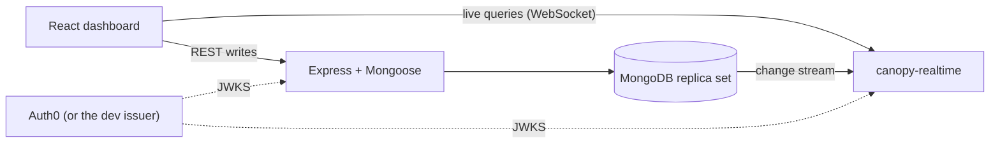

# express-dropin

A small helpdesk built the usual way (Express, Mongoose and Auth0 access tokens) that becomes a live dashboard
without touching its server code. The `canopy-realtime` sidecar reads the same database and pushes each
signed in user exactly the tickets they may see.

- Customers see their own tickets. Support agents see every ticket, including internal notes.
- Writes still go through the app's REST API (`POST /api/tickets`, `PATCH /api/tickets/:id`).
- Every open dashboard updates as soon as a ticket changes, whoever changed it.



## What makes it live

| File                                                                 | Purpose                                                              |
| -------------------------------------------------------------------- | -------------------------------------------------------------------- |
| [`canopy/policies/tickets.ts`](canopy/policies/tickets.ts)           | Who may read which tickets, and which fields they see                |
| [`canopy/policies/tickets.test.ts`](canopy/policies/tickets.test.ts) | Policy tests, run in memory and against MongoDB                      |
| [`web/dashboard.tsx`](web/dashboard.tsx)                             | `createClient` and `createReactDb` instead of polling `/api/tickets` |
| [`canopy.env.example`](canopy.env.example)                           | The sidecar's configuration                                          |

The rest is an ordinary app: [`src/app.ts`](src/app.ts) (routes and authorization),
[`src/tickets.ts`](src/tickets.ts) (the Mongoose model) and the React UI in [`web/`](web). The app only gained a
`/config.json` route that tells the browser where the sidecar is.

## Run it

You need Bun 1.4+ (or Node.js 24+) and a MongoDB replica set. From the repository root, `bun run db:up` starts
one on `localhost:27017`.

```bash
bun install
bun run build
cd examples/express-dropin
cp .env.example .env
cp canopy.env.example canopy.env
```

Then, in two terminals:

```bash
bun --bun run start
```

```bash
bun --bun run sidecar
```

With Node, run `npm start` and `npm run sidecar` (or the `pnpm` and `yarn` equivalents) instead.

Open <http://localhost:3000>, pick a demo user, and open a second window as someone else. Without Auth0
settings the app runs a **development issuer**, a local stand in for Auth0 that signs tokens for three demo
users: Alice and Bob (customers) and Sam (support). Try:

1. As Alice, open a ticket. It appears in Sam's window at once, but never in Bob's.
2. As Sam, add an internal note and move the ticket to "In progress". Alice sees the new status; the note never
   reaches her browser.
3. Change a ticket from the command line. The open dashboards update too:

```bash
TOKEN=$(curl -s -X POST localhost:3000/dev/token -H 'content-type: application/json' -d '{"user":"bob"}' | node -p 'JSON.parse(require("fs").readFileSync(0)).token')
curl -X POST localhost:3000/api/tickets -H "authorization: Bearer $TOKEN" -H 'content-type: application/json' -d '{"title":"Printer jammed","priority":"high"}'
```

Check the setup and the policies:

```bash
bun run doctor
bun run policies:test
```

## Use your Auth0 tenant

1. In Auth0, create an **API** with the identifier `https://helpdesk.example/api` (or your own) and RS256
   signing.
2. Create a **Single Page Application**. Add `http://localhost:3000` to Allowed Callback URLs, Allowed Logout
   URLs and Allowed Web Origins.
3. Create a role named `support`, assign it to your agents, and add a post login Action that copies roles into
   the access token:

```js
exports.onExecutePostLogin = async (event, api) => {
  api.accessToken.setCustomClaim('https://helpdesk.example/roles', event.authorization?.roles ?? [])
}
```

4. In `.env`, set `AUTH0_DOMAIN`, `AUTH0_AUDIENCE` and `AUTH0_CLIENT_ID`. In `canopy.env`, point
   `CANOPY_JWT_JWKS_URL` to `https://YOUR_TENANT.auth0.com/.well-known/jwks.json` and `CANOPY_JWT_ISSUER` to
   `https://YOUR_TENANT.auth0.com/`, with the same audience.

The development issuer refuses to start when `NODE_ENV=production`.

## Tests

```bash
CANOPY_TEST_MONGODB_URI="mongodb://localhost:27017/?replicaSet=rs0" bunx vitest run --project express-dropin
```

The end to end test starts the app, spawns the real sidecar, and checks that every user's live view matches
both the policy and the app's own REST endpoint, that hidden fields never arrive, that the app's write rules
still hold, and that the app database contains only what the app put there.

## Outside this repository

The `@canopy/*` dependencies use `workspace:*`. In your own project, replace them with the published version.
